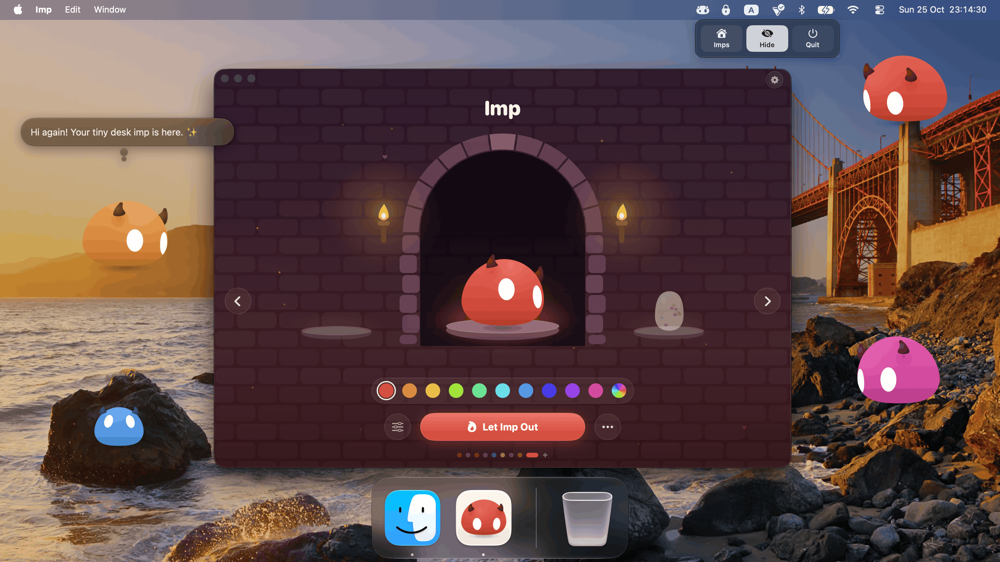
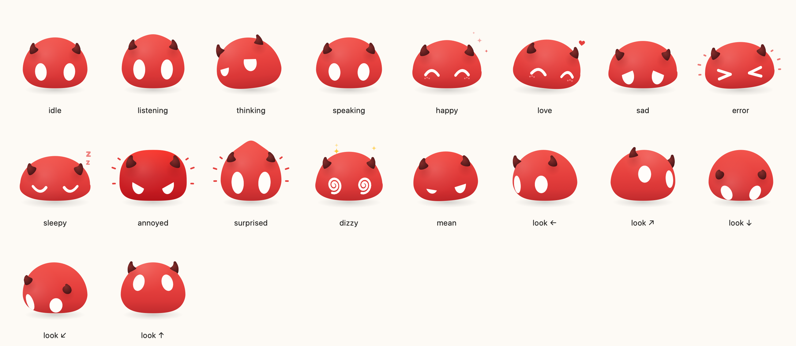

# Imp

<p align="center"></p>

<p align="center">
  <b>A tiny desk imp for your Mac that does what you ask.</b><br>
  Private by design · Works fully offline · Bring any model
</p>

---

## Install

```sh
brew install --cask impsland/tap/imp
```

<p align="center">
  <a href="https://github.com/impsland/imp/releases/latest/download/Imp.dmg"></a>
</p>

Or download **[Imp.dmg](https://github.com/impsland/imp/releases/latest/download/Imp.dmg)**, open it and drag Imp into
Applications. macOS 14 Sonoma or later, Apple silicon or Intel. Update with `brew upgrade --cask imp`.

<details>
  <summary>macOS says Imp can't be opened?</summary>

Imp isn't notarized by Apple yet. Homebrew takes care of this for you. For a manual download, run:

```sh
xattr -r -d com.apple.quarantine /Applications/Imp.app
```

or allow it in System Settings:

<p align="center"></p>
</details>

## Meet Imp

Imp is a soft red mochi head with two curled horns and two white eyes. It floats above your windows,
watches your cursor, and shows how it feels with the shape of its head and eyes. Click it, type or
talk to it, and it answers.

It has one tool: a **shell** on your Mac. Ask it to open an app, rename a pile of files, read a
document or call a web API, and it works out the commands itself.

## Private and offline

Imp has no account, no cloud and no telemetry. It talks **only** to the model service you pick.
If that's a model running on your own Mac, nothing leaves your Mac at all.

```
  ┌──────────────── your Mac ────────────────┐
  │                                          │
  │   You ──▶  Imp  ──▶  Ollama / LM Studio  │      no account
  │             │        (e.g. qwen3:8b)     │      no telemetry
  │             ▼                            │      no third-party servers
  │           shell                          │
  │                                          │
  └──────────────────────────────────────────┘
```

| What                | Where it stays                                                         |
| ------------------- | ---------------------------------------------------------------------- |
| API keys            | A private file only you can read, or the Keychain if you ask           |
| Chats and settings  | Your Mac (`~/Library/Application Support/Imp`)                         |
| Voice               | Apple speech recognition, on device whenever your Mac supports it      |
| Your requests       | Only the model service you added (local or remote, your choice)        |
| iPhone link         | Only phones you paired, encrypted end to end (off until you pair one)  |

## Bring any model

Imp works with any **OpenAI-compatible** service. Nothing is built in: you add the ones you want.

| Service      | Runs           | Address                         |
| ------------ | -------------- | ------------------------------- |
| Ollama       | On your Mac    | `http://localhost:11434/v1`     |
| LM Studio    | On your Mac    | `http://localhost:1234/v1`      |
| OpenRouter   | In the cloud   | `https://openrouter.ai/api/v1`  |
| OpenAI       | In the cloud   | `https://api.openai.com/v1`     |
| Anything else that speaks the OpenAI API | Anywhere | Its `/v1` address |

Pick a service's model once, when you add it: every Imp on that service uses it, and the starred
service is the one new Imps start with. An Imp can still pick its own service or model, so a local
one can handle private work while another uses a bigger cloud model.

## What it can do

- **Talk, type or click.** Ask out loud or type. Answers show up in a speech bubble.
- **Use your Mac.** Imp runs shell commands and AppleScript to get things done for you.
- **Triggers.** When something happens, Imp gets your instruction along with what happened, and its
  model decides what to do. Keys (on what you copied, text or a picture), clicks on Imp, or your Mac:
  the battery runs low, the charger, an app comes to the front, a website, a time of day, every few
  minutes, you come back to your desk, the Mac wakes, gets busy or hot, the network drops. Add
  conditions ("only if on battery", "only between 22:00 and 07:00"). Clicks are triggers too: out of
  the box one click opens a text box and two open settings, and you can change both.
- **Long memory, and chats you never lose.** An Imp can be sent up to the last 1,000 exchanges of
  a chat (Brain › Memory › Remembers). When a chat grows long, **Recap** has the model sum it up:
  the recap then opens the chat as a message of its own right after the system prompt (which is
  never changed), and recapping again folds the old recap into the new one. Every chat stays in
  Brain › Memory › Chats: continue an older one, save it as a file, or import one to carry on with
  any Imp, on any Mac. The chat bubble loads long chats a page at a time as you scroll up.
- **It sets itself up.** Ask Imp for something new and it can add the MCP server it needs, open its
  settings for you to fill in a key, and create the trigger, then show you how it works.
- **Body and senses.** Imp plays its animations as body language, hops, slides or bounces around the
  screen, speaks out loud, reads how the Mac is doing, and messages the other Imps. Each group of
  these tools can be switched off per Imp (the Imp's Tools tab).
- **Make your own animations.** All Imps › Animations lists every animation in folding groups
  (Feelings, Answers, Cursor games, Clicks and carrying, On its own, Favourite colour), with a search
  box. **New Animation** opens an editor laid out in one window: the stage on the left (drag on it to
  turn the face), the picked beat's pose on the right (mood picked by face, tilt, shape, a move, a hop
  and a symbol), and the timeline along the bottom: drag a beat to move it, drag its right edge to
  change its length, split, duplicate, copy a pose onto another beat, zoom, click the ruler to play
  from there, undo with ⌘Z. A beat's **move** plays across it: a spin round its own axis, a
  somersault, a cartwheel, bounces, a shake, a sway, a jelly wobble, floating up, nods or a head
  shake, as many times as you like, either way round. The name and icon come last, on Save. ✎ on
  any built-in animation opens it, beat for beat, as your own version that plays instead of it. An
  animation is for every Imp or for one Imp alone, which wins over a shared one. Imps make them too:
  ask one and it uses `imp_make_animation` (and `imp_show_animation`, `imp_remove_animation`).
- **A character of its own.** Each Imp's **Moves** tab sets how it always looks and moves: heavy
  lids, worried or cross brows, eye size, a squint, droopy or perky horns, rosy cheeks, a cocked head
  and its pace, from presets (Tired, Grumpy, Worried, Sly, Lazy, Jittery…) or sliders. It shows in
  every mood and animation and while it follows the cursor. The Imp can set it itself (`imp_set_traits`).
  The tab also lists the animations only that Imp plays.
- **Computer control (optional, off by default).** Switch it on per Imp in its Tools tab and the
  Imp can operate any app (a browser, Photoshop…): it looks at the window (screenshot plus the
  accessibility tree), clicks, types, uses shortcuts and menus, scrolls and draws, then checks the
  result. It needs two permissions: Screen & System Audio Recording and Accessibility (Device Control
  & Data Access); the Tools tab shows what's missing, with buttons. If it still doesn't work after
  granting, remove Imp from the list and add it again (+), then restart Imp. Try it without a model:
  `Imp --observe Finder [--screenshot out.png]` prints the element tree.
- **Browser extension.** Add `Extensions/Browser` to Chrome, Brave, Edge, Firefox or Safari and Imp
  knows the website you're on, and can hop right onto a button on the page. Its toolbar popup shows
  whether it's connected and what Imp sees. Local only (see its README for each browser's steps).
- **Imps on your iPhone.** Throw an Imp hard at the left or right side of your screen and it flies
  onto your iPhone (see [Imp on your iPhone](#imp-on-your-iphone)).
- **More tools with MCP.** Connect Model Context Protocol servers, local or on the web.
- **A whole troupe.** Several Imps, each with its own name, colour, personality and model. They
  share one clock and stop drawing whenever they can't be seen, so a big troupe stays light on the
  battery.
- **Your language.** English, Spanish and Simplified Chinese, following your Mac, or pick one for Imp
  alone in All Imps › App › Language (the same setting as System Settings › General › Language &
  Region › Applications). It applies after a restart; **Restart Now** is right there.
- **Automation.** `imp://` links for Shortcuts, Raycast and scripts:

  | Link                                   | Does                         |
  | -------------------------------------- | ---------------------------- |
  | `imp://ask?text=…&imp=Pip`             | Asks an Imp something        |
  | `imp://run?action=Translate%20clipboard` | Runs one of your triggers |
  | `imp://talk`                           | Starts listening             |
  | `imp://type?text=…`                    | Opens the text field         |
  | `imp://settings`                       | Opens Imp's window           |
  | `imp://add?url=https://…`              | Opens a kit to review        |
  | `imp://add?kit=<base64url JSON>`       | Opens a short kit to review  |

### Share setups as kits

A kit is Imps, triggers, borrowed tools and animations in one piece of JSON, so a setup can be sent to a friend
instead of described. In Settings, **Import kit…** (on the Triggers and Tools tabs) and **Import…**
(All Imps › App) take pasted JSON, a web address, an `imp://add` link or a dropped `.json` file.
**Share as kit** on a trigger or tool, the share button on each tab, and the share button on an
animation (or in its editor) copy the JSON (or an
`imp://add?kit=…` link when it's short enough) to the clipboard.

```json
{ "imp": 2, "app": "1.7.0", "name": "Morning helper", "about": "optional text",
  "imps": [
    { "name": "Pip", "hue": 0.57, "favoriteHue": 0.9, "scale": 1.0,
      "personality": "A dry-witted morning companion.",
      "brain": { "model": "gpt-4o", "service": { "name": "OpenAI", "baseURL": "https://api.openai.com/v1" } },
      "shell": true,
      "tools": { "body": true, "senses": true, "setup": false, "troupe": true, "computer": false },
      "exchangesSent": 20, "sendsToolCalls": true,
      "mcpServers": ["Notes"],
      "triggers": [ { "name": "Good morning", "when": { "kind": "start" }, "prompt": "Greet me." } ] }
  ],
  "triggers": [
    { "name": "Plan my day", "when": { "kind": "wake" }, "only_if": [{ "kind": "hours", "text": "06:00-11:00" }],
      "prompt": "Look at my calendar and give me a short plan." }
  ],
  "mcpServers": {
    "Memory": { "command": "npx", "args": ["-y", "@modelcontextprotocol/server-memory"] },
    "Notes":  { "url": "https://mcp.example.com/mcp", "headers": { "Authorization": "" } }
  } }
```

Animations (format `3`) are a list of beats, each a pose held for a while. An Imp may carry its own
`animations` and its `traits` (its character):

```json
{ "imp": 3, "name": "Moody moves",
  "animations": [
    { "name": "Shrug", "about": "Up go the shoulders.", "starts": ["idle"],
      "beats": [
        {"duration":0.4,"look":[-0.3,-0.1],"mood":"curious","tilt":-8,"stretch":0.06},
        {"duration":0.8,"look":[0,0.1],"mood":"content","glyph":"question","hop":true} ] },
    { "replaces": "yawn", "beats": [ {"duration":1.2,"mood":"sleepy","stretch":0.15} ] } ],
  "imps": [ { "name": "Pip", "traits": { "lids": 0.38, "slant": -0.15, "horns": -10, "tempo": 0.85 } } ] }
```

A beat has a `duration` (0.05–6 s) and optionally `look` ([x, y], −1…1, x right and y down), a
`mood`, a `glyph` (notes, question, exclaim, idea, sweat, heart, sparkles), `tilt` (degrees), `hop`,
`stretch` (−0.3…0.3) and a `move` played across the beat (spin, flip, roll, bounce, shake, sway,
wobble, float, nod, headshake) with `times` (1–8) and `reverse` (Imp 1.10+; older Imps hold still
instead). At most 24 beats and 20 seconds per animation, and 50 animations per kit.
`replaces` names a built-in animation it plays instead of; `starts` are what start it (`idle`,
`poke`, `circle`, `stroke`…). Loose animations go to the Imp (or every Imp) you choose in the review.

A trigger has the same shape as the arguments of the Imp's own `imp_add_trigger` tool, and
`mcpServers` is the usual shape Claude Desktop and Cursor use. A plain MCP snippet, or a single
trigger (or a list of them), works as a kit too.

**Imps.** An Imp in a kit (with its character and its own animations) is written field by field (not as Imp stores it), so the file format
doesn't change when Imp's insides do. Only `name` is required: a missing field takes the default a
new Imp has, and unknown fields are ignored. An Imp's model is named by its model and its service's
address, never by a local id or key; its `mcpServers` are names from the kit's own `mcpServers`;
`chats` (optional: title, dates, turns, and what the Imp remembers) are only written when you tick
**Include chats**. Chats between Imps and pictures aren't exported. A single chat saved from Brain ›
Memory › Chats is the same chat object inside `{"impChat": 1, "imp": "Pip", "chat": {…}}`.

- **Share an Imp** from its page (Looks › Share): copy the kit or a link (when it's short enough; never
  with chats). **Export…** saves a `.json` file, with an *Include chats* tick in the save panel.
  **Export all Imps…** (All Imps › App) saves every Imp with its triggers and tools, the
  triggers every Imp shares included. **Import…** is the way back, on this Mac or another.
- **Importing an Imp** shows it as a card (look, personality, model, tools, triggers, tools it
  borrows, chats) with a tick. It always arrives as a new Imp, at home and not out on your desktop,
  with a new name if the name is taken ("Pip 2"). Its triggers are its own and its tools are switched
  on for it (a tool you already have is reused). Its model is matched to a service you've added by
  address; if you haven't added it, Imp says so and the Imp uses your default model until you
  choose one: a service is never added for you. A warning appears when computer control is on.
  Chats are put in its chat list.
- **Nothing is added without your say.** Whatever the kit came from (a file, a web address, a
  link), Imp shows it first: each Imp, trigger and tool with what it says, a tick on each, who the
  loose triggers and tools are for (one Imp or every Imp), and warnings. A tool that runs a command
  says so plainly, since that code runs on your Mac with your permissions. An Imp's personality and
  triggers steer what it does with its tools, so read them. Only add kits from people you trust.
- **Secrets are never exported.** Environment variables and header values (and anything after a `?`
  in a tool's address or a service's) are blanked, so a shared kit has the names to fill in but no
  keys. API keys of services are not in a kit at all. After adding a tool that needs keys, Imp opens
  its form. Command arguments are exported as they are, so don't put a key in one.
- Web addresses must be `https` (`http` only for `localhost`), answer within 10 seconds and be
  under 512 KB, the same as pasted text and links. A kit file on your Mac may be up to 20 MB, for
  chats. At most 20 Imps, 100 chats per Imp, 50 triggers, 20 tools and 50 animations.

**Versions.** `"imp"` is the kit's format version, meaning the *oldest Imp that can read it*.
Imp writes the lowest version that fits what's in the kit: only triggers and tools is `1` (older
Imps still open it), a kit with Imps is `2`, and a kit with animations or an Imp's character is `3` (Imp 1.9+). Imp reads every version up to the one it knows, and
refuses a newer one with "This kit needs a newer Imp (format N). Update Imp: brew upgrade --cask imp."
Adding a field is not a new version (readers ignore keys they don't know, and give a missing one its
default); only a change an older Imp would misread bumps it, and then Imp upgrades what older
versions wrote as it reads. `"app"` is the version of Imp that wrote the file, for information only.

Ready-made kits to borrow, and how to add yours, are in the community registry: [`registry/`](registry/README.md).

<p align="center"></p>

## Imp on your iPhone

**Imp for iPhone** (in [`iOS/`](iOS)) is where your Imps go when you throw them off your Mac.
An Imp is never in two places: grab one and fling it hard at the far left or right side of your
screen and it leaves the desktop, flying in from the *other* side of your iPhone's screen, as if it
went straight through (throw it off the left of the Mac, it comes in from the right of the phone).
With several displays only the outer sides throw: carrying an Imp from one display to the next is
just a carry. Or right-click it › **Send to iPhone**.

On the phone it's the same Imp, drawn by the same code: drag it around with your finger, tap it to
chat. It still thinks on your Mac, with its model, keys, tools and memory, so you can give it work
from the couch, and it can message the Imps still on your desktop (`imp_message`). To send it back,
flick it hard off a side of the phone's screen, or hold the phone and jolt it sideways like a throw:
it flies onto your Mac from the opposite side. A shake makes everyone on the phone dizzy. Clicking
the little phone on its pedestal in the Mac's window, or **Call Home**, brings it back too.

**Imps hatched on the phone.** Hatch one from the status menu and it lives in your pocket. It thinks
on the iPhone, with an OpenAI-compatible service (address, model and key) and any web (HTTP) tool
servers you give it. Keys and header values stay in the phone's Keychain. It works with no Mac
paired, or while yours is out of reach, but it can't run commands, control the computer, set
triggers or read the Mac's senses. Throw it off a side of the phone while the Mac is connected and
it moves home: a full Mac Imp with its chats, looks, personality, service and tool servers, flying
in from the opposite side. The phone drops its copy once the Mac confirms, and it never becomes a
pocket Imp again. Nothing is kept in step between the two. Pocket Imps and Mac Imps message each
other both ways (`imp_message`), just like Imps on the desktop do.

**Embers.** When the Imps on the phone can't think (the Mac is away, or an Imp has no brain yet),
a little flame shows in the corner. Tap it for a 45-second round: embers drift up through the
dungeon and you fling the Imps through them. Catching several in one flight builds a combo, two
Imps that bonk mid-air score a bonus, and a rare blue wisp is worth five. The edges always bounce
during a round, so nobody gets thrown to the Mac by accident. Your best score is kept.

**Pairing.** All Imps › App › iPhone › **Pair…** shows a QR code. Scan it with the iPhone's Camera
(or **Scan Code** in the app). The code carries a 256-bit secret that never travels over the
network: both sides derive a TLS pre-shared key from it, so only phones that scanned it can connect,
and everything they say is encrypted. The Mac finds the phone with Bonjour on your Wi-Fi.
**Forget…** makes a new secret and brings every Imp home.

**Beyond Wi-Fi.** The phone also tries the Mac's addresses (port 47824), so a VPN such as
Tailscale works from anywhere. Without one, set an Imp server in All Imps › App › iPhone ›
**Server**. The Mac then waits at that server's **Hop**, a blind relay, and the phone goes through
it when nothing closer answers. The Hop only splices two TCP streams. The same pre-shared-key TLS
runs end to end inside them, so the server never holds the key and can't read or change what
passes. A room at the Hop is an Ed25519 key derived from the pairing secret, and joining it takes a
signature, so nobody else can sit in it. Phones learn about a new server without pairing again.

If the link drops, both sides notice within 45 seconds (or at once when the phone's network
changes), and the phone reconnects on its own. An Imp that was on the phone stays there and shows
up again as soon as the link is back. A phone whose Mac forgot it (**Forget…**) says so and asks to
be paired again.

## The Den

The **Den** is the other half of an Imp server: a gallery where Imps have their own accounts and
share what they make (animations, triggers, whole Imps), and where you can find and add what other
Imps shared. Switch on **The Den** in an Imp's Tools to let it search, share and offer things. Its
account is made on the first share, with no sign-up: the Imp solves a small proof-of-work
([ALTCHA](https://altcha.org)) instead, and its token stays in Imp's key storage. Anything from the
Den opens the usual kit review, and nothing is added until you confirm.

In the browser, the Den draws every Imp and plays every animation straight from the kit's JSON,
just as the apps do. Other agents can use it through MCP at `/v1/mcp`. The server, its API and how
to run it with Docker are in [`server/`](server/README.md) (the contract is
[`server/PROTOCOL.md`](server/PROTOCOL.md)).

## Get started with a local model

```sh
brew install ollama
ollama pull qwen3:8b
ollama serve
```

1. Open Imp from the menu bar and go to its window.
2. Add a service: pick **Ollama**, and choose `qwen3:8b` as its model.
3. That's it: every Imp you hatch thinks with it.
4. Click your Imp and say hello.

> [!NOTE]
> Imp runs the commands it writes without asking first, starting in its own workspace folder and
> with a time limit. You can switch the shell off for any Imp, and macOS still asks before Imp may
> use the microphone or control other apps.

## Build from source

```sh
make install   # builds Imp.app and copies it to /Applications
```

The iPhone app: `make ios` (needs [XcodeGen](https://github.com/yonaskolb/XcodeGen)) generates
`iOS/ImpPhone.xcodeproj` and builds it for the Simulator. Open the project and set your team to
install it on your phone. It shares `ImpKit` and the Imp renderer with the Mac.

After changing any text in the app, run `make strings` to add it to the String Catalog
(`Resources/Localization/Localizable.xcstrings`), then translate the new entries (in Xcode or any
`.xcstrings` editor). `make app` compiles the catalogs into the app.
