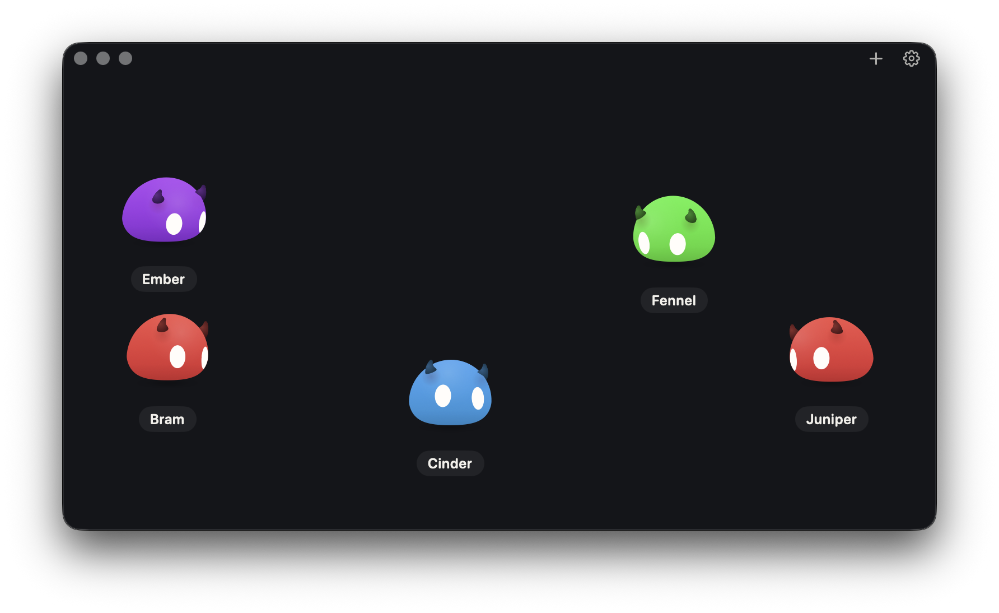

<p align="center">
  
</p>

<h1 align="center">😈 Imp</h1>

<p align="center">
  <b>A tiny desk imp for your Mac that does what you ask.</b><br>
  Private by design · Works fully offline · Bring any model
</p>

<p align="center">
  <a href="https://github.com/impsland/imp/releases/latest/download/Imp.dmg"></a>
</p>

<p align="center">
  <a href="docs/guide/getting-started.md">🚀 Get started</a> ·
  <a href="docs/guide/features.md">✨ Features</a> ·
  <a href="docs/guide/services.md">🧠 Models</a> ·
  <a href="docs/guide/privacy.md">🔒 Privacy</a> ·
  <a href="docs/index.md">📚 Documentation</a>
</p>

---

## ✨ Why Imp

| | |
| --- | --- |
| 🫠 **A character** | A soft red head with horns and eyes. It watches your cursor and shows how it feels. |
| 🖥️ **Does things on your Mac** | Ask it to open an app, rename files or call an API. It writes and runs the commands. |
| ⚡ **Triggers** | Act on keys, clicks, the battery, an app coming forward, a time of day and more. |
| 🔒 **Private** | No account, no cloud, no telemetry. Local models keep everything on your Mac. |
| 🧩 **Any model** | Any OpenAI-compatible service. The **Remote** (OpenRouter) and **Local** (Ollama) presets are one tap away. |
| 📱 **Across devices** | Throw an Imp to your iPhone or another Mac. It keeps thinking at home. |
| 🤝 **Share setups** | Send Imps, triggers and animations as a reviewed kit. |

➡️ [All features](docs/guide/features.md)

## 🚀 Install

```sh
brew install --cask impsland/tap/imp
```

Or download **[Imp.dmg](https://github.com/impsland/imp/releases/latest/download/Imp.dmg)**, open it and drag Imp into
Applications.

| Requirement | Value |
| --- | --- |
| 🍎 macOS | 15 Sequoia or later |
| 💻 Chip | Apple silicon or Intel |
| 🔄 Update | `brew upgrade --cask imp` |

> [!TIP]
> **"Imp can't be opened?"** Imp isn't notarized by Apple yet. See
> [Getting started](docs/guide/getting-started.md#macos-says-imp-cant-be-opened).

### ⌨️ In a terminal

The `imp` terminal app runs on macOS, Linux and Windows. Install it from [crates.io](https://crates.io/crates/imp-chat)
(Rust 1.99 or newer):

```sh
cargo install imp-chat
```

➡️ [Terminal app](docs/apps/cli.md)

## ⚡ Quick start with a local model

```sh
brew install ollama
ollama pull qwen3:8b
ollama serve
```

1. 🪟 Open Imp from the menu bar and go to its window.
2. ➕ Add a service: choose the **Local** preset and set the model to `qwen3:8b`.
3. 🐣 Every Imp you hatch now thinks with it.
4. 💬 Click your Imp and say hello.

➡️ [Full guide](docs/guide/getting-started.md)

## 🔒 Privacy at a glance

| What | Where it stays |
| --- | --- |
| 🔑 API keys | A private file only you can read, or the Keychain |
| 💬 Chats and settings | Your Mac |
| 🎙️ Voice | On device, when your Mac supports it |
| 🌐 Requests | Only the model service you added |
| 🔗 Device links | Only your linked devices, encrypted end to end |

➡️ [Privacy in detail](docs/guide/privacy.md)

## 📚 Documentation

| Topic | What you'll find |
| --- | --- |
| 🚀 [Getting started](docs/guide/getting-started.md) | Install, first chat, local models |
| ✨ [Features](docs/guide/features.md) | Triggers, memory, animations, computer control, MCP |
| 🧠 [Services](docs/guide/services.md) | The Remote and Local presets, and any other OpenAI-compatible service |
| 🔗 [Automation](docs/guide/automation.md) | The `imp://` links for Shortcuts and scripts |
| 📱 [Imps on other devices](docs/connecting/phone.md) | iPhone, Macs, doors, visits, trust, linking |
| 🎮 [Games](docs/guide/games.md) | Embers and Echo on the iPhone |
| 🤝 [Sharing setups](docs/sharing/setups.md) | Kits, import and export, limits |
| 🌍 [The Den](docs/sharing/den.md) | The gallery of shared Imps |
| ⌨️ [Terminal app](docs/apps/cli.md) | The `imp` command line app |
| 🛠️ [Building](docs/development/building.md) | `make` targets, the iPhone app, text and design |
| 🧪 [Testing](docs/apps/testing.md) | Tests, snapshots, live tests |
| 🏗️ [Architecture](docs/architecture/index.md) | Layers, repository layout, the portable core |
| 🎨 [Design](docs/design/index.md) · [UX](docs/ux/index.md) | The look, the rules and the screens |

Build the site locally with `make docs` (output in `docs/.vitepress/dist`), or start with [`docs/index.md`](docs/index.md).

## 🗂️ Project layout

| Folder | Contents |
| --- | --- |
| `apple/` | The Mac app, the iPhone app, shared Swift code (`ImpKit`, `ImpDesign`), tests and scripts |
| `engine/` | The portable Rust core (`imp-engine`) and its bindings |
| `chat/` | The `imp` terminal app |
| `server/` | The Den, the Hop and their shared code, with Docker files |
| `extension/` | The browser extension |
| `spec/` | The protocol and the JSON fixtures every platform passes |
| `design/` | Design tokens, components and words, generated for each platform |
| `docs/` | The documentation site |

## 🛠️ Build

```sh
make install     # build Imp.app, copy it to /Applications and open it
make test        # run every test, the screen snapshots included
make rust        # format, lint and test the Rust workspace
make help        # list every command
```

➡️ [Building from source](docs/development/building.md) · [Testing](docs/apps/testing.md)

<p align="center"><sub>Made for people who want a helper on the desk, not in the cloud. 🪄</sub></p>
