# Getting started

Imp is a small app for your Mac that lives above your windows and does what you ask. This page gets
you from install to your first chat.

## Requirements

| Item        | Needed                                  |
| ----------- | --------------------------------------- |
| macOS       | 15 Sequoia or later                     |
| Processor   | Apple silicon or Intel                  |
| A model     | Any OpenAI-compatible service (see [Services](/guide/services)) |

## Install

### With Homebrew (recommended)

```sh
brew install --cask impsland/tap/imp
```

Update later with:

```sh
brew upgrade --cask imp
```

### From the disk image

Download **Imp.dmg** from the [latest release](https://github.com/impsland/imp/releases/latest/download/Imp.dmg),
open it and drag Imp into Applications.

## "macOS says Imp can't be opened"

Imp is not notarized by Apple yet. Homebrew takes care of this for you. For a manual download, either
remove the quarantine flag:

```sh
xattr -r -d com.apple.quarantine /Applications/Imp.app
```

or allow it in **System Settings**:



## Quick start with a local model

Nothing leaves your Mac when the model runs on it. This example uses [Ollama](https://ollama.com):

```sh
brew install ollama
ollama pull qwen3:8b
ollama serve
```

1. Open Imp from the menu bar and go to its window.
2. Add a service: choose the **Local** preset (it fills in Ollama's address, `http://localhost:11434/v1`) and set the model to `qwen3:8b`.
3. That's it: every Imp you hatch thinks with it.
4. Click your Imp and say hello.

## Good to know

> [!NOTE]
> Imp runs the commands it writes **without asking first**. They start in the Imp's own workspace folder
> and have a time limit. You can switch the shell off for any Imp, and macOS still asks before Imp may use
> the microphone or control other apps.

## Next steps

- [Features](/guide/features): everything an Imp can do.
- [Services](/guide/services): connect a model, local or in the cloud.
- [Privacy](/guide/privacy): what stays on your Mac.
- [Sharing setups](/sharing/setups): send Imps and triggers to a friend.
