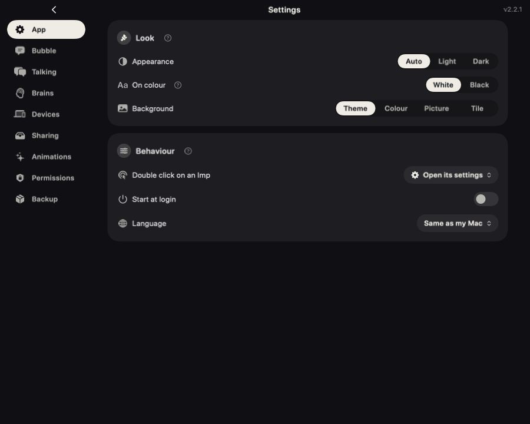
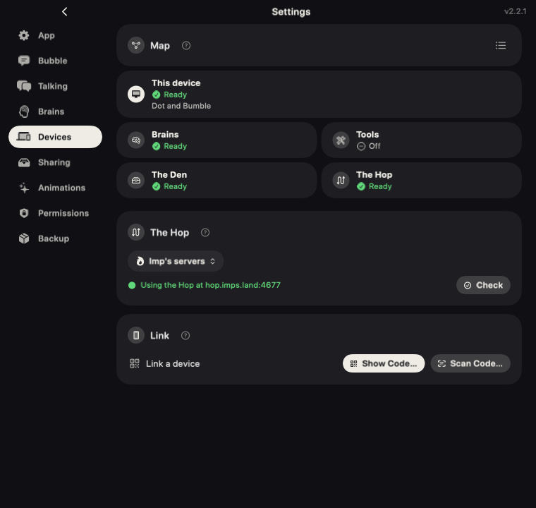
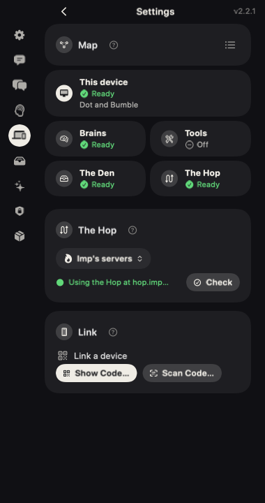
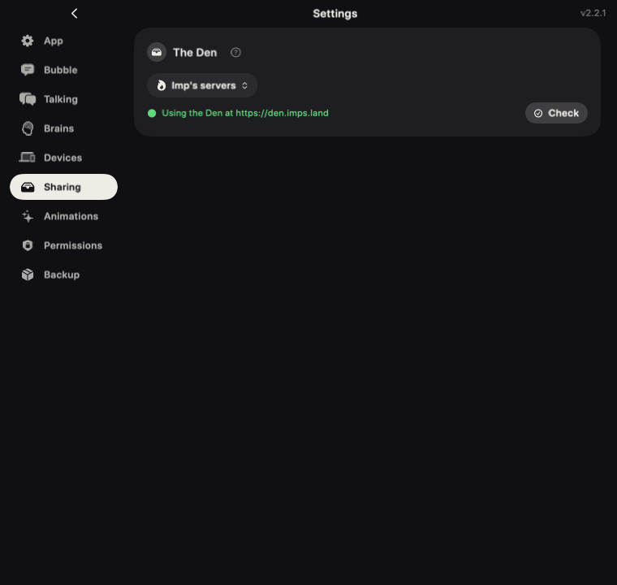
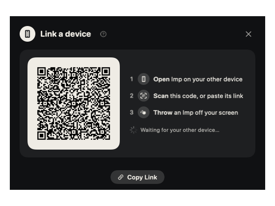
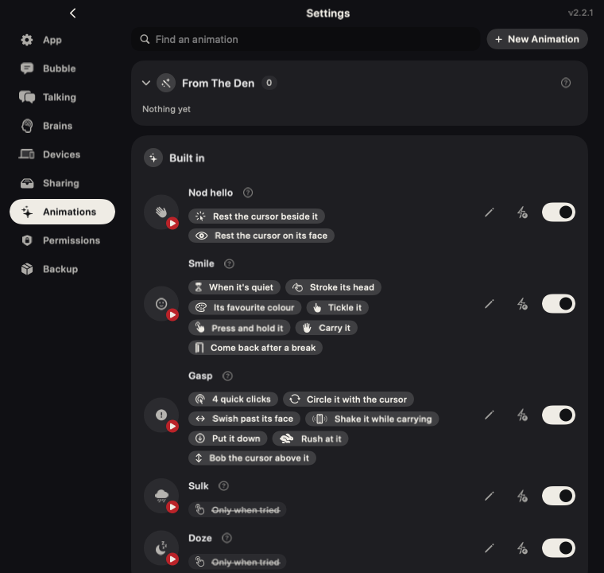

# All Imps settings

The app-wide settings. The user opens Settings, sees which section has something to set up, and changes only that.

## Decision: a rail of sections, no overview

The settings have one level. A rail of sections sits on the leading edge (a bar above the content on the iPhone). There are nine sections and no page before them. One tap or click switches section and the content cross-fades. There is no list of pages to go back to. Settings opens on the section that was showing last, App the first time.

The bar on top says "Settings" in every section and does not change as the sections change. The rail shows which one is open.

Back in the top bar, and Esc, leave Settings for the Imps. Always one level, from any section. A deep link (a tool, an attention mark) simply selects a section and lights a row.

In a narrow window the Mac's rail shows icons only (the titles are tooltips and spoken labels).

### Needs attention

What is left to set up is said where it is fixed. A section that has something to fix carries a small mark in the rail, and its page starts with a notice (`AttentionNotice`) of one short line for each thing.

| What | Section |
| --- | --- |
| No Brains, or an Imp with no Brain | Brains |
| The Den not set up | Sharing |
| The Hop not set up, a linked device offline | Devices |

When nothing needs attention there is no mark and no notice. An overview page that listed these apart from the settings that fix them was removed: it was one more page to open, and every item on it was a link to somewhere else.

### Pages

Nine sections, each with a one-word name and a few cards of icon rows. A card has at most one "?" in its header. A row has its own only when its title cannot be understood alone.

| Page | Cards and rows |
| --- | --- |
| App | Look: Appearance (Auto, Light, Dark), On colour (White, Black) and Background (Theme, Colour, Picture, Tile). Behaviour: double click, start at login, language. Window: the smallest width and height. |
| Bubble | Look: Background (Solid or Translucent, and the amount when translucent), with a live preview over a light, a dark and a picture swatch. Showing: hide after, text box lines, chat size. Media: autoplay, audio look. |
| Talking | Listening: language. Between Imps: talk in, threads, window. Long answers: suggest. |
| Brains | Services: the list of Brains and the default for new Imps. Keys: the keychain. Requests: wait, retries, first wait, longer waits. |
| Devices | Link: Link a device (Scan code, Show code), each linked device, and Forget all. The Hop: the server that lets devices find each other, in the server card. |
| Sharing | The Den: the server where Imps share and find animations, triggers and Imps, in the same server card, then Browse The Den. |
| Animations | The search, made ones (shared, or the selected Imp's own) with New animation, the built-in ones, and restore defaults. |
| Permissions | Listening: microphone and speech. Computer control: screen recording and accessibility. |
| Backup | Keep: export and import. Reset: start again. Reset is last and asks first. |

### Why

- Each thing lives where a person looks for it. The Hop connects devices, so it is in Devices. The Den is where things are shared, not a device, so it has its own section, Sharing.
- A mark and a notice on the section that fixes a problem turn "what is wrong" into "here, change this".
- The rail makes every section one click from every other. The page order stays the same so people learn where things are.
- Nine sections with plain names are easier to scan than many tabs. Each page is a few cards, and each card a few rows.

### Rejected

A list of pages that opens each page and needs Back to reach the next (Settings, App, Back, Bubble, Back). It costs a Back for every section. A long scrolling form of every setting. It hides what is wrong. A wizard for settings. It is too heavy for a person who only wants to change one thing.

## The Devices page

Two cards. **Link** comes first, because the devices are what the page is about. Its first row is `settings.devices.pair.title` with two actions: `devices.scan` and `devices.show` (the primary one until a device is linked). Under it, each linked device is a pebble: its symbol (dimmed while away), its name, how it is reached (on the local network, through The Hop, or away) and the Imps on it now (`devices.has`), then the "Mine" switch and Forget. With no device the card says `devices.none`. Forget all is the last row and asks first. **The Hop** is the server card below.

**Link a device** is one sheet with two tabs, the same title and the same actions in its footer row:

| Tab | Content | Footer |
| --- | --- | --- |
| Show code | This Mac's code on white, the three steps for the other device, and a line that waits for it or names it once linked. | Copy Link. |
| Scan code | The camera with a frame to aim at, the link field, and one status line (not a link, linking, linked, or why it failed). | Paste (a link or a picture of a code), then Link. |

A code the camera sees links at once. What was typed survives switching tabs. The state behind the sheet (`LinkJoin`, `LinkedDevices`) is tested apart from the views.

## The Sharing page

The Den in the server card, then one row that says what The Den holds, with `sharing.browse` on its trailing edge. Without a Den the row says `servers.den.needed` and has no button.

## Presets for The Den and The Hop

The Den and The Hop are one component, the server card (`ServerCard`, with its state in `ServerSetting`), on Devices, on Sharing and in the Den browser. On top a pebble shows the address in use (or Off) with its state under it and Check on the trailing edge. Under it the Server choice (`servers.choice`) and, for Custom only, the address field.

Most people use the default servers. Each of The Den and The Hop has four choices:

| Choice | Meaning |
| --- | --- |
| Imp's servers | The default, run by the Imp project. |
| This computer | A server on this computer. |
| Custom | An address the user types. It must start with https://. |
| Off | No server. |

A "Check" button tests the choice and shows `servers.state_ok` or `servers.state_fail`. Before a check the state is `servers.preset.imp_note` for Imp's servers and `servers.state_unchecked` otherwise. Off says what goes missing (`servers.den.off_note`, `servers.hop.off_note`). A check is for the address it started with: changing the address drops it. For a Den it asks the `/healthz` page, which must answer. For a Hop it opens a connection to the address. The Mac and the iPhone both have it.

 What happens when only one of the two is set up is on [States](/ux/states).

## Brains

A Brain service is one generic list entry: a name, an address, a key and a model. "Add a service" offers the same two choices as the first run, Remote (a service with the user's own key) and Local (a model on this computer), and the address stays editable for any other compatible service. A hosted model from the project is not built. If it comes, it is one more entry in the same list.

## Animations

Five animations are built in, so offline users and users with local models work without a download. A larger set is in The Den. They come from the same catalog, so the two lists cannot drift apart. The Den seeds the catalog when it starts. 

The page is simple: the search, the made ones with New animation in their card's header, the built-in ones, a button to find more and a button to restore defaults. The animation editor sheet stays. Made animations are shared by every Imp unless they are one Imp's own: the page shows the shared ones and the selected Imp's own, each own one tagged with its Imp. Saving a shared animation for one Imp makes that Imp's version and leaves the shared one (see [Scope](/ux/imp-settings#scope-this-imp-or-every-imp)). A switch on an Imp's own version of a built-in animation is for that Imp alone.

Every gesture has a built-in animation out of the box, so an offline Imp is never still. Pokes, swishes, rushes, shakes, drops, dangling and circling start Wow. Strokes, tickles, holding, carrying, the favourite colour and coming back start Smile. Resting the cursor beside or on its face starts Nod hello. A quiet moment starts Smile. These defaults are the `defaults` of the catalog. An animation from The Den or one you make for a gesture takes it over, and a gesture has one animation at a time. Remove that animation and the built-in one comes back.

## Presets: where they come from

Imp ships presets as data, never as literals in code, and reads each the way it reads the same data from elsewhere.

| Preset | Data | Read by | Offered |
| --- | --- | --- | --- |
| Starter triggers (clicks, falling asleep, waking up) | `spec/presets/starter-kit.json`, a kit | `Kit.parse` and the kit's Add, as a kit from The Den or a file | Added for every Imp on the first launch. Again only through Add the starter kit in Triggers, which opens the kit review. A changed or deleted one is never put back on its own. |
| Service choices (Remote, Local) | `spec/presets/services.json` | `ServicePreset.all` | The first run and "Add a service". |
| Built-in animations and the gestures they start | `spec/animations/catalog.json` | `AnimationCatalog` | Always there. Restore defaults gives them back their starts. |

`node design/generate.mjs` compiles the first two into the apps like the third, and `--check` fails when they are out of date.

## App

Two cards. **Look** holds Appearance (Auto, Light, Dark), On colour and Background. **Behaviour** holds what a double click does, start at login and language. Backup and Reset are on their own page. The canvas has no floating decoration and no setting for it.

**Window** sets the smallest size of the app's window: Smallest width (400 to 1,200 pt) and Smallest height (420 to 900 pt), 660 by 540 until changed, in steps of 20. A double click on a slider goes back to the default. The window's minimum follows at once, and a window smaller than a new minimum grows to it. The window opens the first time at 780 by 640 (or the minimum, if larger) and keeps the size it is given after that. Every screen in it adapts to any size above the minimum: nothing has a fixed layout size.

Settings and design tokens are kept apart. The smallest window is a setting: a person's choice, stored in the preferences (`WindowSizing`). Where the layout changes is a design token, not a setting: below `narrowWindowPoints` (520 pt) Imp Settings shows its plain list and the Settings rail shows icons only. The smallest width the setting allows is below that breakpoint, so the narrow layout can always be reached.

On colour is what is drawn on coloured controls (a filled button, the chosen segment, a switch that is on): White or Black, for every Imp and every screen. White is the default, because black is hard to see on most colours. The choice is always honoured. When it would not read on an Imp's colour (white on yellow or green, black on navy), the control shows the nearest deeper or lighter shade of that colour on which it has 4.5 to 1. The Imp itself keeps its colour. See [Accessibility](/ux/accessibility).

Background is one segmented choice with a symbol on each kind (Theme, Colour, Picture, Tile). The symbols show when the row is narrow. Theme is the flat app surface. The action that finishes a choice shows right under it, only for the kinds that need it: a swatch and "Choose a colour…" for Colour, "Choose a picture…" for Picture and Tile. It was a dropdown that hid the follow-up step.

## iPhone

The same model as the Mac: a sheet with the title and Close on top, the sections as a bar under it (`SectionRail`, horizontal) and the chosen section below in one scroll view. Sections are siblings, so there is no Back. The sheet opens on the section that was asked for and fits its content (`medium` and `large` detents).

| Section | Holds |
| --- | --- |
| Brains | Which Imps of this iPhone can think. How long an Imp waits, tries, pause. |
| Devices | The name, the QR code with copy and share, scan or paste a link, The Hop (one menu and Check), linked devices. |
| Sharing | The Den (one menu and Check). |
| App | Appearance (Auto, Light, Dark), On colour (White, Black), double tap (a menu), play voices, language (opens the system settings), shake, version. |

Animations and Tools are not on the phone. See [Parity](/ux/parity#the-phone-leaves-out).

### Bubble background (Mac only)

Background is a segmented choice, Solid or Translucent, with a symbol on each. Solid is the raised surface. Translucent is the same surface at the chosen amount over a blur of what is behind the bubble, so text never sits on raw pixels. The Amount slider shows only when translucent, from the least that keeps text legible (40%) to 100%, with the percent as its spoken value. The bubble and its tail are one surface. Reduce Transparency and Increase Contrast make it solid. The phone has no such setting: its bubble sits over the app's own stage.

## Look of the pages

The pages follow the Pebble design language (see [Design](/design/)). Every settings page sits on the one flat app surface, whatever the canvas shows. Groups are soft fills with no outlines, and there are no dividers between rows. The only colour is the Imp's own.

## Choices, help and rows

- A few short options seen at a glance are a segmented control with symbols (Appearance, Background, audio look). Sentence-like options (double click, the server choice) are a dropdown, so they are never cramped. Long or open lists are a dropdown (language, models, locales, token sizes).
- No paragraph of help is shown on a page. Every setting has an icon and a "?" help. It opens a compact popover as wide as its words, with one or two short sentences.
- Controls adapt on narrow widths. A row moves its control under its title. A segmented choice falls back from words to icons to a menu.
- A field and an action that works on its value are one control: the action sits inside the field at its trailing edge (`fieldAction`, see [Components](/design/components)), never as a button beside it. A page's own action (New, Add) goes in the header of its card or list, never on a field's line.
- A row with a status and an action gives the flexible width to the status and puts the action on the trailing edge. A button is never stretched across the row. When narrow, a button becomes its icon.
- The model picker is a popover on the app surface. Its header has the title and, on the trailing side, the count. The search and list use the full popover width.

## States

| State | What is shown |
| --- | --- |
| Everything ready | No mark in the rail and no notice. |
| Nothing set up | The Imps still work on this device. Brains, Devices and Sharing are marked, and each says what it needs. |
| A device offline | Its row says Away, Devices is marked and says `settings.attention.device_offline`. |
| A server not reachable | `servers.state_fail` next to its address. |
| No Brains | `brains.empty`. |
| The Den not set up | `animations.needs_den`. |

## Words

<!-- strings: settings brains servers animations voice privacy app devices sharing -->
| Key | English |
| --- | --- |
| `animations.built_in` | Built in |
| `animations.find` | Find more in The Den |
| `animations.from_den` | From The Den |
| `animations.needs_den` | Set up The Den to find more. |
| `animations.new` | New animation |
| `animations.restore` | Restore defaults |
| `animations.search` | Find an animation |
| `animations.title` | Animations |
| `app.behaviour` | Behaviour |
| `app.language` | Language |
| `app.login` | Start at login |
| `app.login_note` | Open Imp when you sign in. |
| `app.look` | Look |
| `app.reset` | Reset Imp |
| `app.title` | App |
| `app.window.info` | The smallest the window can be made. Everything in it fits any size above this. |
| `app.window.min_height` | Smallest height |
| `app.window.min_width` | Smallest width |
| `app.window.points` | {value} pt |
| `app.window.title` | Window |
| `brains.add` | Add a Brain |
| `brains.default` | Default for new Imps |
| `brains.empty` | No Brains yet. Add a model on this computer or a service with your key. |
| `brains.local` | A model on this computer |
| `brains.used_by` | one: Used by {count} Imp / other: Used by {count} Imps |
| `brains.with_key` | A service with your key |
| `devices.copy_link.help` | For a device that can't scan: paste the link in Scan code on the other device. Keep it private. It lets a device link with this Mac for a while. |
| `devices.has` | Has {imps} |
| `devices.none` | No devices yet. Link your iPhone or another Mac and your Imps can visit it. |
| `devices.scan` | Scan code |
| `devices.show` | Show code |
| `privacy.computer` | Computer control |
| `privacy.computer_note` | Lets an Imp run commands on this computer when you ask. |
| `privacy.microphone` | Microphone |
| `privacy.microphone_note` | Used only when you talk to an Imp by voice. |
| `privacy.title` | Permissions |
| `privacy.trust` | Trust my other devices |
| `privacy.trust_note` | Only for your own devices. Their Imps may use tools on this one. |
| `servers.address` | Address |
| `servers.address_hint` | Start with https:// |
| `servers.choice` | Server |
| `servers.den.about` | Where Imps share animations, triggers and Imps. Shared items are public. |
| `servers.den.in_use` | Using the Den at {address} |
| `servers.den.needed` | This needs a Den. Set one in Settings. |
| `servers.den.off_note` | Sharing and finding in The Den are off. |
| `servers.den.title` | The Den |
| `servers.hop.about` | Lets your devices find each other. It only passes encrypted data. |
| `servers.hop.in_use` | Using the Hop at {address} |
| `servers.hop.needed` | Linking from anywhere needs a Hop. Add one in Settings under Devices. Devices on the same network still find each other. |
| `servers.hop.off_note` | Only devices on the same network find each other. |
| `servers.hop.title` | The Hop |
| `servers.off` | Off |
| `servers.preset.custom` | Custom |
| `servers.preset.imp` | Imp's servers |
| `servers.preset.imp_note` | The default, run by the Imp project. |
| `servers.preset.local` | This computer |
| `servers.preset.off` | Off |
| `servers.state_checking` | Checking… |
| `servers.state_fail` | Cannot reach it. Check the address. |
| `servers.state_ok` | Reachable |
| `servers.state_unchecked` | Not checked yet |
| `settings.app.appearance.title` | Appearance |
| `settings.app.behaviour.info` | What the app does when you click it or start your Mac. |
| `settings.app.control_ink.black` | Black |
| `settings.app.control_ink.info` | Text, icons and switches on coloured buttons are white or black. A colour too light or too dark for them is shown a shade deeper or lighter. |
| `settings.app.control_ink.title` | On colour |
| `settings.app.control_ink.white` | White |
| `settings.app.double_click.info` | What happens when you double click an Imp. |
| `settings.app.look.info` | How the app looks. |
| `settings.attention.den_off` | The Den is not set up. |
| `settings.attention.device_offline` | {device} is offline. |
| `settings.attention.hop_off` | The Hop is not set up. |
| `settings.attention.imp_no_brain` | {name} has no Brain. |
| `settings.backup.export.title` | Save a copy |
| `settings.backup.import.title` | Load a copy |
| `settings.backup.keep.info` | Save your Imps and settings in a file, or load them back. |
| `settings.backup.keep.title` | Backups |
| `settings.backup.reset.info` | Erase everything and begin again. This cannot be undone. |
| `settings.backup.reset.title` | Start over |
| `settings.brains.first_wait.info` | How long to wait before asking again. |
| `settings.brains.first_wait.title` | First pause |
| `settings.brains.keychain.info` | Keep keys safe in your Mac's Keychain. |
| `settings.brains.keychain.title` | Keychain |
| `settings.brains.keys.info` | Secret passwords for your brains. |
| `settings.brains.keys.title` | Keys |
| `settings.brains.longer.info` | How much longer each pause gets. |
| `settings.brains.longer.title` | Longer each time |
| `settings.brains.requests.info` | How patient an Imp is when a brain is slow. |
| `settings.brains.requests.title` | Asking |
| `settings.brains.retries.info` | How many times to ask again if it fails. |
| `settings.brains.retries.title` | Tries |
| `settings.brains.services.info` | The brains your Imps think with. |
| `settings.brains.wait.title` | Wait |
| `settings.bubble.amount.title` | Amount |
| `settings.bubble.audio.title` | While playing |
| `settings.bubble.autoplay.title` | Play by itself |
| `settings.bubble.background.solid` | Solid |
| `settings.bubble.background.title` | Background |
| `settings.bubble.background.translucent` | Translucent |
| `settings.bubble.hide.title` | Hide after |
| `settings.bubble.lines.title` | Lines |
| `settings.bubble.look.title` | Look |
| `settings.bubble.media.info` | What the bubble does with sound and video. |
| `settings.bubble.media.title` | Sound and video |
| `settings.bubble.preview.label` | Preview of the bubble on a light, a dark and a busy background |
| `settings.bubble.showing.info` | How the bubble shows answers. |
| `settings.bubble.showing.title` | Showing |
| `settings.bubble.size.title` | Size |
| `settings.devices.forget_all.title` | Forget all |
| `settings.devices.link.info` | Link another device so your Imps can visit it. |
| `settings.devices.link.title` | Link |
| `settings.devices.mine.info` | The devices linked with this one. |
| `settings.devices.pair.title` | Link a device |
| `settings.group.animations` | Animations |
| `settings.group.app` | App |
| `settings.group.backup` | Backup |
| `settings.group.brains` | Brains |
| `settings.group.bubble` | Bubble |
| `settings.group.devices` | Devices |
| `settings.group.privacy` | Permissions |
| `settings.group.servers` | The Den and The Hop |
| `settings.group.sharing` | Sharing |
| `settings.group.talking` | Talking |
| `settings.group.voice` | Voice and chat |
| `settings.map.brains` | Brains |
| `settings.map.den` | The Den |
| `settings.map.hop` | The Hop |
| `settings.map.hop_local` | The Hop on this computer |
| `settings.map.not_seen` | Cannot see each other yet |
| `settings.map.seen` | Can see each other |
| `settings.map.state_needs_setup` | Needs setup |
| `settings.map.state_off` | Off |
| `settings.map.state_offline` | Offline |
| `settings.map.state_ready` | Ready |
| `settings.map.this_device` | This device |
| `settings.map.tools` | Tools |
| `settings.map.tools_here` | Its tools can be used from here |
| `settings.map.via` | Through {server} |
| `settings.privacy.accessibility.info` | So Imp can press keys and click for you. |
| `settings.privacy.accessibility.title` | Control |
| `settings.privacy.computer.title` | This computer |
| `settings.privacy.core.info` | What your Mac lets Imp do. |
| `settings.privacy.core.title` | Allowed |
| `settings.privacy.microphone.title` | Microphone |
| `settings.privacy.screen.title` | Screen |
| `settings.privacy.speech.title` | Speech |
| `settings.service.address.info` | The web address of the brain. |
| `settings.service.cloud.info` | A brain on the internet. It may ask for a key. |
| `settings.service.key.info` | A secret password the brain asks for. |
| `settings.service.local.info` | A brain that runs on this computer. |
| `settings.service.model.info` | Which model to ask. |
| `settings.service.name.info` | A name you pick for this brain. |
| `settings.talking.between.info` | How Imps talk to each other. |
| `settings.talking.between.title` | Between Imps |
| `settings.talking.language.title` | Language |
| `settings.talking.listening.info` | How Imps hear you. |
| `settings.talking.listening.title` | Listening |
| `settings.talking.long.info` | What to do when a chat gets very long. |
| `settings.talking.long.title` | Long chats |
| `settings.talking.suggest.title` | Suggest a new chat |
| `settings.talking.talk_in.title` | Talk in |
| `settings.talking.threads.info` | Whether Imps keep chatting in the same chat or start a new one. |
| `settings.talking.threads.title` | Chats |
| `settings.talking.window.info` | How many minutes a chat stays the same chat. |
| `settings.talking.window.title` | Same chat for |
| `settings.title` | Settings |
| `settings.tool.address.info` | The web address of the tool. |
| `settings.tool.command.info` | The command that starts the tool. |
| `settings.tool.headers.info` | Extra lines sent with each request, like a password. |
| `settings.tool.name.info` | A name you pick for this tool. |
| `settings.tool.variables.info` | Secret values the tool needs to run. |
| `sharing.browse` | Browse The Den |
| `voice.autoplay` | Play voices on their own |
| `voice.autoplay_note` | A voice an Imp marks to play starts by itself in a new reply. Otherwise you tap it. |
| `voice.listen` | Talk to Imps by voice |
| `voice.speak` | Speak answers aloud |
| `voice.title` | Voice and chat |
<!-- /strings -->

## Opening a setting from a chat

The Imp never changes a setting value itself. When someone asks for a change ("make the bubble stay longer"), the Imp calls `imp_open_settings` with the exact `setting` (or a `page`), the window opens that page and the setting is lit for about 1.5 seconds with a soft fill in the Imp's colour (no motion under Reduce Motion), and the Imp tells the person what to set.

- Every setting has a stable id in `SettingsCatalog.swift` (for example `bubble_hide_after`, `backup_export`). The tool's `setting` and `page` lists are generated from that catalog, so a new setting cannot be missed. A test checks that each row on a settings screen has one `.settingAnchor(...)`.
- Links do the same: `imp://settings?setting=bubble_hide_after` (add `&imp=<name>` for a setting of one Imp) or `imp://settings?page=backup`.
- The iPhone has the brains, devices, sharing and app sections (see [iPhone](#iphone)); for a setting that is only on the Mac the answer is "that setting is on the Mac".
