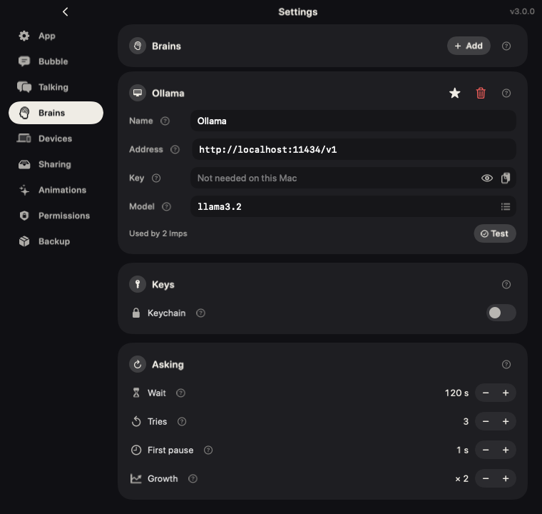

# All Imps settings

The app-wide settings. The user opens Settings, sees which section has something to set up, and changes only that.

## Decision: a rail of sections, no overview

The settings have one level. A rail of sections sits on the leading edge (a bar above the content on the iPhone). There are seven sections and no page before them. Devices is not one of them: it is its own screen, [Devices](/ux/devices), opened from the home corner. One tap or click switches section and the content cross-fades. There is no list of pages to go back to. Settings opens on the section that was showing last, App the first time.

The bar on top says "Settings" in every section and does not change as the sections change. The rail shows which one is open.

Back in the top bar, and Esc, leave Settings for the Imps. Always one level, from any section. A deep link (a tool, an attention mark) simply selects a section and lights a row.

In a narrow window the Mac's rail shows icons only (the titles are tooltips and spoken labels).

### Needs attention

What is left to set up is said where it is fixed. A section that has something to fix carries a small mark in the rail, and its page starts with a notice (`AttentionNotice`): one calm pebble for each thing, with a picture of what it is about, one short line and, when the fix is elsewhere (an Imp's Brain on the iPhone), a button that opens it.

| What | Section |
| --- | --- |
| No Brains, or an Imp with no Brain | Brains |
| The Den not set up | Sharing |
| The Hop not set up, a linked device offline | The Devices corner of the home screen (a warning mark while a linked device is away) |

When nothing needs attention there is no mark and no notice. An overview page that listed these apart from the settings that fix them was removed: it was one more page to open, and every item on it was a link to somewhere else.

### Pages

Seven sections, each with a one-word name and a few cards of icon rows. A card has at most one "?" in its header. A row has its own only when its title cannot be understood alone.

| Page | Cards and rows |
| --- | --- |
| App | Look: Appearance (Auto, Light, Dark), On colour (White, Black). System: start at login, language. Window: the size of the home window (Small, Medium, Large, Full). |
| Bubble | Look: Background (Solid or Translucent, and the amount when translucent), with a live preview over a light, a dark and a picture swatch. Showing: hide after, text box lines, chat size. Media: autoplay, audio look. |
| Talking | Listening: language (Same as my Mac, Automatic, or one language) and, with Automatic, the languages it listens for. Between Imps: talk in, threads, waiting, window. |
| Brains | Services: the list of Brains and the default for new Imps. Keys are typed in each service and kept in the shared `auth.json`. Requests: wait, retries, first wait, longer waits. |
| Sharing | Import (the Gallery card), then everything shareable in the Imp settings' list style: Triggers, Animations and Tools, shared or an Imp's own, and The Den in the compact server card. |
| Permissions | Listening: microphone and speech. Computer control: screen recording and accessibility. |
| Backup | Keep: export and import, and Configuration: the folder the shared configuration lives in (`~/.config/imp`), with a folder icon button that shows it in the Finder. Reset: start again. Reset is last and asks first, with two buttons: erase the app's own data, or also remove the shared configuration (the terminal app uses it too). |

### Talking: Listening in more than one language

Automatic (`ListeningLanguages`) is for people who talk to their Imps in more than one language. There is no step that guesses the language first, so nothing waits and no words are lost:

- The microphone feeds one Apple recognizer for each language at the same time, at most three. They are the person's picks in Listens for, or else the Mac's own preferred languages, one locale per language.
- The bubble shows the live words of the language heard last time (kept on the Mac, not in the settings). While that one has no words yet, it shows the first that has some.
- When the person stops, each recognizer's final words are scored: the recognizer's confidence in its words, and how much the words read as that language (the system's text language check). The best wins. The language heard last time wins a close call (`switchMargin`), so a short "yes" or a name never flips the language, and short phrases work from the first word.
- Everything runs on the Mac where the language allows it, as with one language. No model is downloaded and nothing more is sent anywhere.

Ear (an on-device spoken-language model) was considered and not used: its license requires a license check that sends an install ID and the app's details to its maker on every model load, with no opt-out, which Imp's privacy promise rules out.

### Between Imps: Waiting

A segmented row after Chats: Wait, Don't wait, The Imp decides (the default). Wait is how messages between Imps always worked: the sender stops until the answer comes. Don't wait hands the message over at once and the sender goes on. The answer comes back later as a turn of its own, shown as "Bo answered" in Bo's colour, and the Imp reacts to it. The Imp decides leaves the choice to the Imp, per message. Why: a question that takes minutes (research, a long job) should not freeze the Imp that asked, and several questions can be out at once. The limits (how many answers may be pending, how deep a chain of answers may go, how long to wait for one) are the core's, so a chain of Imps cannot run away.

### Why

- Each thing lives where a person looks for it. The Hop connects devices, so it is in the Link sheet of [Devices](/ux/devices). The Den is where things are shared, not a device, so it has its own section, Sharing.
- A mark and a notice on the section that fixes a problem turn "what is wrong" into "here, change this".
- The rail makes every section one click from every other. The page order stays the same so people learn where things are.
- Seven sections with plain names are easier to scan than many tabs. Each page is a few cards, and each card a few rows.

### Rejected

A list of pages that opens each page and needs Back to reach the next (Settings, App, Back, Bubble, Back). It costs a Back for every section. A long scrolling form of every setting. It hides what is wrong. A wizard for settings. It is too heavy for a person who only wants to change one thing.

## Devices and Animations are not pages here

Devices (the map of the devices and where the Imps are, linking a device, the Hop and the tools each device may use) is the standalone [Devices screen](/ux/devices). Animations are not an app-wide page either: every animation is listed on Sharing, and an Imp's own are in its Animations section ([Imp settings](/ux/imp-settings)).

## The Sharing page

The one place that lists everything that can be shared. Top to bottom:

- **Import**: the icon button `sharing.import` in the Triggers header (Import kit…) brings in a kit from a link, a file or the clipboard.
- **Triggers**: every trigger, shared or an Imp's own. A row shows its sentence and whose it is (Every Imp, or only that Imp), a share button (copy the kit or a link) and `sharing.open_in`, which opens the Triggers section in the settings of that Imp (for a shared one, the selected Imp or the first). The header shares all of them as one kit.
- **Animations**: every animation, shared or an Imp's own, as the rows of an Imp's Animations section: try it, change it, a switch, Export as Sticker, the Imp's name when it is its own. The header has New (an icon, a shared animation) and shares all of them.
- **Tools**: every MCP server with its icon (terminal for a local tool, globe for a remote one), a dot in the colour of each Imp that uses it (its name is the tooltip and the accessibility label), a share button (keys are left out) and Edit. The header shares all of them.

Each list is ordered shared first, then by Imp in the order of the Imps, each by name with numbers in order (`ImpPreferences.sharableTriggers`, `sharableAnimations`, `sharableServers`). An empty list is only its header, with `sharing.none` beside it. Publishing to a gallery starts from the share button of what you want to share. Under it, The Den in the compact server card.

## Presets for The Den and The Hop

The Den and The Hop are one component, the compact server card (`ServerCard`, with its state in `ServerSetting`), on Devices, on Sharing and in the Den browser. Its header carries a status icon (the address and the state are its tooltip) and Check, a button that shows its own progress, tick or cross. Under it the choice is a row of buttons with symbols (no dropdown) and, for Custom only, the address field. A failed check or an address that is not valid floats as a notice (`.impNotice`). Nothing is ever inserted into the page.

Most people use the default servers. Each of The Den and The Hop has three choices:

| Choice | Meaning |
| --- | --- |
| Imp's servers | The default, run by the Imp project. |
| Custom | An address the user types. It must start with https://. |
| Off | No server. |

A server the person runs on this computer is a Custom address (`localhost:4677`, `http://localhost:8080`). There is no separate choice for it. On the same Wi-Fi devices link without a Hop, and a Hop on this computer only helps away from home when the router forwards its port. A "Check" button tests the choice and shows `servers.state_ok` or `servers.state_fail`, or `servers.state_fail_local` when nothing answers at a local address. Before a check the state is `servers.preset.imp_note` for Imp's servers and `servers.state_unchecked` otherwise. Off says what goes missing (`servers.den.off_note`, `servers.hop.off_note`). A check is for the address it started with: changing the address drops it. For a Den it asks the `/healthz` page, which must answer. For a Hop it opens a connection to the address. The Mac and the iPhone both have it.

 What happens when only one of the two is set up is on [States](/ux/states).

## Brains

A Brain service is one generic list entry: a name, an address, a key and a model. "Add a service" offers the same two choices as the first run, Remote (a service with the user's own key) and Local (a model on this computer), and the address stays editable for any other compatible service. A hosted model from the project is not built. If it comes, it is one more entry in the same list.

## Stickers

Each animation row on the Sharing page has **Export as Sticker…** (`sticker.export`), which saves it as a `.tgs` animated sticker.

A sticker is the Imp acting the animation out, recorded from the same drawing code as the screen (`ImpPen`, `VectorPen`) and written as Lottie shape layers (`LottieWriter`), gzipped: 512 × 512, 60 frames a second, at most 3 seconds and 64 KB, with no pictures, expressions, masks, mattes, effects, text or repeaters. SF Symbols over the head become vector shapes. Each part of the Imp (an eye, a horn, a note) is its own track, keyframed only where a straight line between frames would not do. To fit 64 KB the keyframes grow sparser, step by step. A longer animation plays up to twice as fast, then stops at 3 seconds, and the save panel says so (`sticker.note.*`). One that does not fit even then says why (`sticker.error.too_big`).

The page is simple: the search, the made ones with New animation and Find more (when a Den is set up) in their card's header. Without a Den, a last line says so beside the button that sets one up. The animation editor sheet stays. Made animations are shared by every Imp unless they are one Imp's own: the page shows the shared ones and the selected Imp's own, each own one tagged with its Imp. Saving a shared animation for one Imp makes that Imp's version and leaves the shared one (see [Scope](/ux/imp-settings#scope-this-imp-or-every-imp)). Each row shows what starts the animation as small symbols, not words: lit when that trigger is live, dim when it is off (the words are the hover help and the VoiceOver label). An animation no trigger plays shows a bolt button that opens a new trigger with a Play step for it ("To play it on an event, add a trigger"). A gesture with no trigger starts nothing: the Imp just shows its mood. To play an animation at a gesture, add a trigger such as "poke → play Wiggle".

## Presets for The Den and The Hop

The Den and The Hop are one component, the compact server card (`ServerCard`, with its state in `ServerSetting`), on Devices, on Sharing and in the Den browser. Its header carries a status icon (the address and the state are its tooltip) and Check, a button that shows its own progress, tick or cross. Under it the choice is a row of buttons with symbols (no dropdown) and, for Custom only, the address field. A failed check or an address that is not valid floats as a notice (`.impNotice`). Nothing is ever inserted into the page.

Most people use the default servers. Each of The Den and The Hop has three choices:

| Choice | Meaning |
| --- | --- |
| Imp's servers | The default, run by the Imp project. |
| Custom | An address the user types. It must start with https://. |
| Off | No server. |

A server the person runs on this computer is a Custom address (`localhost:4677`, `http://localhost:8080`). There is no separate choice for it. On the same Wi-Fi devices link without a Hop, and a Hop on this computer only helps away from home when the router forwards its port. A "Check" button tests the choice and shows `servers.state_ok` or `servers.state_fail`, or `servers.state_fail_local` when nothing answers at a local address. Before a check the state is `servers.preset.imp_note` for Imp's servers and `servers.state_unchecked` otherwise. Off says what goes missing (`servers.den.off_note`, `servers.hop.off_note`). A check is for the address it started with: changing the address drops it. For a Den it asks the `/healthz` page, which must answer. For a Hop it opens a connection to the address. The Mac and the iPhone both have it.

 What happens when only one of the two is set up is on [States](/ux/states).

## Brains

A Brain service is one generic list entry: a name, an address, a key and a model. "Add a service" offers the same two choices as the first run, Remote (a service with the user's own key) and Local (a model on this computer), and the address stays editable for any other compatible service. A hosted model from the project is not built. If it comes, it is one more entry in the same list.

No gesture has an animation out of the box: there are no built-in animations. An animation that you or your Imp make (ask it, for example "wiggle when I poke you"), or one added from a kit, plays only through a trigger such as "poke → play Wiggle".

## Presets: where they come from

Imp ships its service presets as data, never as literals in code, and reads each the way it reads the same data from elsewhere.

| Preset | Data | Read by | Offered |
| --- | --- | --- | --- |
| Service choices (Remote, Local) | `spec/presets/services.json` | `ServicePreset.all` | The first run and "Add a service". |

`node design/generate.mjs` compiles it into the apps, and `--check` fails when it is out of date.

## App

Two cards. **Look** holds Appearance (Auto, Light, Dark) and On colour. **System** holds start at login and language. What a double click on an Imp does is no longer a setting here: it is a Triggers entry ("2 clicks on the Imp"). Backup and Reset are on their own page. The canvas has no floating decoration and no setting for it.

**Window** is one row, Size, with four segmented buttons that have symbols: Small (560 by 520 pt), Medium (780 by 640, the default and the size the window first opens at), Large (1,040 by 780) and Full (the whole visible screen). Choosing one resizes the home window at once, animated, keeping its top left corner where it is and moving it just enough to stay on the screen. No size is larger than the screen's visible area. Dragging the edges still works, and the row keeps showing the last size chosen. The smallest the window can be (440 by 480 pt) is a fixed design value, not a setting, and lies below the narrow breakpoint. Every screen in the window adapts to any size above it: nothing has a fixed layout size. The pure logic is `WindowSizing`.

Where the layout changes is a design token: below `narrowWindowPoints` (520 pt) Imp Settings shows its plain list and the Settings rail shows icons only.

On colour is what is drawn on coloured controls (a filled button, the chosen segment, a switch that is on): White or Black, for every Imp and every screen. White is the default, because black is hard to see on most colours. The choice is always honoured. When it would not read on an Imp's colour (white on yellow or green, black on navy), the control shows the nearest deeper or lighter shade of that colour on which it has 4.5 to 1. The Imp itself keeps its colour. See [Accessibility](/ux/accessibility).

There is no Background setting. The canvas behind the Imps is an HTML page the Imps write when you ask them (see [Main screen](/ux/main-screen#background)). File › Reset Background puts the plain one back. Rejected: the Theme, Colour, Picture and Tile choice. It could only show what you already had as a file, while an Imp can draw clouds, a starry sky or a poker table, and animate it.

## iPhone

The same model as the Mac: a sheet with the title and Close on top, the sections as a bar under it (`SectionRail`, horizontal, `fills`: the three sections share the width in equal parts on one track, the chosen one lit in the tint, with icon and title, or the icon alone on a screen too narrow for the titles, never scrolling) and the chosen section below in one scroll view. Sections are siblings, so there is no Back. The sheet opens on the section that was asked for and fits its content (`medium` and `large` detents).

| Section | Holds |
| --- | --- |
| Brains | Each Imp of this iPhone with what it thinks with (service and model) or Set up, and which Imp's Brain a new Imp starts with. How long an Imp waits, tries, pause. |
| Devices | The name, one Link card (the QR code, Copy and Share, Scan and Paste, where a bad code is a notice), the linked devices as pebbles with Forget all in the header, The Hop (buttons and Check). |
| App | Look: Appearance (Auto, Light, Dark), On colour (White, Black). Language and voices: the language (Same as my iPhone or one of Imp's languages, the same setting as Settings › Apps › Imp › Language, applied the next time Imp opens) and Autoplay. Haptics (on or off, for every tap the app gives: picks such as a size step, a colour or a character, an Imp leaving for or landing from another device, a result that works or fails, touching an Imp, games). Shake, version. A tap on an Imp opens its chat at once: there is no double tap setting. |

Animations, Tools and Sharing are not on the phone: a pocket Imp has no Den tools, so a Den address there would do nothing. See [Parity](/ux/parity#the-phone-leaves-out).

### Bubble background (Mac only)

Background is a segmented choice, Solid or Translucent, with a symbol on each. Solid is the raised surface. Translucent is the same surface at the chosen amount over a blur of what is behind the bubble, so text never sits on raw pixels. The Amount slider shows only when translucent, from the least that keeps text legible (40%) to 100%, with the percent as its spoken value. The bubble and its tail are one surface. Reduce Transparency and Increase Contrast make it solid. The phone has no such setting: its bubble sits over the app's own stage.

## Look of the pages

The pages follow the Pebble design language (see [Design](/design/)). Every settings page sits on the one flat app surface, whatever the canvas shows. Groups are soft fills with no outlines, and there are no dividers between rows. The only colour is the Imp's own.

## Choices, help and rows

- A few short options seen at a glance are a segmented control with symbols (Appearance, audio look). Sentence-like options are a dropdown, so they are never cramped. The Den and Hop server choice is a row of buttons instead (see Presets for The Den and The Hop). Long or open lists are a dropdown (language, models, locales, token sizes).
- No paragraph of help is shown on a page. Every setting has an icon and a "?" help. It opens a compact popover as wide as its words, with one or two short sentences.
- Controls adapt on narrow widths. A row moves its control under its title. A segmented choice falls back from words to icons to a menu.
- A field and an action that works on its value are one control: the action sits inside the field at its trailing edge (`fieldAction`, see [Components](/design/components)), never as a button beside it. A page's own action (New, Add) goes in the header of its card or list, never on a field's line.
- A row with a status and an action gives the flexible width to the status and puts the action on the trailing edge. A button is never stretched across the row. When narrow, a button becomes its icon.
- The model picker is a popover on the app surface. Its header has the title and, on the trailing side, the count. The search and list use the full popover width.

## States

| State | What is shown |
| --- | --- |
| Everything ready | No mark in the rail and no notice. |
| Nothing set up | The Imps still work on this device. Brains and Sharing are marked in the rail, and each says what it needs. The Hop is a hint on the Devices screen. |
| A device offline | Its card on the Devices screen says Away, and the Devices corner of the home screen wears a warning mark. |
| A server not reachable | `servers.state_fail` next to its address. |
| No Brains | `brains.empty`. |
| The Den not set up | `animations.needs_den`. |

## Words

<!-- strings: settings brains servers animations voice privacy app devices sharing sticker -->
| Key | English |
| --- | --- |
| `animations.empty` | No animations yet. |
| `animations.find` | Browse |
| `animations.help.list` | Animations made for only this Imp come first. The shared ones follow: changing one changes it for every Imp. |
| `animations.list` | Animations |
| `animations.new` | New |
| `animations.search` | Search |
| `app.language` | Language |
| `app.login` | Autostart |
| `app.login_note` | Open Imp when you sign in. |
| `app.look` | Look |
| `app.reset` | Reset |
| `app.system` | System |
| `app.title` | App |
| `app.window.full` | Full |
| `app.window.info` | How big the window is. You can still drag its edges. |
| `app.window.large` | Large |
| `app.window.medium` | Medium |
| `app.window.size` | Size |
| `app.window.small` | Small |
| `app.window.title` | Window |
| `brains.add` | Add |
| `brains.default` | Default |
| `brains.empty` | No Brains yet. |
| `brains.local` | A model on this computer |
| `brains.used_by` | one: Used by {count} Imp / other: Used by {count} Imps |
| `brains.with_key` | A service with your key |
| `devices.call_all_home` | Call all home |
| `devices.channel.title` | {from} and {to} |
| `devices.chip.label_ours` | {name}, an Imp of this Mac, on {node} |
| `devices.chip.label_visitor` | {name}, an Imp from another device, on {node} |
| `devices.copy_link.help` | For a device that can't scan: paste the link in Scan code on the other device. Keep it private. It lets a device link with this Mac for a while. |
| `devices.edge.label` | {from} to {to}. {route}. {state} |
| `devices.empty` | No devices yet. |
| `devices.forget.one` | Forget this device… |
| `devices.hop.add` | Add a Hop |
| `devices.hop.pill` | Hop: {host} |
| `devices.hop.state.idle` | Not in use |
| `devices.hop.state.needs_address` | Needs an address |
| `devices.hop.state.off` | Off |
| `devices.imp.settings` | Its settings |
| `devices.imp.talks` | Can message |
| `devices.imp.talks.info` | The Imps this one can message. They are lit on the map while it is selected. |
| `devices.imp.tools` | Its tools |
| `devices.inspector.holds` | Imps of this Mac it holds |
| `devices.inspector.reach` | How it is reached |
| `devices.inspector.through_hop` | Reached through it |
| `devices.list.info` | Devices linked with this one. Mine lets a device act for you. |
| `devices.map.summary` | Map of your devices: {devices} linked, {ours} Imps of this Mac, {visitors} Imps of other devices. |
| `devices.node.label` | {name}, {state}. Imps: {imps} |
| `devices.node.label_empty` | {name}, {state} |
| `devices.node.this_mac_label` | {name}, this Mac |
| `devices.place.body` | On |
| `devices.place.mind` | Thinks on |
| `devices.reach.away` | Away |
| `devices.reach.direct` | Direct, on the local network |
| `devices.reach.last_seen` | Last known address |
| `devices.reach.none` | Not reachable |
| `devices.reach.server` | Through the server |
| `devices.reach.yes` | Reachable |
| `devices.route.hop` | Through the Hop |
| `devices.route.hop_at` | Through the Hop at {address} |
| `devices.route.local` | On the local network |
| `devices.route.local_at` | On the local network at {address} |
| `devices.route.tag_local` | Wi-Fi |
| `devices.scan` | Scan code |
| `devices.show` | Show code |
| `devices.state.connected` | Connected |
| `devices.state.connecting` | Connecting |
| `devices.state.offline` | Away |
| `devices.tether.label` | {imp} is on {node} and thinks on {home} |
| `devices.tether.tools` | Tools it may use there |
| `devices.tether.tools.info` | What the Imp may use while this device asks it. Change it on the device. |
| `devices.this.info` | Link another device here. The dot shows whether The Hop lets devices find each other from anywhere. |
| `devices.this_mac_badge` | This Mac |
| `devices.title` | Devices |
| `devices.tools.commands` | Commands |
| `devices.tools.info` | When this device asks one of your Imps, the Imp can use the tools that are on here. Switch off what it should not touch for this device. |
| `devices.tools.locked` | No tools until Mine |
| `devices.tools.not_mine` | Imps answer this device without tools. Turn on Mine to choose what they may use. |
| `devices.tools.title` | Tools Imps may use from this device |
| `devices.tools.toggle` | Show or hide the switches |
| `devices.unknown_device` | a device not linked with this Mac |
| `devices.visitor.send_home` | Send home |
| `privacy.computer` | Control |
| `privacy.computer_note` | Lets an Imp run commands on this computer when you ask. |
| `privacy.microphone` | Microphone |
| `privacy.microphone_note` | Used only when you talk to an Imp by voice. |
| `privacy.title` | Permissions |
| `privacy.trust` | Trust devices |
| `privacy.trust_note` | Only for your own devices. Their Imps may use tools on this one. |
| `servers.address_hint` | Start with https:// |
| `servers.hop.about` | Lets your devices find each other. It only passes encrypted data. |
| `servers.hop.off_note` | Only devices on the same network find each other. |
| `servers.hop.title` | Hop |
| `servers.preset.custom` | Custom |
| `servers.preset.imp` | Imp's servers |
| `servers.preset.imp_note` | The default, run by the Imp project. |
| `servers.preset.off` | Off |
| `servers.state_checking` | Checking… |
| `servers.state_fail` | Cannot reach it. Check the address. |
| `servers.state_fail_local` | {server} isn't running on this computer. Start it first. |
| `servers.state_help` | {address}: {state} |
| `servers.state_ok` | Reachable |
| `servers.state_unchecked` | Not checked yet |
| `settings.app.appearance.title` | Appearance |
| `settings.app.control_ink.black` | Black |
| `settings.app.control_ink.info` | Text, icons and switches on coloured buttons are white or black. A colour too light or too dark for them is shown a shade deeper or lighter. |
| `settings.app.control_ink.title` | On colour |
| `settings.app.control_ink.white` | White |
| `settings.app.look.info` | How the app looks. |
| `settings.app.system.info` | How the app starts and which language it speaks. |
| `settings.attention.device_offline` | {device} is offline. |
| `settings.attention.imp_no_brain` | {name} has no Brain. |
| `settings.backup.export.title` | Export |
| `settings.backup.folder.reveal` | Show in Finder |
| `settings.backup.folder.title` | Configuration |
| `settings.backup.import.title` | Import |
| `settings.backup.keep.info` | Save your Imps and settings in a file, or load them back. |
| `settings.backup.keep.title` | Backups |
| `settings.backup.reset.app` | Erase and Restart |
| `settings.backup.reset.confirm` | Erase everything and start over? |
| `settings.backup.reset.info` | Erase everything and begin again. This cannot be undone. |
| `settings.backup.reset.message` | Chats, memories and the app's own settings are deleted. Imps, services and keys are kept unless you also remove the shared configuration, which the terminal app uses too. This can't be undone. |
| `settings.backup.reset.shared` | Erase and Also Remove the Shared Configuration |
| `settings.backup.reset.title` | Reset |
| `settings.brains.first_wait.info` | How long to wait before asking again. |
| `settings.brains.first_wait.title` | First pause |
| `settings.brains.longer.info` | How much longer each pause gets. |
| `settings.brains.longer.title` | Growth |
| `settings.brains.requests.info` | How patient an Imp is when a brain is slow. |
| `settings.brains.requests.title` | Asking |
| `settings.brains.retries.info` | How many times to ask again if it fails. |
| `settings.brains.retries.title` | Tries |
| `settings.brains.services.info` | The brains your Imps think with. |
| `settings.brains.wait.info` | How long to wait for an answer before giving up. |
| `settings.brains.wait.title` | Wait |
| `settings.bubble.amount.info` | How much of the desktop shows through the bubble. |
| `settings.bubble.amount.title` | Amount |
| `settings.bubble.audio.info` | What shows while a voice or sound plays. |
| `settings.bubble.audio.title` | While playing |
| `settings.bubble.autoplay.info` | Plays a picture, video or sound in a reply as soon as it arrives. |
| `settings.bubble.autoplay.title` | Autoplay |
| `settings.bubble.background.info` | Whether the bubble is solid or lets what is behind it show through. |
| `settings.bubble.background.solid` | Solid |
| `settings.bubble.background.title` | Background |
| `settings.bubble.background.translucent` | Translucent |
| `settings.bubble.hide.info` | How long a bubble stays after the Imp stops talking. |
| `settings.bubble.hide.title` | Hide after |
| `settings.bubble.lines.info` | How many lines the text box grows to before it scrolls. |
| `settings.bubble.lines.title` | Lines |
| `settings.bubble.look.title` | Look |
| `settings.bubble.media.info` | What the bubble does with sound and video. |
| `settings.bubble.media.title` | Media |
| `settings.bubble.preview.label` | Preview of the bubble on a light, a dark and a busy background |
| `settings.bubble.showing.info` | How the bubble shows answers. |
| `settings.bubble.showing.title` | Showing |
| `settings.bubble.size.info` | The size of the chat bubble. Drag its corner to change it. |
| `settings.bubble.size.title` | Size |
| `settings.devices.call_home` | Call its Imps home |
| `settings.devices.forget_all.title` | Forget all |
| `settings.devices.link.info` | Link another device so your Imps can visit it. |
| `settings.devices.link.title` | Link |
| `settings.devices.mine.info` | Turn on for a device that's yours. Its Imps can then message the Imps here, Imps answer it with their tools, it can open any Imp's files, and an Imp you throw to it goes without asking. Turn it on on both devices so Imps talk both ways. Leave it off for a friend's device: Imps still answer it, but without tools. |
| `settings.devices.pair.title` | Link |
| `settings.group.app` | App |
| `settings.group.backup` | Backup |
| `settings.group.brains` | Brains |
| `settings.group.bubble` | Bubble |
| `settings.group.privacy` | Permissions |
| `settings.group.servers` | Servers |
| `settings.group.sharing` | Sharing |
| `settings.group.talking` | Talking |
| `settings.group.voice` | Voice |
| `settings.map.brains` | Brains |
| `settings.map.hop` | Hop |
| `settings.map.hop_local` | The Hop on this computer |
| `settings.map.not_seen` | Cannot see each other yet |
| `settings.map.seen` | Can see each other |
| `settings.map.state_needs_setup` | Needs setup |
| `settings.map.state_off` | Off |
| `settings.map.state_offline` | Offline |
| `settings.map.state_ready` | Ready |
| `settings.map.this_device` | This device |
| `settings.map.tools` | Tools |
| `settings.map.tools_here` | Its tools can be used from here |
| `settings.map.via` | Through {server} |
| `settings.privacy.accessibility.info` | So Imp can press keys and click for you. |
| `settings.privacy.accessibility.title` | Control |
| `settings.privacy.computer.title` | This computer |
| `settings.privacy.core.info` | What your Mac lets Imp do. |
| `settings.privacy.core.title` | Allowed |
| `settings.privacy.microphone.title` | Microphone |
| `settings.privacy.screen.title` | Screen |
| `settings.privacy.speech.title` | Speech |
| `settings.service.address.info` | The web address of the brain. |
| `settings.service.cloud.info` | A brain on the internet. It may ask for a key. |
| `settings.service.key.info` | A secret password the brain asks for. |
| `settings.service.local.info` | A brain that runs on this computer. |
| `settings.service.model.info` | Which model to ask. |
| `settings.service.name.info` | A name you pick for this brain. |
| `settings.talking.between.info` | How Imps talk to each other. |
| `settings.talking.between.title` | Between Imps |
| `settings.talking.language.auto` | Automatic |
| `settings.talking.language.info` | The language you speak to it. Automatic listens for a few at once and keeps the one you spoke. |
| `settings.talking.language.title` | Language |
| `settings.talking.languages.device` | My Mac's languages |
| `settings.talking.languages.info` | Up to three languages. It listens in all of them at once, on this Mac, and keeps the one you spoke. The one you spoke last time wins a close call. |
| `settings.talking.languages.pick` | Or pick up to three |
| `settings.talking.languages.title` | Listens for |
| `settings.talking.listening.info` | How Imps hear you. |
| `settings.talking.listening.title` | Listening |
| `settings.talking.talk_in.info` | Which chat a message from one Imp to another lands in. |
| `settings.talking.talk_in.title` | Talk in |
| `settings.talking.threads.info` | Whether Imps keep chatting in the same chat or start a new one. |
| `settings.talking.threads.title` | Chats |
| `settings.talking.waiting.decides` | The Imp decides |
| `settings.talking.waiting.dont_wait` | Don't wait |
| `settings.talking.waiting.info` | Whether an Imp waits for the answer of the Imp it messages, or goes on and hears it later as a new turn. |
| `settings.talking.waiting.title` | Waiting |
| `settings.talking.waiting.wait` | Wait |
| `settings.talking.window.info` | How many minutes a chat stays the same chat. |
| `settings.talking.window.title` | Same chat for |
| `settings.title` | Settings |
| `settings.tool.address.info` | The web address of the tool. |
| `settings.tool.command.info` | The command that starts the tool. |
| `settings.tool.headers.info` | Extra lines sent with each request, like a password. |
| `settings.tool.name.info` | A name you pick for this tool. |
| `settings.tool.variables.info` | Secret values the tool needs to run. |
| `sharing.animations.info` | Every animation, shared or an Imp's own. Try one, change it, save it as a sticker or share it as a kit. |
| `sharing.import` | Import |
| `sharing.none` | None yet |
| `sharing.open_in` | Open in {name}'s settings |
| `sharing.share_all` | Share all as a kit |
| `sharing.tools.info` | Every tool added from outside, with a dot for each Imp that uses it. Keys are left out when you share one. |
| `sharing.tools.unused` | No Imp uses it |
| `sharing.triggers.info` | Every trigger, shared or an Imp's own. Share one as a kit, or open it in the settings of its Imp to change it. |
| `sticker.error.empty` | The animation is empty. |
| `sticker.error.title` | Couldn’t make the sticker |
| `sticker.error.too_big` | It is still {kb} KB when simplified. A sticker may be 64 KB: try fewer beats or simpler moves. |
| `sticker.export` | Export as Sticker… |
| `sticker.note` | An animated sticker (.tgs): 512 × 512, 60 frames a second, vector only. |
| `sticker.note.faster` | It plays {speed}× faster to fit 3 seconds. |
| `sticker.note.trimmed` | It stops at 3 seconds. |
| `voice.autoplay` | Autoplay |
| `voice.autoplay_note` | A voice an Imp marks to play starts by itself in a new reply. Otherwise you tap it. |
| `voice.listen` | Listen |
| `voice.speak` | Speak |
| `voice.title` | Voice |
<!-- /strings -->

## Opening a setting from a chat

The Imp never changes a setting value itself. When someone asks for a change ("make the bubble stay longer"), the Imp calls `imp_open_settings` with the exact `setting` (or a `page`), the window opens that page and the setting is lit for about 1.5 seconds with a soft fill in the Imp's colour (no motion under Reduce Motion), and the Imp tells the person what to set.

- Every setting has a stable id in `SettingsCatalog.swift` (for example `bubble_hide_after`, `backup_export`). The tool's `setting` and `page` lists are generated from that catalog, so a new setting cannot be missed. A test checks that each row on a settings screen has one `.settingAnchor(...)`.
- Links do the same: `imp://settings?setting=bubble_hide_after` (add `&imp=<name>` for a setting of one Imp) or `imp://settings?page=backup`.
- The iPhone has the brains, devices and app sections (see [iPhone](#iphone)). For a setting that is only on the Mac, the answer is "that setting is on the Mac".
