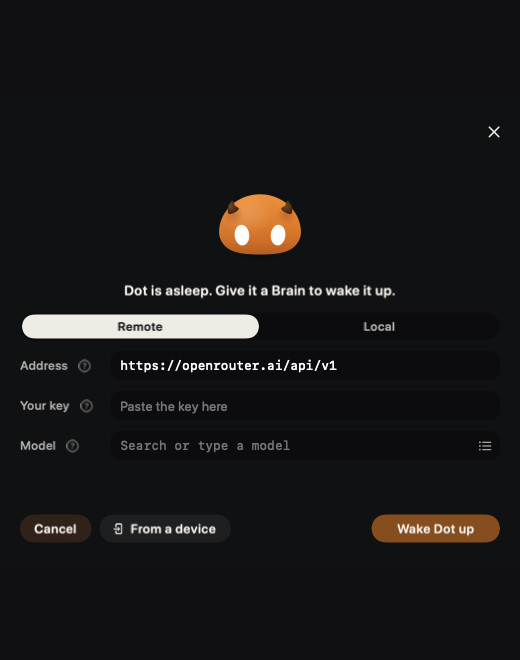
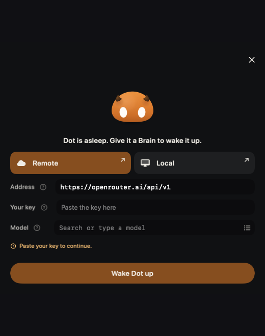

# First run

A new user goes from the first launch to the first answer from an Imp in a short, friendly path.

## Decision

The path feels like waking the Imp up, not like filling in a form. An Imp without a Brain already sleeps, so that state is the hint. It is one modal flow of two steps, the same on every platform, and the same two steps are shown in place in the Brain panel of an Imp that has no Brain.

1. **Service** (`firstrun.step.service`). Two choices as tiles, each with its symbol: **Remote** (`firstrun.service.remote`, a service in the cloud with a key) and **Local** (`firstrun.service.local`, a model server on your own computer). Remote is picked to begin with. Each choice fills the address, which stays freely editable, so any OpenAI-compatible service works, and links to its key or model page. Remote fills OpenRouter's address and Local fills Ollama's. Local needs no key, so the key field is not shown. Remote insists on a key only while the address is its own service: an edited address may be open. On the Mac, Local is marked as found (`firstrun.service.found`) when its server answers, but nothing is picked for the user. One quiet line says the key stays on this device (`firstrun.service.note`). The button is Continue: it loads the models from the address with the key.
2. **Model** (`firstrun.step.model`). The models the service returned, searchable and pickable, with one preselected. A model can also be typed (`firstrun.model.search`). The button is `firstrun.wake`: a tiny request while the Imp stirs (`firstrun.check.running`). On success the Imp wakes (`firstrun.check.ok`), keeps the Brain, and the flow ends by itself. On failure an error sentence shows and the button is `common.try_again`, on the same step.

**Where the choices come from.** Remote and Local are data, not code: `spec/presets/services.json` lists each one's name, symbol, address and link, and which is picked first. `node design/generate.mjs` compiles the file into the apps, like the animation catalog. Changing an address or a link is an edit of that file.

**Moving.** The top bar has Back (leading icon, hidden on step 1), the step indicator in the centre and Close (trailing icon). Back goes one step back. The indicator jumps to a step already completed, never forward past an unmet requirement: step 2 needs models loaded for the address and key as they are now. Nothing jumps while a request runs. Close dismisses at any time and leaves the Imp asleep, a calm valid state. There is no "Later" and no "skipped" screen. What the user typed survives every move between steps. Return presses the one primary button, Esc closes.

The Imp on top reacts: asleep, stirring while it checks, awake once it works. Steps change with the `scene` motion (a plain fade with Reduce Motion). Focus goes to the first empty field. The Brain marker and the "Give {name} a Brain" button on a sleeping Imp open the flow again at any time.

## Why

- "Wake the Imp" is a story people understand at once. Nothing says "configuration".
- Two named steps show where the user is and what each asks. The indicator makes them interactive instead of a label.
- Remote or Local is the one question a newcomer can answer. Both fill an address that stays editable, so any OpenAI-compatible API works, LM Studio included, without a list of products to read.
- Closing is safe. A sleeping Imp is a calm state, and its triggers still work.
- The service choice and the address and key fields are one component with the "Add a service" sheet, so the two cannot drift apart. "Add a service" offers the same two choices and nothing more.
- The flow ends when the Imp is awake. The Imp is then ready to talk to where it lives (its bubble on the Mac, its chat on the iPhone).

## Rejected

A long wizard with a page for each setting. It feels like a form. A "Later" button: Close already does that, and a second way out is noise. Hard-coding one service. Asking for a hosted account: there is no hosted model yet. A grid of named products (OpenRouter, Ollama, LM Studio, OmniRoute) and "Other": five choices that newcomers had to tell apart, when the address already accepts any of them. LM Studio and OmniRoute are no longer presets in the first run or in "Add a service": their users type or paste their address into Local's field. A third step, "Say hello to Imp", with a ready-made first message: the Imp is already awake when the check works, and the step asked for a message nobody needed to write there.

## On the iPhone

The steps and words are the same, with both choices. Local is a server on another computer, because an iPhone cannot look at its own localhost, so its address is filled with a host to replace (`firstrun.service.host_note`). The first screen has two halves. On top, one sleeping Imp says what it needs in its own speech bubble (the stage's bubble, its tail pointing at it). It leans as the phone tips, stirs at a touch and hops when tapped. Under it, "Meet Imp" (`phone.start.title`) and one sentence about what Imp is. In the thumb zone, two ways to begin, in order of weight: a wide main button that wakes it (`firstrun.wake`) with one line on what that needs (`phone.start.wake_note`), and a card that links a device (`phone.start.link_title`, with what it brings in one line, opening its own sheet with this iPhone's code, Scan a Code, Paste Link and this iPhone's name). There is no separate Hatch: waking makes the first Imp, and `+` in the room makes the next ones. The parts fade in one after the other, once, and only fade with Reduce Motion. The very first Imp is hatched by the main button and meets the flow in one sheet with the live Imp on top (Close leaves it asleep). The sheet wears the Imp's colour. Any later Imp without a Brain is dimmed, with no words over it. "Wake {name} up" in its chat opens the Imp's settings on the Brain, the same form in place, not this sheet. On the iPhone the flow is one screen with no step numbers: Remote or Local, then the address, the key and the model together, and one button. A blank model is picked for you (the first one that chats). The list button beside the field shows the service's models to choose from, and any name can be typed. An Imp keeps its Brain the moment it wakes. The key field never offers a password manager.

## Errors in this path

Every error is a plain sentence that says what to do next. It shows in place and keeps what the user typed.

| What happened | Key |
| --- | --- |
| The address is not an http or https address | `firstrun.error.address` |
| The key field is empty | `firstrun.error.empty_key` |
| No model is picked | `firstrun.error.no_model` |
| The key was refused | `error.brain.key` |
| The service does not answer | `error.brain.unreachable` |
| The service is too slow | `error.brain.timeout` |
| The model does not exist | `error.brain.model` |
| No local server answered | `error.brain.local` |

## States

| State | What is shown |
| --- | --- |
| Service | Remote and Local, address, key, Continue. |
| Loading models | `firstrun.service.loading`, the fields wait. |
| Model | The list and the model field, `firstrun.wake`. |
| Checking | `firstrun.check.running`, the Imp stirs. |
| Failed | An error sentence and `common.try_again`, on step 2. |
| Awake | `firstrun.check.ok`. The Imp keeps its Brain and the flow ends by itself. |
| Done | The flow closes. The Imp is awake. |

## Words

<!-- strings: firstrun -->
| Key | English |
| --- | --- |
| `firstrun.asleep_bubble` | {name} is asleep. Give it a Brain to wake it up. |
| `firstrun.check.ok` | {name} is awake. |
| `firstrun.check.running` | Waking {name} up… |
| `firstrun.error.address` | That address does not look right. It starts with https:// or http://. |
| `firstrun.error.empty_key` | Paste your key to continue. |
| `firstrun.error.key_not_saved` | Imp could not save the key. Try again. |
| `firstrun.error.no_model` | Pick a model to continue. |
| `firstrun.model.search` | Search or type a model |
| `firstrun.service.address` | Address |
| `firstrun.service.found` | Found here |
| `firstrun.service.host_note` | Use the address of your computer on this network. |
| `firstrun.service.key` | Your key |
| `firstrun.service.loading` | Loading models… |
| `firstrun.service.local` | Local |
| `firstrun.service.note` | Any OpenAI-compatible API. Your key stays on this device. |
| `firstrun.service.remote` | Remote |
| `firstrun.step.model` | Model |
| `firstrun.step.service` | Service |
| `firstrun.wake` | Wake {name} up |
<!-- /strings -->
