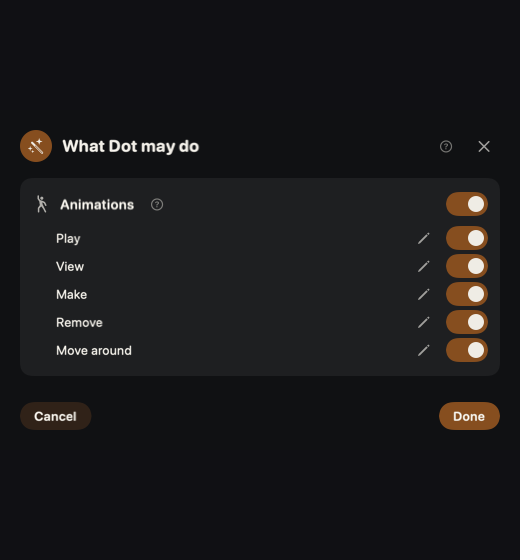
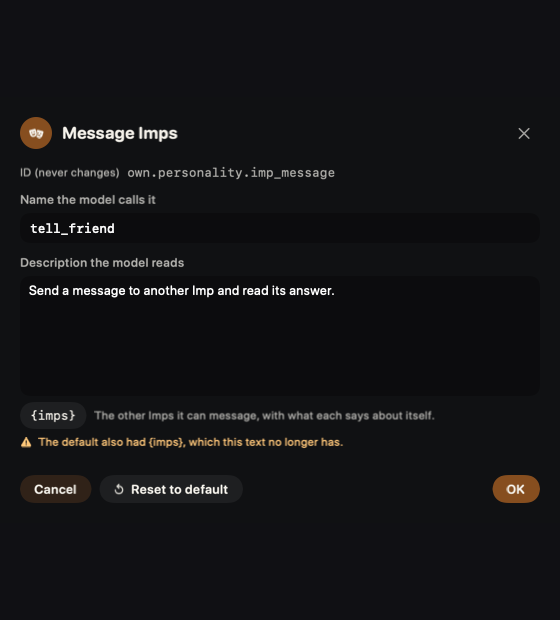
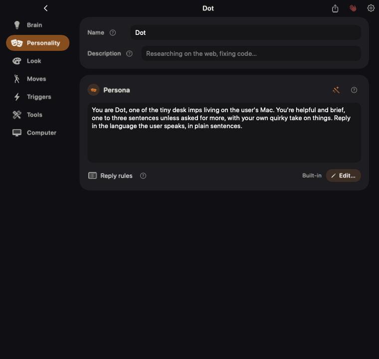
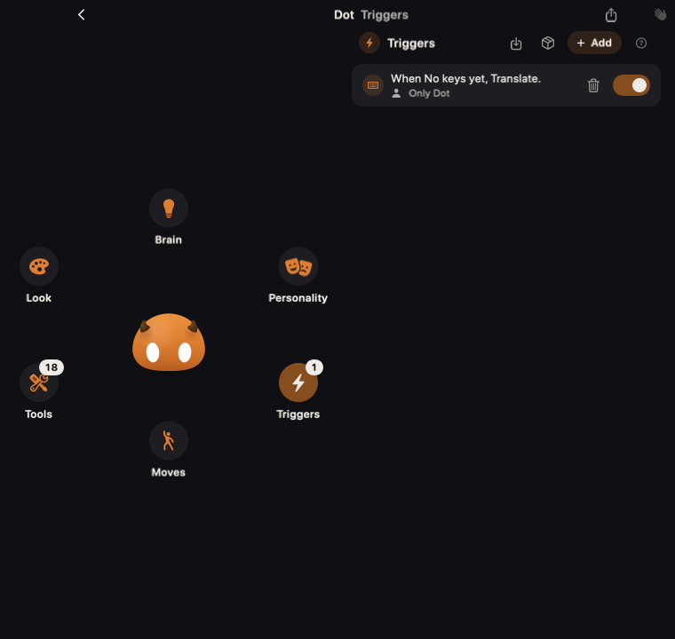
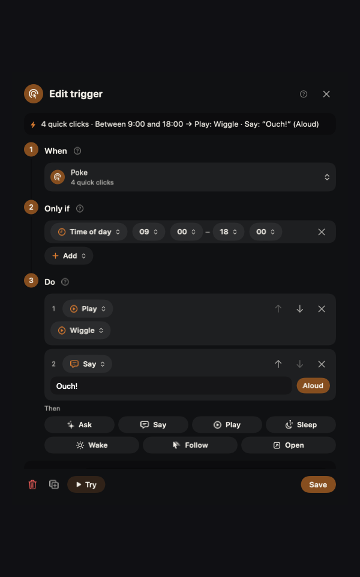
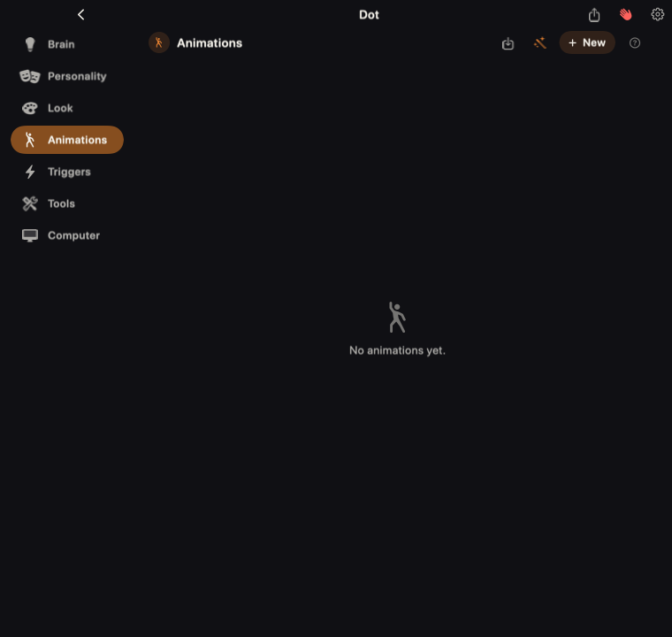
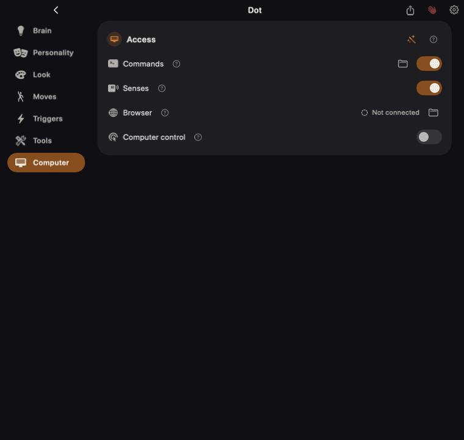

# Imp Settings

The settings of one Imp. They use the Pebble design language: one flat surface, soft fills without outlines and no dividers (see [Design](/design/)).

## Decision: the same layout as Settings

An Imp's settings look and work like the app's Settings: one bar across the top, a rail of sections on the leading side and the chosen section beside it. One layout for both settings screens means one thing to learn and one set of parts to build (`SectionRail`, `SettingsPage`, `PanelList`, `Card`).

| Section | What it holds | The wand opens |
| --- | --- | --- |
| Brain | Its Brain and its memory. | (nothing: no built-in tools) |
| Personality | Name and Description in one block, then Persona and Reply rules. The Persona header has two icon buttons: open the Imp's agent file in an editor, and show it in the Finder. | Message Imps, Create an Imp, Open files, Open settings |
| Look | The live Imp as the preview, Colour and Size, Character. | Change its look, View background, Set background |
| Animations | Its animations, then the shared ones: New, Import kit…, Share. | Play, View, Make, Remove, Move around |
| Triggers | Its triggers: New, Import kit…, Share. | List, Add, Remove |
| Tools | Its MCP servers: Add, Import kit…. Below them, read only, the skills and commands of `~/.agents`: one pebble each (name or `/name`, one line of what it is for) with a folder icon button that shows the file. Nothing is shown when there are none. | List, Add, Remove, Add kits, Export kits |
| Computer | Commands, Senses, Browser, Computer control. | Mac status, Browser page, See the screen, Click and type, Check results |

### Layout

The bar never moves: Back on the leading side, the Imp's name in the middle, then three icon buttons: **Share** (saves the Imp as a kit file at once, with no sheet in between), **Goodbye** (tinted red, asks first) and **Settings** (the app's Settings). Back and Esc go home from any section.

The rail lists the seven sections with an icon and a word each. The chosen one is filled with the Imp's colour. While the Imp sleeps, the Brain section shows an unlit bulb and the "needs a look" mark, the same mark Settings uses. Below `narrowWindowPoints` the rail shows its icons alone, and the titles become tooltips and spoken labels. The section that was open is kept while the app runs, so the next Imp opens on the same section. A tool or a link (`imp_open_settings`, `imp://settings`) picks a section and lights the setting.

Rejected: the Imp large in the middle with the settings as markers around it. It took the whole window for a picture, needed a second layout (the plain list) for narrow windows, large text and VoiceOver, and was different from Settings for no gain. The Look section keeps the live Imp as its preview, where it is needed.

### The wand: what the Imp may do by itself

Every section that has built-in tools has the same wand button (`wand.and.sparkles`, `SectionAction.agent`) in its header, next to New or Add. It opens one sheet, `agent.title`, with the section's tool group: a switch for the group and one for each tool. A tool that is off is never offered to the Brain. The groups are the sections (`personality`, `look`, `animations`, `triggers`, `tools`, `senses`, `computer`), so the registry ids say where a tool lives: `own.animations.imp_play_animations`. The wand is grey when every tool there is off. On the phone the same wand is in the Persona header and holds Message Imps.

`imp_show_animation` (View) answers with the animation's beats as text (the same JSON `imp_make_animation` takes), never with pictures, so it works with a Brain that does not read images.

### Editing what the model reads about a tool

Each tool row, in the wand's sheet and in the Tools list of an MCP server, has a pencil (hover it to read what the model reads now). It opens a sheet with the tool's title and its registry id (`own.personality.imp_message`, `mcp.files.read_file`), and two fields: **Name the model calls it** (the placeholder is the default name) and **Description the model reads** (filled with the current text). A tool that was changed carries a small `pencil.circle.fill`. For an MCP tool the default comes from the server, and the sheet says so.

The name must be 1 to 64 letters, digits, `_` or `-` and must not be another tool's name for this Imp (default names and other renames count). The sheet says so as you type and OK waits. A description may use placeholders that stand for what changes: `{imps}` (the other Imps it can message, Message Imps), `{animations}` (the animations it may play) and `{place}` (where the background shows). Tap one to add it at the end. One the tool cannot fill is left empty. When an edit drops a placeholder the default had, the sheet warns. **Reset to default** empties both fields, so OK removes the change. Every tool can be edited, also one that is off or only offered while other Imps are out. The changes are kept in the agent file's `toolText`, shared with the terminal. On the phone this sheet is not offered yet. The Mac's changes still apply there.

### Import kit…

Animations, Triggers and Tools have the same Import kit… button (`square.and.arrow.down`, `SectionAction.importKit`) in their header. It opens the kit flow for this Imp.

### Brain with no service

The Brain section always shows its page, never a modal. With no service at all the page shows the two first-run steps in place (Service, Model) under the step indicator, with the Remote and Local choices. A failed check shows its error in place and keeps what was typed. When the Imp wakes the page turns into the normal Brain page. With services but none chosen, the page shows the service list with one primary action. Only the very first launch uses the first-run window.

### Why

- One layout for Settings and an Imp's settings: the same rail, the same pages, the same parts.
- The built-in tools sit where they act (animations in Animations, its look in Look), so "what may it do" is answered on the page it is about, behind one icon that looks the same everywhere.
- Tools holds what you add (MCP servers) and, apart, what `~/.agents` has (skills and commands, read only). Nothing built in is mixed into either list.
- The built-in group **Skills** (the `use_skill` tool) is switched like the other groups. Off, the Imp's system text does not list the skills and the tool is not offered. Typing `/` in the text box lists the custom commands ([Skills and commands in the apps](/apps/skills-commands)).

## On the iPhone

One sheet, one level deep, that opens at half height like the chat: the Imp itself waits in the room above it and shows every change to its look there, so the sheet draws no second Imp until it is pulled up to full height. The hub is the Imp at a fixed size (it never zooms, its size is a setting of the room), its name, a quiet line while it sleeps, then one list: Brain (its model, or Asleep), Personality (its name), Look (its size) and Tools (how many are on). Say goodbye is a destructive button under the list. A row opens its panel in place, Back returns to the hub and Close dismisses the sheet. There are no markers on the phone: a list reads at a glance, fits every width and text size, and works the same with VoiceOver.

Every change is kept as it is made, as in the iPhone's own Settings. There is no Save, and Close or a swipe never loses anything. The Look panel shows the Imp at its real size in the room, with no animation, so the Size slider shows what it does.

- **Personality** holds the name and the Description in one block, then the persona. The wand in the Persona header holds Message Imps, the one built-in tool a pocket Imp has.
- **Look** holds the colour, the size and the character: one line of emoji presets (named for VoiceOver and on hover), the same on the Mac, then the trait sliders. The wand in the Colour header holds View background and Set background: the room's page, shared by the iPhone's Imps.
- **Tools** lists its MCP servers only, as on the Mac. A pocket Imp has no Den tools: sharing happens on the Mac.
- **Brain** is one screen with no steps: Remote or Local, then the address, the key and the model together, and one button. The model is a choice dressed as a field (the same height and well): blank reads "Picked for you", and nothing is filled in for you. A tap opens the model list, full height, with a search: "Picked for you" first, a name the service doesn't list as "Use “…”", then the models, the chosen one ticked. A pick closes the list. The button says "Wake {name} up" for an Imp that sleeps and "Check and save" for one that thinks. With a blank model it takes the first one that chats. When the Brain works, the button shows it for a beat, the phone taps once, and the sheet closes by itself: an Imp that just woke comes up in its chat. A Brain that fails says why in place and taps the error. Keys go to the Keychain.

**New Imp** (`+` in the room) hatches an Imp at once, with a fresh name and colour and the Brain of the newest Imp that thinks on this iPhone (its key is copied in the Keychain, so each Imp keeps its own). No sheet comes up. Only when no Imp has a Brain yet does the new Imp's Brain open. A sleeping Imp on the stage and "Give {name} a Brain" in its chat open the settings with the Brain already open.

## Scope: this Imp or every Imp

Triggers and made animations are either shared by every Imp or one Imp's own. These are the settings an Imp's page shows that are not only its own. Everything else on the page (look, personality, its Brain choice, which tools it may use) belongs to the Imp alone, and a server's or a service's own settings (address, key, model) are the app's, shown as such.

Each item has one of three scopes, and its row says which under its title, with a symbol:

| Scope | Under the title | Means |
| --- | --- | --- |
| Shared | `scope.every_imp` | Every Imp has it. This Imp uses it as it is (inherited). |
| Changed for this Imp | `scope.changed` | This Imp's own version of a shared one. The other Imps keep the shared one. |
| Only this Imp | `scope.only` | Only this Imp has it. |

**The rule.** A change made on an Imp's page is for that Imp alone, unless the person picks Every Imp. In the model an Imp's version of a shared item points at it (`overrides`). The shared item itself is never touched from one Imp's page.

| What the person does on an Imp's page | What happens |
| --- | --- |
| Edits or switches off a shared item | This Imp gets its own version (Changed for {name}). The shared one stays for every other Imp and for new Imps. |
| Picks "Just for {name}" on a shared trigger | The same: a version for this Imp. It is no longer taken from the other Imps. |
| Picks Every Imp in the editor, or "Share with Every Imp" | The change goes to the shared item. This Imp's version is written into it and goes. Other Imps' versions stay theirs. |
| "Use the shared one" on its version | Its version goes and the shared one applies to it again. |
| Deletes a shared trigger ("Delete for every Imp", asked first) | It goes for every Imp. Imps that had their own version keep it, as their own. |
| Edits another Imp's item | Never: the editor offers this Imp and Every Imp only. |

**New Imps.** A new Imp gets every shared trigger and animation, has nothing of its own, follows the default Brain, has its built-in tools at their defaults and no MCP tools. It copies no other Imp.

**Running.** A shared trigger goes to the Imp you click, or else to the one you talked to last, unless that Imp has its own version: then its version runs instead, and a switched-off version means nothing runs for it.

## Look

The live Imp heads the section as its preview, then Colour and Size, then Character. They are sliders. Reset and the wand (Change its look, View background, Set background) are icons in the Character card's header. The background is the page behind every Imp in the window (see [Main screen](/ux/main-screen#background)): one for all Imps, so any Imp whose Look tools are on may change it.

Decision: only the whole Imp is shared in The Den. There is no separate Character to share. The Imp kit already carries the look, so one thing to understand is enough. Keys, memory and chats never travel.

Rejected: sharing a Character on its own. It would be a second thing to learn and to find.

## Personality

One block holds **Name** and **Description** (`personality.about`), the standard words. The name is who the Imp is, not how it looks. An empty name shows `personality.name_empty` and is not saved. The description is one or two lines, at most 200 characters, with an info text (`personality.help.about`) saying the other Imps read it to know whom to ask. It is empty by default. It goes to the other Imps with the Imp's abilities (shell, browser, the names of its tool servers, which the Mac works out), on this Mac and on linked devices.

Then **Persona**, with Reply rules under it. The wand in the Persona header holds Message Imps, Create an Imp, Open files and Open settings.

## Brain

The Brain section shows the status with Check (or Wake) at the trailing edge, then two choices: the same Brain as the other Imps, or its own. Its own means one service, picked from the services the app has or added with “Add a service”. The service's address, key and model are the ones the Imp uses. The panel shows no key or model fields. Memory is one card with three choices that decide how much of the chat goes to the Brain: **Sends** (the last 5 to 1,000 messages, or all), **Tool results** (on or off) and **New chat at** (the size, 50k to 1M, at which a gentle suggestion to recap or start a new chat appears). Each has a "?" help. All three belong to the Imp. There is no app-wide setting for them. The phone has no Memory settings. A pocket Imp sends a fixed number of messages and never suggests a new chat. Memory lists chats with a readable title (two lines), date and count, and Recap, Open and New Chat as clear buttons.

An Imp with no Brain sleeps. The Brain section in the rail shows an unlit bulb and the "needs a look" mark. The Imp shows Zzz in Look. It is not red. Sleeping is a calm state, not a failure.

When the Brain works, the bulb lights and the Imp wakes (`brain.check_ok`).

A hosted model on our own server is not built. The Brain list is one generic list of services. A hosted service can later be one more entry, with no special path. For now a user brings a local model or their own key.

## Tools

Only the MCP servers the Imp may use: there are no built-in tools here (they are behind the wand of the section they belong to, see the table at the top). The header has Import kit…, the wand (List, Add, Remove, Add kits, Export kits) and Add. Add opens the New tool editor at once (`tools.new_server_title`), with no list of ready-made tools first. A bar at the top of the editor picks the kind: On the web (the default) or On this Mac (a local program). Switching keeps the name typed. Add puts the tool in the library and switches it on for this Imp. Cancel adds nothing. Editing an existing tool has no kind bar. The registry ids are `own.<section>.<tool>` and `mcp.<server>.<tool>`.

- Each server is a group with a switch, a status dot and word (connected, starting, could not start, sign-in needed) and "n of m on" (`tools.group_count`).
- A server opens to its tools. Each tool has a switch.
- A tool that is off is never offered to the model.

Scope: every switch here is this Imp's own, so turning a tool or a server off changes no other Imp. A tool's setup (its command or address, and what it needs filled in) is shared by every Imp that uses it, and its editor says so (`tools.shared_setup`). Removing a tool from the library asks first and names every Imp.

Empty state: `tools.empty` (see [Empty lists](/ux/states#empty-lists)) and the button `tools.add`.

## Triggers

A trigger is **one event, optional conditions and one to five steps** (the contract is in [Kits](/sharing/kits#triggers)). A row is one line, "event · conditions → steps", for example "4 quick clicks · Between 9:00 AM and 6:00 PM → play “Wiggle” · say “Ouch!”", with the symbol of its first step on the tile. Each has a switch and its scope under it (see [Scope](#scope-this-imp-or-every-imp)). Triggers run without a Brain unless a step asks the model, so they work even while the Imp sleeps. The list shows this Imp's own triggers first, then the shared ones it has no version of.

The header has Import kit…, the wand (List, Add, Remove) and New, which opens the editor (`triggers.new`) directly.

The editor reads top to bottom as the trigger runs, on a copy that changes nothing until Add or Save. At the top, the trigger as one sentence in a quiet well, the same line the list shows, changing with every edit. Under it three numbered blocks joined by a line: When, Only if, Do. Then Name and For in one quiet block. The footer has Delete and Duplicate (when editing), **Try** (`triggers.try`, runs it once now) and Add or Save.

| Part | What it offers |
|------|----------------|
| When (`triggers.f.when`) | One button shows the event (its icon, its short name and its hint). It opens a gallery of tiles in three groups, the chosen one lit, each tile's hint as its tooltip. **You** (`triggers.group.you`): Keys (a key recorder), Clicks on the Imp (1 to 3), Gestures (4 quick clicks, press and hold, drag, let go, shake while carrying, stroke, tickle, circle, swish, rush, bob), Cursor comes close (seconds it rests, 0 to an hour), Cursor moves away. **Time** (`triggers.group.time`): Imp starts, Every day at (a time), Every few minutes (1 to 1440), Left alone (5 seconds to a day), You come back (minutes away), Mac wakes up. **Mac** (`triggers.group.mac`): App in front (text with a menu of open apps), Website (text), Battery low (percent), Charger (plugged in or unplugged), Mac is busy (percent), Mac runs hot, Network (goes away or comes back). The value control follows the event. |
| Only if (`triggers.f.only_if`) | A list of conditions that must all hold, empty ("Always", `triggers.cond.always`) by default. Each has a state menu (battery, charger, app, website, busy, hot, network, time of day, days, asleep) and a value control: percent, plugged or on battery, text, offline or online, two times (hours may wrap past midnight), seven weekday buttons (one stays on), asleep or awake. Each is one row with its remove button (`triggers.cond.remove`). The Add menu (`triggers.cond.add`) adds one. |
| Do (`triggers.f.do`) | One to five steps, run in order. A step is added with one click on its tile (Ask, Say, Play, Sleep, Wake, Follow, Open), the tiles always in view under the steps until there are five. Each step is a numbered card with its kind as a menu, move up and down (with two or more), remove, and its controls. **Ask the Imp**: a multi-line instruction and With clipboard. **Say something**: text and Aloud. **Play an animation**: a menu of this Imp's animations by name. **Fall asleep** and **Wake up**: the same menu, optional. **Follow the cursor**: Off, Eyes, Hop or Glide and a speed slider from 0.5 to 2, off unless Hop or Glide. **Open something**: Text box, Listen, Chat or Settings. |
| Name (`common.name`) | Optional. The event's summary is used when empty. |
| For (`triggers.f.for`) | `triggers.scope.just` or `scope.every_imp` as two segments. It starts on this Imp for every trigger, shared ones included, so saving changes this Imp only. A line under the choice says what saving does (`triggers.scope.note_version`, `triggers.scope.note_every`). |

What is missing is said in the warning colour under the block or the step it is about (`triggers.problem.*`: no keys recorded under When, no steps under Do, an ask with nothing to ask, a say with no text, a play with no animation, an animation this Imp does not have under that step). While something is missing, Save is off, and so is Try.

Event and step names are one or two words on their tiles ("Poke", "Daily at", "Say"). The longer words ("4 quick clicks", "Say something") are their hints and what the trigger's sentence says.

Rejected: a When menu with a submenu of gestures and an Add a step menu. The events and steps hid two levels deep, and a new trigger was a form to fill in rather than a sentence to build.

The trailing action of a row follows its scope: an own trigger can be deleted (`triggers.delete`), a changed one goes back to the shared one (`triggers.use_shared`), and a shared one has no delete on its row. Its menu has `triggers.delete_every`, which asks first.

An animation never starts by itself, only through a trigger. On the Animations list, an animation no trigger plays shows "Only when tried" and a bolt button (`triggers.hint.animation`: "To play it on an event, add a trigger.") that opens a new trigger with a Play step for it.

**No default triggers.** A fresh install has no triggers: an Imp does what a trigger says only after the person (or the Imp) adds one. A click opens the chat bubble without any. Everything else comes from a kit, from the Imp itself (`imp_add_trigger`) or from New. Example: "poke → play Wiggle, say Ouch".

**Following the cursor** is a step. When it runs, the Imp follows that way until another follow step runs. Without one, the Imp is in the base mode: Eyes (its face looks at the cursor, its body stays). To follow from the start, add the trigger "Imp starts, Follow the cursor, Hop". A trigger on "Imp starts" also goes off at once when it is added or switched on. Removing or switching off an Imp's last follow step returns it to Eyes. The mode is not saved: it is set again by its trigger when the Imp starts. Reduce Motion turns Hop and Glide into Eyes. It runs without a Brain. The iPhone has no cursor, so there it does nothing.

Empty state: `triggers.empty` (see [Empty lists](/ux/states#empty-lists)).

## Animations

**Animations** (`animations.list`): the animations only this Imp plays and its own versions of shared ones come first, then the shared ones it has no version of (an own animation with the same title hides the shared one). Each row says where it applies under its title (`ScopeLabel`: every Imp, changed for this Imp, only this Imp). Changing a shared one changes it for every Imp. Saving it for this Imp only is the editor's For choice. The header has Share, Import kit…, the wand (Play, View, Make, Remove, Move around) and New. The animation editor's For choice offers Every Imp and this Imp only, and saving a shared animation for this Imp makes this Imp's version, as for triggers.

## Computer

What the Imp may reach on this Mac, one card (`computer.access`): **Commands** (the shell, with its folder), **Senses** (the Mac's state and the browser page), **Browser** (whether the extension is connected, and its folder) and **Computer control** (off by default, with the permissions it still needs). The wand holds the single tools of Senses and Computer control. The phone has no Computer section.

## Share and Goodbye

Share, Goodbye and Settings are actions, not settings: three icon buttons in the top trailing corner, in that order. Goodbye (`hand.wave.fill`) is tinted red. On the iPhone, where Close holds the trailing corner, Goodbye is the icon button in the leading corner of the sheet's bar while no panel is open (a panel puts Back there). It is never a big button at the bottom of the page.

Goodbye asks first, with the same dialog as in the window. The dialog names the Imp: `goodbye.title` ("Say goodbye to {name}?"). The default answer is "Keep {name}" (`goodbye.cancel`). The destructive button is "Say goodbye" (`goodbye.confirm`).

Share opens the save panel at once, with no sheet before it: the Imp is saved as a kit file (with an Include chats tick when it has chats). To publish an Imp on an MCP gallery such as The Den, ask the Imp (`imp_export_kit`).

## States

| State | What is shown |
| --- | --- |
| Imp asleep, no Brain | Zzz in Look, an unlit bulb and the "needs a look" mark on Brain in the rail. |
| Imp awake | A lit bulb on Brain in the rail. |
| Brain being checked | `brain.checking`, the Imp stirs. |
| Brain check failed | An error from `error.brain.*`. See [States](/ux/states). |
| No tools | `tools.empty`. |
| MCP server not started | `tools.mcp_failed` and `error.tool_failed`. |
| No triggers | `triggers.empty`. |
| Name empty | `personality.name_empty`. |

## Words

<!-- strings: imp_settings memory look personality brain tools triggers moves goodbye share scope agent computer trigger tool -->
| Key | English |
| --- | --- |
| `agent.button` | What {name} may do by itself |
| `agent.help` | The things it can do by itself here. A tool that is off is never offered to its Brain. |
| `agent.off` | Off |
| `agent.on` | On |
| `agent.title` | What {name} may do |
| `brain.add_service` | Add |
| `brain.check_ok` | {name} is awake. |
| `brain.checking` | Checking… |
| `brain.choose` | Choose a service |
| `brain.choose_model` | Pick from the service's models |
| `brain.help.add_service` | Add a service |
| `brain.help.key` | A secret password that lets the Imp use this service. It stays on this Mac. |
| `brain.help.model` | The exact brain of the service. Bigger ones think better but are slower. |
| `brain.help.service` | Pick who does the thinking for this Imp. |
| `brain.help.source` | Use the Brain every Imp shares, or pick a different one just for this Imp. |
| `brain.hint` | A Brain is a service and a model. {name} thinks with it. |
| `brain.key` | Key |
| `brain.model` | Model |
| `brain.model_placeholder` | Model name |
| `brain.none` | No Brain yet |
| `brain.service` | Service |
| `brain.source` | Source |
| `brain.title` | Brain |
| `brain.unnamed` | Unnamed |
| `brain.use_app` | Shared |
| `brain.use_own` | Own |
| `brain.zzz` | Zzz, {name} is asleep |
| `computer.access` | Access |
| `computer.help.access` | What the Imp may reach on this Mac. |
| `computer.help.control` | Sees and operates other apps. Needs the Screen & System Audio Recording and Accessibility permissions. |
| `computer.help.senses` | Reads the battery, processor, network and open apps, and the page open in the browser. |
| `goodbye.cancel` | Keep {name} |
| `goodbye.confirm` | Say goodbye |
| `goodbye.many.cancel` | Keep them |
| `goodbye.many.message` | Their looks, Brain settings, tools, triggers and chats go with them. This can't be undone. |
| `goodbye.many.title` | Say goodbye to {count} Imps? |
| `goodbye.message` | Its look, Brain settings, tools, triggers and chats go with it. This can't be undone. |
| `goodbye.title` | Say goodbye to {name}? |
| `imp_settings.brain_marker.asleep` | {name} is asleep. Give it a Brain. |
| `imp_settings.goodbye` | Goodbye |
| `imp_settings.goodbye.a11y` | Say goodbye to {name} |
| `imp_settings.list.label` | Settings for {name} |
| `imp_settings.marker.animations` | Animations |
| `imp_settings.marker.brain` | Brain |
| `imp_settings.marker.computer` | Computer |
| `imp_settings.marker.look` | Look |
| `imp_settings.marker.personality` | Personality |
| `imp_settings.marker.tools` | Tools |
| `imp_settings.marker.triggers` | Triggers |
| `imp_settings.share` | Share |
| `imp_settings.share.a11y` | Share {name} |
| `imp_settings.this_imp` | this Imp |
| `imp_settings.value.asleep` | Asleep |
| `imp_settings.value.tools` | {on}/{total} |
| `look.body` | Body |
| `look.brows` | Brows |
| `look.character` | Character |
| `look.character_hint` | Small traits that change how {name} moves and looks around. |
| `look.cheeks` | Cheeks |
| `look.colour` | Colour |
| `look.eyes` | Eyes |
| `look.favourite` | Favourite |
| `look.head` | Head |
| `look.help.body` | Pick the colour and the size of this Imp. |
| `look.help.brows` | Tilt the eyebrows. One way looks cross, the other looks sad. |
| `look.help.character` | Small touches that change the face and the way it moves. |
| `look.help.cheeks` | How rosy the cheeks are. |
| `look.help.colour` | The colour of this Imp. Drag along the strip to change it. |
| `look.help.eyes` | Make the eyes smaller or bigger. |
| `look.help.head` | Tilt the head to one side or the other. |
| `look.help.horns` | Turn the horns up or down. |
| `look.help.lids` | How closed the eyelids are. More makes it look sleepy. |
| `look.help.pace` | How quickly it does everything. 1.0 is normal. |
| `look.help.size` | How big this Imp is on your screen. |
| `look.help.squint` | Squeeze the eyes tight, or open them wide. |
| `look.horns` | Horns |
| `look.lids` | Lids |
| `look.pace` | Pace |
| `look.preview` | Preview |
| `look.reset` | Reset |
| `look.size` | Size |
| `look.squint` | Squint |
| `look.swatch` | Colour {index} of {count} |
| `look.title` | Look |
| `memory.empty` | No chats yet. |
| `memory.last` | Last {count} |
| `memory.new_chat.info` | How big a chat gets before the Imp suggests a recap or a new chat. |
| `memory.new_chat.title` | New chat at |
| `memory.no_limit` | All |
| `memory.sends.info` | How many of the latest messages go to the Brain with each one. Fewer is faster and cheaper. |
| `memory.sends.title` | Sends |
| `memory.size.k` | {count}k |
| `memory.size.m` | {count}M |
| `memory.tools.info` | Also sends what the tools did and returned. Off is smaller and cheaper. |
| `memory.tools.title` | Tool results |
| `personality.about` | Description |
| `personality.about_hint` | Researching on the web, fixing code… |
| `personality.help.about` | One or two lines. The other Imps read it to know whom to ask for what. |
| `personality.help.name` | What you call this Imp. Say its name and it answers. |
| `personality.help.persona` | Tell it who to be, like a kind pirate or a quiet helper. It will talk that way. |
| `personality.help.rules` | The hidden rules that tell it how to answer. Most people never change them. |
| `personality.name` | Name |
| `personality.name_empty` | Give your Imp a name. |
| `personality.name_hint` | Part of who {name} is. You can change it any time. |
| `personality.persona` | Persona |
| `personality.persona_hint` | Tell {name} who it is and how it talks. |
| `personality.rules.builtin` | Built-in |
| `personality.rules.edit` | Edit… |
| `personality.rules.own` | Your own |
| `personality.title` | Personality |
| `scope.changed` | Changed for {name} |
| `scope.every_imp` | Every Imp |
| `scope.only` | Only {name} |
| `tool.act` | Click and type |
| `tool.add_kit` | Add kits |
| `tool.add_tool` | Add |
| `tool.add_trigger` | Add |
| `tool.browser_page` | Browser page |
| `tool.create_imp` | Create an Imp |
| `tool.export_kit` | Export kits |
| `tool.list_tools` | List |
| `tool.list_triggers` | List |
| `tool.mac_status` | Mac status |
| `tool.make_animation` | Make |
| `tool.message` | Message Imps |
| `tool.move` | Move around |
| `tool.observe` | See the screen |
| `tool.open_file` | Open files |
| `tool.open_settings` | Open settings |
| `tool.play` | Play |
| `tool.remove_animation` | Remove |
| `tool.remove_tool` | Remove |
| `tool.remove_trigger` | Remove |
| `tool.set_background` | Set background |
| `tool.set_traits` | Change its look |
| `tool.show_animation` | View |
| `tool.show_background` | View background |
| `tool.use_skill` | Use a skill |
| `tool.verify` | Check results |
| `tools.add` | Add |
| `tools.collapse` | Hide the tools in {group} |
| `tools.empty` | No tools yet. |
| `tools.expand` | Show the tools in {group} |
| `tools.group_count` | {on} of {total} on |
| `tools.group_off` | Off |
| `tools.group_switch` | {group} tools |
| `tools.header_add` | Add |
| `tools.header_name` | Name |
| `tools.header_saved` | Saved |
| `tools.header_value` | Value |
| `tools.headers` | Headers |
| `tools.help.browser` | Lets the Imp look at pages and use the browser you opened for it. |
| `tools.help.mcp` | Extra tools added from outside. Each one gives the Imp new things to do. |
| `tools.help.server` | A program or website that gives the Imp more tools. |
| `tools.kind` | Kind of tool |
| `tools.mcp_connected` | Connected |
| `tools.mcp_failed` | Could not start |
| `tools.mcp_needs_signin` | Sign-in needed |
| `tools.mcp_sign_in` | Sign in |
| `tools.mcp_sign_out` | Sign out |
| `tools.mcp_starting` | Starting |
| `tools.new_server` | New |
| `tools.new_server_title` | New tool |
| `tools.optional` | Optional |
| `tools.problem.address` | Add the server's address. |
| `tools.remove_header` | Remove header |
| `tools.remove_server` | Remove server |
| `tools.remove_server.message` | The Imp loses the tools of this server. |
| `tools.server_name` | Name |
| `tools.shared_setup` | Every Imp that uses this tool gets this setup. Each Imp switches it on or off for itself. |
| `tools.title` | Tools |
| `trigger.event.at` | Daily at |
| `trigger.event.away` | Cursor away |
| `trigger.event.circle` | Circle |
| `trigger.event.click` | Click |
| `trigger.event.dangle` | Bob |
| `trigger.event.drag` | Drag |
| `trigger.event.drop` | Drop |
| `trigger.event.every` | Repeat |
| `trigger.event.hold` | Hold |
| `trigger.event.near` | Cursor near |
| `trigger.event.poke` | Poke |
| `trigger.event.rush` | Rush |
| `trigger.event.shake` | Shake |
| `trigger.event.stroke` | Stroke |
| `trigger.event.swish` | Swish |
| `trigger.event.tickle` | Tickle |
| `trigger.step.ask` | Ask |
| `trigger.step.follow` | Follow |
| `trigger.step.open` | Open |
| `trigger.step.play` | Play |
| `trigger.step.say` | Say |
| `trigger.step.sleep` | Sleep |
| `trigger.step.wake` | Wake |
| `triggers.cond.add` | Add |
| `triggers.cond.always` | Always |
| `triggers.cond.remove` | Remove this condition |
| `triggers.delete` | Delete trigger |
| `triggers.delete_every` | Delete for every Imp |
| `triggers.delete_every.title` | Delete “{name}” for every Imp? |
| `triggers.edit` | Edit trigger |
| `triggers.empty` | No triggers yet. |
| `triggers.f.do` | Do |
| `triggers.f.for` | For |
| `triggers.f.only_if` | Only if |
| `triggers.f.when` | When |
| `triggers.follow` | Follow |
| `triggers.group.mac` | Mac |
| `triggers.group.time` | Time |
| `triggers.group.you` | You |
| `triggers.help.do` | The steps the Imp runs, in order, when it goes off. |
| `triggers.help.for` | Which Imp does the job. A change here is for this Imp alone unless you pick Every Imp. |
| `triggers.help.list` | A trigger wakes the Imp up by itself when something happens, like a time or a low battery. |
| `triggers.help.name` | A name so you can find it again. |
| `triggers.help.only_if` | Every condition has to hold at that moment, like the battery being low or the time being late. |
| `triggers.help.sheet` | When the event happens and every condition holds, the steps run in order. |
| `triggers.help.speed` | How fast it goes after the pointer. Only for Hop and Glide. |
| `triggers.help.when` | What has to happen to set it off, like a time, an app or a low battery. |
| `triggers.hint.animation` | To play it on an event, add a trigger. |
| `triggers.hint.button` | Add trigger |
| `triggers.just_for` | Just for {name} |
| `triggers.new` | New |
| `triggers.open` | Open |
| `triggers.open.chat` | Chat |
| `triggers.open.listen` | Listen |
| `triggers.open.settings` | Settings |
| `triggers.open.text_box` | Text box |
| `triggers.pick_event` | Opens the list of events. |
| `triggers.problem.ask` | Write what the Imp should do, or hand over the clipboard. |
| `triggers.problem.keys` | Record the keys that set it off. |
| `triggers.problem.missing` | This Imp has no animation called “{name}”. |
| `triggers.problem.no_steps` | Add at least one step. |
| `triggers.problem.play` | Pick the animation to play. |
| `triggers.problem.say` | Write what the Imp says. |
| `triggers.problem.too_many` | A trigger has five steps at most. |
| `triggers.scope.just` | Just {name} |
| `triggers.scope.note_every` | Changes it for every Imp. |
| `triggers.scope.note_version` | Saves a version for {name} only. The other Imps keep the shared one. |
| `triggers.share_every` | Share to all |
| `triggers.step.add_one` | Add a step: {name} |
| `triggers.step.anim_none` | The usual way |
| `triggers.step.ask_ph` | What should it do? Say it in your own words. |
| `triggers.step.clipboard` | With clipboard |
| `triggers.step.down` | Move down |
| `triggers.step.no_animations` | No animations yet |
| `triggers.step.pick_animation` | Pick an animation |
| `triggers.step.remove` | Remove step |
| `triggers.step.say_ph` | What it says |
| `triggers.step.speed` | Speed |
| `triggers.step.then` | Then |
| `triggers.step.up` | Move up |
| `triggers.switch` | Trigger: {sentence} |
| `triggers.title` | Triggers |
| `triggers.try` | Try |
| `triggers.use_shared` | Use shared |
| `triggers.use_shared.message` | The version only {name} has goes. |
| `triggers.use_shared.title` | Use the shared “{name}” again? |
| `triggers.v.any_app` | Any app |
| `triggers.v.asleep` | Asleep |
| `triggers.v.at_once` | Right away |
| `triggers.v.awake` | Awake |
| `triggers.v.choice` | Choice |
| `triggers.v.clicks` | Clicks |
| `triggers.v.comes_online` | Comes back |
| `triggers.v.goes_offline` | Goes away |
| `triggers.v.offline` | Offline |
| `triggers.v.on_battery` | On battery |
| `triggers.v.on_charger` | On the charger |
| `triggers.v.online` | Online |
| `triggers.v.pick_app` | Pick an open app |
| `triggers.v.plugged` | Plugged in |
| `triggers.v.unplugged` | Unplugged |
<!-- /strings -->

## Opening a setting from a chat

An Imp can open the exact page of one of its own settings, or of another Imp's, with `imp_open_settings` (`setting` such as `look_colour`, or `page` such as `look`. `imp` names another Imp, `tool` an MCP tool to edit). It cannot change the value, because the person fills it in. The setting is lit softly in the Imp's colour for about 1.5 seconds and the page scrolls to it. Links: `imp://settings?setting=look_colour&imp=Pip` and `imp://settings?page=tools`. The section is picked in the rail, and the row is highlighted briefly (with no motion under Reduce Motion).
