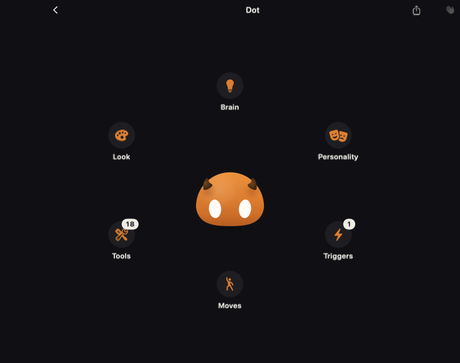
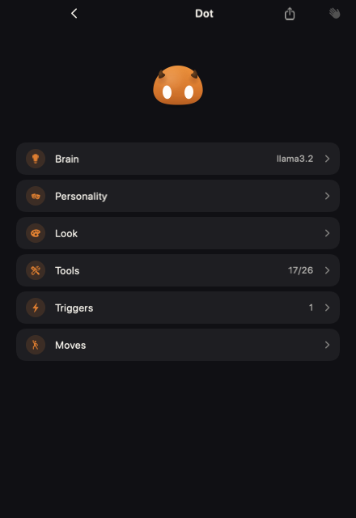
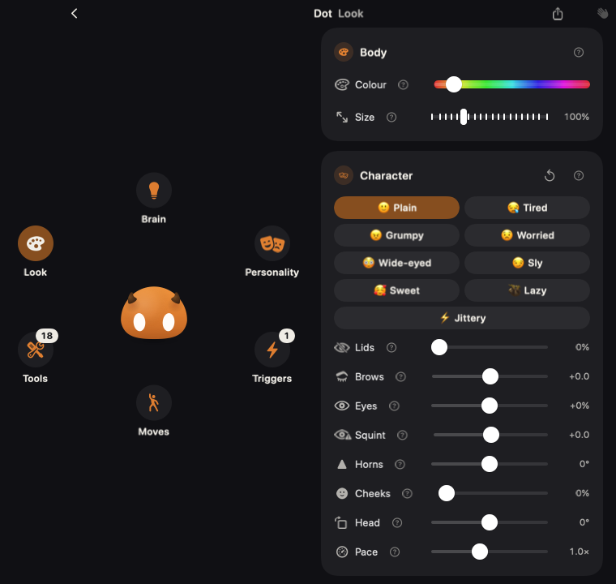
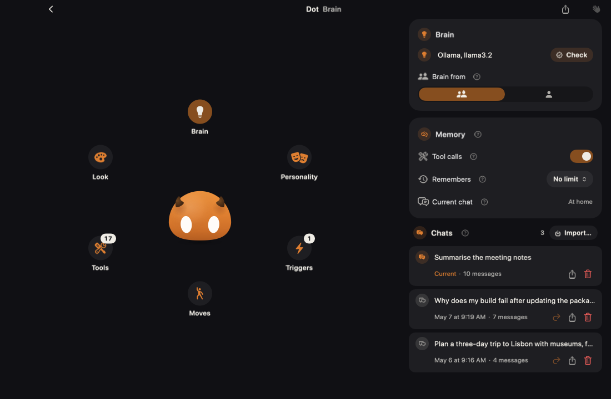
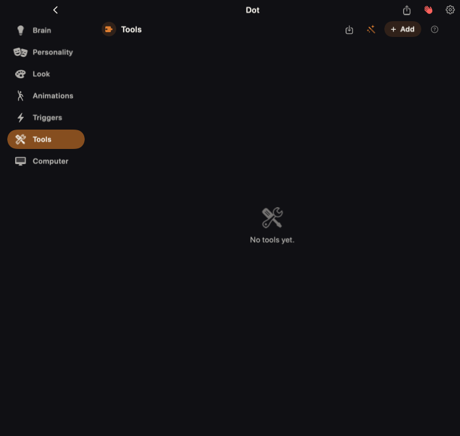
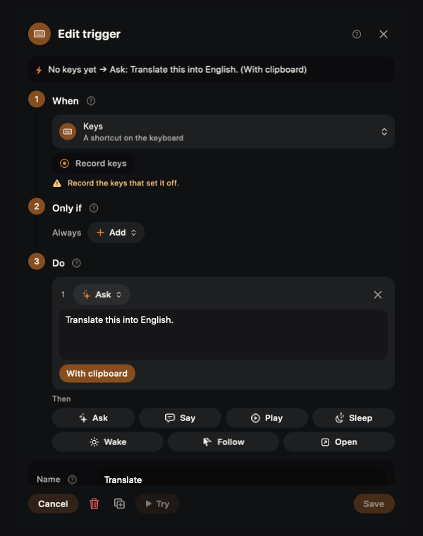
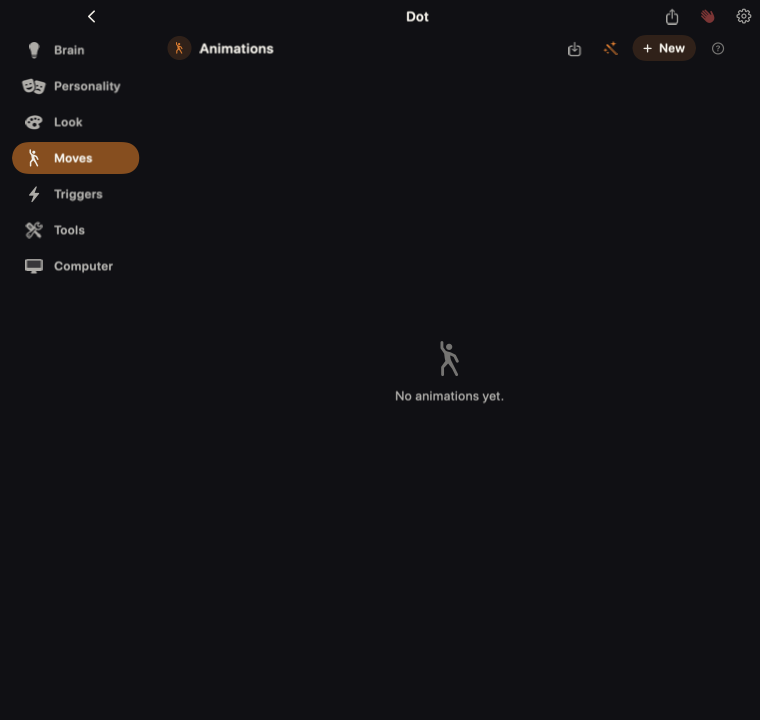

# Imp Settings

The settings of one Imp. They use the Pebble design language: one flat surface, soft fills without outlines and no dividers (see [Design](/design/)).

## Decision: the Imp in the middle

No tabs and no boxed blocks. The Imp is large in the centre. The settings sit around it as markers the user can tap:

| Place | Marker | Opens |
| --- | --- | --- |
| Above the head | Brain | The Brain panel. |
| Left | Look | Colour, size and character, with the live Imp as the preview. |
| Right | Personality | Name, persona and voice. |
| Lower left | Tools | The list of tools. |
| Lower right | Triggers | The list of triggers. |
| Below | Moves | The Imp's animations. |

### Markers

A marker is a round tile (the setting's icon) with a one-word title. It shows its state in a mark, not a sentence: the Brain lantern is lit or unlit, Tools and Triggers carry a small count. The full summary is the tooltip and what a screen reader says. The picked marker is filled with the Imp's colour.

### Layout

One top bar runs across the whole window and never moves: back, the Imp's name in the middle, then Share and Goodbye as icon buttons. Goodbye is at the far edge, apart from Share. The bar is the same with a panel open or closed, in a wide and in a narrow window. The only thing that changes in it is the name of the open panel, shown quietly after the Imp's name ("Dot Moves").

A marker opens its panel as a column under the bar. The panel has no header of its own: no second title and no help line above its cards. The bar names it, and beside the stage its marker is lit. It has no close button: Back is the only way out. The column has no fill and no outline: it is on the same flat surface as the stage, with no divider. Inside, the settings are cards, and each row has an icon and a "?" help. Hints live in the help of a card or a row, never as paragraphs.

A header over the panel that moved the name and the actions when the panel opened, and repeated the marker's word with a sentence of help, was rejected: the bar jumped, and the sentence said nothing the cards do not.

Opening, closing and switching are one motion. The stage shrinks by the panel width while the panel slides in, from a single state change. With Reduce Motion nothing slides: the panel fades and the stage re-centres at once.

| Window | Panel open |
| --- | --- |
| Wide (the panel fits beside the markers) | The panel sits beside the stage. |
| Medium, or the plain list | The panel takes the stage's place under the same bar. |

### Back

There is one Back, at the leading edge of the top bar. Two levels only (`ImpSettingsNavigation`): the main settings (markers or list) and one panel.

| Where | Back, Esc and the back swipe |
| --- | --- |
| In a panel | Return to the main settings. The stage comes back and focus goes to the marker that opened the panel. Never leave to home from a panel. |
| On the main settings | Go home. |

The bar stays when the panel covers the stage (a narrow window), so the same Back is in the same place and exactly one is on screen. What a panel pushes (a server, a trigger, an animation, adding a service, a chat) is a sheet with its own Close in its `SheetBar`, so Back inside a panel is always one level.

### Brain with no service

The Brain marker always opens its panel, never a modal. With no service at all the panel shows the two first-run steps in place (Service, Model) under the step indicator, with the Remote and Local choices at panel width. A failed check shows its error in place and keeps what was typed. When the Imp wakes the panel turns into the normal Brain panel. With services but none chosen, the panel shows the service list with one primary action. Only the very first launch uses the first-run window.

### Plain list

The list replaces the markers when the window is narrower than `narrowWindowPoints` (520 pt), when the phone uses accessibility text sizes, and when a screen reader is running. Each row is an icon tile, the title, one short value ("17/26", the model name, "Asleep") and a chevron. The order is Brain, Personality, Look, Tools, Triggers, Moves. Share and Goodbye stay in the top bar. Its name is `imp_settings.list.label`.

### Why

- The owner wants a fresh layout with no tabs. Markers around the Imp show that the settings are about this Imp.
- A mark on each marker means nobody needs to read a paragraph.
- A panel that is part of the window, not a box on top of it, feels like one screen.
- The plain list gives keyboard and screen reader users the same things in a calm order.

### Rejected

Tabs with boxed cards. It is the old design, and it hides the Imp. A side panel with its own colour and a summary under every marker. It split the screen in two and was too much to read. A radial menu that opens on hover. It cannot be used with a keyboard or on a phone.

## On the iPhone

One sheet holds the live Imp on top, then the hub and the open panel. The hub is the markers, or the plain list at accessibility text sizes and with VoiceOver. Back in a panel returns to the hub and Close dismisses the sheet. Hatch or Save is at the bottom of the hub. Every panel is the Mac's panel in phone controls, except Moves (Animations), which stays on the Mac.

The Brain panel of an Imp without a Brain runs the two first-run steps in place (Service, Model) with Remote and Local, and turns into the normal Brain panel when the Imp wakes. A sleeping Imp on the stage and "Give {name} a Brain" in its chat open the settings with the Brain panel already open. Keys are typed once and go to the Keychain.

## Scope: this Imp or every Imp

Triggers and made animations are either shared by every Imp or one Imp's own. These are the settings an Imp's page shows that are not only its own. Everything else on the page (look, personality, its Brain choice, which tools it may use, following) belongs to the Imp alone, and a server's or a service's own settings (address, key, model) are the app's, shown as such.

Each item has one of three scopes, and its row says which under its title, with a symbol:

| Scope | Under the title | Means |
| --- | --- | --- |
| Shared | `scope.every_imp` | Every Imp has it. This Imp uses it as it is (inherited). |
| Changed for this Imp | `scope.changed` | This Imp's own version of a shared one. The other Imps keep the shared one. |
| Only this Imp | `scope.only` | Only this Imp has it. |

**The rule.** A change made on an Imp's page is for that Imp alone, unless the person picks Every Imp. In the model an Imp's version of a shared item points at it (`overrides`). The shared item itself is never touched from one Imp's page.

| What the person does on an Imp's page | What happens |
| --- | --- |
| Edits or switches off a shared item | This Imp gets its own version (Changed for {name}). The shared one stays for every other Imp and for new Imps. |
| Picks "Just for {name}" on a shared trigger | The same: a version for this Imp. It is no longer taken from the other Imps. |
| Picks Every Imp in the editor, or "Share with Every Imp" | The change goes to the shared item. This Imp's version is written into it and goes. Other Imps' versions stay theirs. |
| "Use the shared one" on its version | Its version goes and the shared one applies to it again. |
| Deletes a shared trigger ("Delete for every Imp", asked first) | It goes for every Imp. Imps that had their own version keep it, as their own. |
| Edits another Imp's item | Never: the editor offers this Imp and Every Imp only. |

**New Imps.** A new Imp gets every shared trigger and animation, has nothing of its own, follows the default Brain, has its built-in tools at their defaults and no extra tools. It copies no other Imp.

**Running.** A shared trigger goes to the Imp you click, or else to the one you talked to last, unless that Imp has its own version: then its version runs instead, and a switched-off version means nothing runs for it.

## Look

One panel for Colour, Size and Character. They are sliders, with the live Imp as the preview. Reset, an icon in the Character card's header, restores the defaults.

Decision: only the whole Imp is shared in The Den. There is no separate Character to share. The Imp kit already carries the look, so one thing to understand is enough. Keys, memory and chats never travel.

Rejected: sharing a Character on its own. It would be a second thing to learn and to find.

## Personality

The name moves here, with the persona and the voice. The name is part of who the Imp is, not part of how it looks. An empty name shows `personality.name_empty` and is not saved.

## Brain

The Brain panel shows the status with Check (or Wake) at the trailing edge, then two choices: the same Brain as the other Imps, or its own. Its own means one service, picked from the services the app has or added with “Add a service”. The service's address, key and model are the ones the Imp uses. The panel shows no key or model fields. Memory is one card with three choices that decide how much of the chat goes to the Brain: **Sends** (the last 5 to 1,000 messages, or all), **Tool results** (on or off) and **New chat at** (the size, 50k to 1M, at which a gentle suggestion to recap or start a new chat appears). Each has a "?" help. All three belong to the Imp: there is no app-wide setting for them (the Long chats card on Talking is gone). The phone has no Memory settings. A pocket Imp sends a fixed number of messages and never suggests a new chat. Memory lists chats with a readable title (two lines), date and count, and Recap, Open and New Chat as clear buttons.

An Imp with no Brain sleeps. The Brain marker above its head is an unlit lantern. The Imp shows Zzz. The marker says `imp_settings.summary.brain_none`. It is not red and has no warning icon. Sleeping is a calm state, not a failure.

When the Brain works, the lantern lights and the Imp wakes (`brain.check_ok`).

A hosted model on our own server is not built. The Brain list is one generic list of services. A hosted service can later be one more entry, with no special path. For now a user brings a local model or their own key.

## Tools

One list. It comes from the core registry, with the registry IDs `own.<group>.<tool>` and `mcp.<server>.<tool>`. There is no second list.

- Each group has a switch and the line "n of m on" (`tools.group_count`). The Tools marker shows the number on.
- A group opens to its tools. Each tool has a switch.
- An MCP server is a group with a status dot: connected, starting, could not start.
- A tool that is off is never offered to the model.

Scope: every switch here is this Imp's own, so turning a tool or a group off changes no other Imp. An extra tool's setup (its command or address, and what it needs filled in) is shared by every Imp that uses it, and its editor says so (`tools.shared_setup`). Removing a tool from the library asks first and names every Imp.

Empty state: `tools.empty` and the button `tools.add`.

## Triggers

A trigger is shown as a sentence: "When {event}, {action}." Each has a switch and its scope under it (see [Scope](#scope-this-imp-or-every-imp)). Triggers run without a Brain, so they work even while the Imp sleeps. The list shows this Imp's own triggers first, then the shared ones it has no version of.

`triggers.add` opens the editor (`triggers.new`) directly, with the When and Do menus. The editor's For choice starts on `triggers.scope.just` for every trigger, shared ones included, so saving changes this Imp only. `scope.every_imp` sends the change to every Imp, and a line under the choice says what saving does (`triggers.scope.note_version`, `triggers.scope.note_every`).

The trailing action of a row follows its scope: an own trigger can be deleted (`triggers.delete`), a changed one goes back to the shared one (`triggers.use_shared`), and a shared one has no delete on its row. Its menu has `triggers.delete_every`, which asks first.

**The starter kit.** A fresh install starts with the triggers of the starter kit, shared by every Imp: one click opens the text box, two clicks open the settings, a quiet while puts the Imp to sleep and the cursor coming close wakes it. Nothing in the app makes triggers of its own: the kit is data (`spec/presets/starter-kit.json`), read and added by the same code as a kit from The Den or a file. It is added once, on the first launch. A starter trigger the person changes or deletes is never put back on its own. To get them again, `triggers.starter` (in the empty list, and in the kit menu of the panel) opens the usual kit review with the starter kit, where nothing is added before Add.

Empty state: `triggers.empty`, with `triggers.starter`.

## Moves

The animations the Imp plays: how it follows the cursor, and its own animations. Its own are new ones only it plays, and its own versions of built-in or shared ones (`scope.changed`). A version of a built-in animation has its own switch, for this Imp alone, and keeps the built-in one's starts. The animation editor's For choice offers Every Imp and this Imp only, and saving a shared animation for this Imp makes this Imp's version, as for triggers.

## Share and Goodbye

Share and Goodbye are actions, not settings. They are two small icon buttons in the top trailing corner, apart from each other. Goodbye is the one at the far edge, away from the other buttons. On the iPhone, where Close holds the trailing corner, Goodbye is the icon button in the leading corner of the sheet's bar while no panel is open (a panel puts Back there). It is never a big button at the bottom of the page.

Goodbye asks first. A destructive dialog names the Imp: `goodbye.title`. The safe button is `goodbye.cancel` and it is the default. The destructive one is `goodbye.confirm`.

Share opens a sheet (the note `share.note` is its ⓘ). The user can share it in The Den (if it is set up) or save it as a file.

## States

| State | What is shown |
| --- | --- |
| Imp asleep, no Brain | Zzz, an unlit lantern, `imp_settings.brain_marker.asleep` for a screen reader. |
| Imp awake | A lit lantern. The Brain summary names the service and model. |
| Brain being checked | `brain.checking`, the Imp stirs. |
| Brain check failed | An error from `error.brain.*`. See [States](/ux/states). |
| No tools | `tools.empty`. |
| MCP server not started | `tools.mcp_failed` and `error.tool_failed`. |
| No triggers | `triggers.empty`. |
| Name empty | `personality.name_empty`. |
| Share needs The Den | `share.den_needs_setup`. |

## Words

<!-- strings: imp_settings memory look personality brain tools triggers moves goodbye share scope -->
| Key | English |
| --- | --- |
| `brain.add_service` | Add |
| `brain.check_ok` | {name} is awake. |
| `brain.checking` | Checking… |
| `brain.choose` | Choose a service |
| `brain.choose_model` | Pick from the service's models |
| `brain.help.add_service` | Add a service |
| `brain.help.key` | A secret password that lets the Imp use this service. It stays on this Mac. |
| `brain.help.model` | The exact brain of the service. Bigger ones think better but are slower. |
| `brain.help.service` | Pick who does the thinking for this Imp. |
| `brain.help.source` | Use the Brain every Imp shares, or pick a different one just for this Imp. |
| `brain.hint` | A Brain is a service and a model. {name} thinks with it. |
| `brain.key` | Key |
| `brain.model` | Model |
| `brain.model_placeholder` | Model name |
| `brain.none` | No Brain yet |
| `brain.service` | Service |
| `brain.source` | Source |
| `brain.title` | Brain |
| `brain.unnamed` | Unnamed |
| `brain.use_app` | Shared |
| `brain.use_own` | Own |
| `brain.zzz` | Zzz, {name} is asleep |
| `goodbye.cancel` | Keep {name} |
| `goodbye.confirm` | Say goodbye |
| `goodbye.message` | Its look, Brain settings, tools, triggers and chats go with it. This can't be undone. |
| `goodbye.title` | Say goodbye to {name}? |
| `imp_settings.brain_marker.asleep` | {name} is asleep. Give it a Brain. |
| `imp_settings.brain_marker.awake` | Brain: {service}, {model} |
| `imp_settings.goodbye` | Goodbye |
| `imp_settings.goodbye.a11y` | Say goodbye to {name} |
| `imp_settings.list.label` | All settings for {name} |
| `imp_settings.marker.brain` | Brain |
| `imp_settings.marker.look` | Look |
| `imp_settings.marker.moves` | Moves |
| `imp_settings.marker.personality` | Personality |
| `imp_settings.marker.tools` | Tools |
| `imp_settings.marker.triggers` | Triggers |
| `imp_settings.share` | Share |
| `imp_settings.share.a11y` | Share {name} |
| `imp_settings.summary.brain_none` | Asleep |
| `imp_settings.summary.brain_set` | {service}, {model} |
| `imp_settings.summary.look` | Colour and size |
| `imp_settings.summary.moves` | Animations |
| `imp_settings.summary.personality` | Name and voice |
| `imp_settings.summary.tools` | {on} of {total} on |
| `imp_settings.summary.triggers` | one: {count} trigger / other: {count} triggers |
| `imp_settings.this_imp` | this Imp |
| `imp_settings.value.asleep` | Asleep |
| `imp_settings.value.tools` | {on}/{total} |
| `look.body` | Body |
| `look.brows` | Brows |
| `look.character` | Character |
| `look.character_hint` | Small traits that change how {name} moves and looks around. |
| `look.cheeks` | Cheeks |
| `look.colour` | Colour |
| `look.eyes` | Eyes |
| `look.favourite` | Favourite |
| `look.head` | Head |
| `look.help.body` | Pick the colour and the size of this Imp. |
| `look.help.brows` | Tilt the eyebrows. One way looks cross, the other looks sad. |
| `look.help.character` | Small touches that change the face and the way it moves. |
| `look.help.cheeks` | How rosy the cheeks are. |
| `look.help.colour` | The colour of this Imp. Drag along the strip to change it. |
| `look.help.eyes` | Make the eyes smaller or bigger. |
| `look.help.head` | Tilt the head to one side or the other. |
| `look.help.horns` | Turn the horns up or down. |
| `look.help.lids` | How closed the eyelids are. More makes it look sleepy. |
| `look.help.pace` | How quickly it does everything. 1.0 is normal. |
| `look.help.size` | How big this Imp is on your screen. |
| `look.help.squint` | Squeeze the eyes tight, or open them wide. |
| `look.horns` | Horns |
| `look.lids` | Lids |
| `look.pace` | Pace |
| `look.preview` | Preview |
| `look.reset` | Reset |
| `look.size` | Size |
| `look.squint` | Squint |
| `look.swatch` | Colour {index} of {count} |
| `look.title` | Look |
| `memory.last` | Last {count} |
| `memory.new_chat.info` | How big a chat gets before the Imp suggests a recap or a new chat. |
| `memory.new_chat.title` | New chat at |
| `memory.no_limit` | All |
| `memory.sends.info` | How many of the latest messages go to the Brain with each one. Fewer is faster and cheaper. |
| `memory.sends.title` | Sends |
| `memory.size.k` | {count}k |
| `memory.size.m` | {count}M |
| `memory.tools.info` | Also sends what the tools did and returned. Off is smaller and cheaper. |
| `memory.tools.title` | Tool results |
| `moves.builtin` | Moves |
| `moves.change` | Change |
| `moves.empty` | No special moves yet. |
| `moves.follow_how` | Follow |
| `moves.help.builtin` | Pick one of the moves every Imp has and make a version only for this Imp. |
| `moves.help.follow` | Choose what this Imp does when you move your mouse pointer: stay still, look at it, or run after it. |
| `moves.help.follow_how` | Off: it stays still. Eyes: only its eyes look at the pointer. Hop: it jumps after the pointer. Glide: it slides after the pointer. |
| `moves.help.own` | Moves made for only this Imp. They play instead of the shared ones. |
| `moves.help.speed` | How fast it goes after the pointer. Only for Hop and Glide. |
| `moves.title` | Moves |
| `personality.help.name` | What you call this Imp. Say its name and it answers. |
| `personality.help.persona` | Tell it who to be, like a kind pirate or a quiet helper. It will talk that way. |
| `personality.help.rules` | The hidden rules that tell it how to answer. Most people never change them. |
| `personality.help.voice` | What shows on your screen while this Imp talks out loud. |
| `personality.help.voice_look` | Pick the picture shown while it talks: Glow is a glowing edge, Smoke is a puff of smoke, Both shows the two, Players is a small player with play and pause. |
| `personality.name` | Name |
| `personality.name_empty` | Give your Imp a name. |
| `personality.name_hint` | Part of who {name} is. You can change it any time. |
| `personality.persona` | Persona |
| `personality.persona_hint` | Tell {name} who it is and how it talks. |
| `personality.rules.builtin` | Built-in |
| `personality.rules.edit` | Edit… |
| `personality.rules.own` | Your own |
| `personality.title` | Personality |
| `personality.voice` | Voice |
| `personality.voice_look` | Shows as |
| `scope.changed` | Changed for {name} |
| `scope.every_imp` | Every Imp |
| `scope.only` | Only {name} |
| `share.den` | Den |
| `share.den_needs_setup` | Set up The Den to share there. |
| `share.file` | File |
| `share.note` | Its look, personality, tools and triggers are shared. Keys, memory and chats never are. |
| `share.title` | Share {name} |
| `tools.add` | Add |
| `tools.built_in` | Built in |
| `tools.collapse` | Hide the tools in {group} |
| `tools.empty` | No tools yet. Add some from a kit or an MCP server. |
| `tools.expand` | Show the tools in {group} |
| `tools.group_count` | {on} of {total} on |
| `tools.group_off` | Off |
| `tools.group_switch` | {group} tools |
| `tools.header_add` | Add |
| `tools.header_name` | Name |
| `tools.header_saved` | Saved |
| `tools.header_value` | Value |
| `tools.headers` | Headers |
| `tools.help.browser` | Lets the Imp look at pages and use the browser you opened for it. |
| `tools.help.built_in` | Things the Imp can already do, like look at your screen. Switch off any it should not use. |
| `tools.help.mcp` | Extra tools added from outside. Each one gives the Imp new things to do. |
| `tools.help.server` | A program or website that gives the Imp more tools. |
| `tools.mcp` | MCP |
| `tools.mcp_connected` | Connected |
| `tools.mcp_failed` | Could not start |
| `tools.mcp_starting` | Starting |
| `tools.new_server` | New |
| `tools.optional` | Optional |
| `tools.problem.address` | Add the server's address. |
| `tools.remove_header` | Remove header |
| `tools.remove_server` | Remove server |
| `tools.remove_server.message` | The Imp loses the tools of this server. |
| `tools.server_name` | Name |
| `tools.shared_setup` | Every Imp that uses this tool gets this setup. Each Imp switches it on or off for itself. |
| `tools.title` | Tools |
| `triggers.add` | Add |
| `triggers.delete` | Delete trigger |
| `triggers.delete_every` | Delete for every Imp |
| `triggers.delete_every.title` | Delete “{name}” for every Imp? |
| `triggers.edit` | Edit trigger |
| `triggers.empty` | No triggers yet. Add one and {name} acts on its own. |
| `triggers.help.do` | What the Imp does when it goes off. |
| `triggers.help.for` | Which Imp does the job. A change here is for this Imp alone unless you pick Every Imp. |
| `triggers.help.input` | What the Imp gets to look at when it goes off, like the clipboard. |
| `triggers.help.instruction` | Tell the Imp in your own words what to do. |
| `triggers.help.list` | A trigger wakes the Imp up by itself when something happens, like a time or a low battery. |
| `triggers.help.name` | A name so you can find it again. |
| `triggers.help.starter` | The triggers Imp comes with: clicks, falling asleep and waking up. You see them before anything is added. |
| `triggers.help.when` | What has to happen to set it off, like a time, an app or a low battery. |
| `triggers.instruction` | Task |
| `triggers.just_for` | Just for {name} |
| `triggers.new` | New |
| `triggers.scope.just` | Just {name} |
| `triggers.scope.note_every` | Changes it for every Imp. |
| `triggers.scope.note_version` | Saves a version for {name} only. The other Imps keep the shared one. |
| `triggers.sentence` | When {event}, {action}. |
| `triggers.share_every` | Share to all |
| `triggers.starter` | Starter kit |
| `triggers.switch` | Trigger: {sentence} |
| `triggers.title` | Triggers |
| `triggers.use_shared` | Use shared |
| `triggers.use_shared.message` | The version only {name} has goes. |
| `triggers.use_shared.title` | Use the shared “{name}” again? |
<!-- /strings -->

## Opening a setting from a chat

An Imp can open the exact page of one of its own settings, or of another Imp's, with `imp_open_settings` (`setting` such as `look_colour`, or `page` such as `look`. `imp` names another Imp, `tool` an extra tool to edit). It cannot change the value, because the person fills it in. The setting is lit softly in the Imp's colour for about 1.5 seconds and the page scrolls to it. Links: `imp://settings?setting=look_colour&imp=Pip` and `imp://settings?page=tools`. The marker or list row of the page is picked, and the row is highlighted briefly (with no motion under Reduce Motion).
