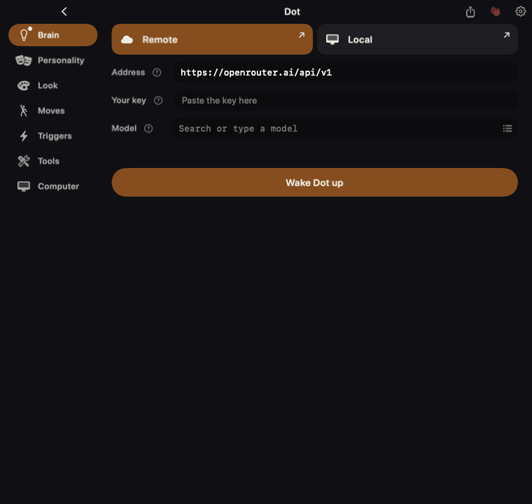

# Imps

How an Imp moves and answers the pointer. This is the same inside the window and on the desktop.

## Moving, letting out and sending home

### Decision

On desktop an Imp in the window is a view. The user drags it with the pointer. In the window the Imp follows the pointer exactly, held by the same spot all along. It is not stopped at the canvas edge. As soon as the Imp's own frame would cross the edge of the window, it is handed to a small borderless window that appears exactly where the Imp was drawn, and the same drag goes on in it. The copy in the window goes away at the same moment. There is no gap and no jump. The Imp is now free on the desktop. This is "Let out".

A free Imp let go with the pointer over the app window goes home into the window again, and lands exactly where it was drawn, under the same grab. This is "Send home". If it would be partly outside the canvas, it settles just inside.

An Imp put down inside the window settles inside the canvas (a small margin, and room for its name below).

The two actions are also in the Imp's context menu, with the same words.

### Is it reliable?

- **macOS.** Yes. The handover happens while the drag goes on, so the hand never lets go. A borderless panel can follow the pointer anywhere on the screen.
- **Windows.** Yes, with the same technique: a borderless, topmost, layered window.
- **Linux on X11.** Yes, the same technique.
- **Linux on Wayland.** No. A Wayland app cannot place a window or follow the pointer outside its own window. Imps stay in the window and "Let out" is not offered. The context menu says so with `imp.let_out.unavailable`.
- **iPhone and Android.** There is no free Imp outside the app. Imps stay in the app and "Let out" is not offered.

### An accidental drop

Letting out and sending home are quick and can be reversed, so there is no question. An Undo bar shows for `undoBarSeconds` (6 s) with the text `imp.out.undo` or `imp.home.undo`. Undo puts the Imp back where it was. This matches the transfer rules: ask first when the choice matters, offer Undo when it is quick and safe.

### Why

A drag is something people already try. It is easy to understand. The cost of a wrong drop is low.

### Rejected

A confirmation dialog on every drop. It would remove the feeling of picking the Imp up. A separate "pin" mode. It would be one more thing to learn.

## Clicks

| Action | Result |
| --- | --- |
| One click, or one tap | Opens the Imp's message bubble (on the phone, its chat) at once. |
| Two clicks (Mac) | Run the Imp's triggers for two clicks. The starter kit's "Settings" trigger opens the Imp's settings. |
| Right click, or touch and hold | Opens the Imp's context menu. |
| Drag | Moves the Imp. |

There is no double click setting. Two or more clicks are Triggers ("2 clicks on the Imp"), so they can open the settings, talk, run a prompt or anything else, per Imp or for every Imp. A first click waits for a second only when some trigger of that Imp answers to two or more clicks. Without one, a click opens the bubble with no delay. The phone has no double tap: a tap opens the chat at once, and the touch-and-hold menu has Settings. There is no settings button on the Imp.

Clicks behave the same whether the Imp is free or in the window.

## Selection

The selected Imp (the one a click or the keyboard last chose, and the one the menu bar acts on) has no border. It shows two things, in its own colour, on every platform and without hover:

- the floor under it glows more (`Opacity.glow`, against a faint glow for the others);
- its name sits in a capsule tinted with its colour (the others have a plain name on a dark scrim).

Keyboard focus is shown apart, with the focus ring (`focusRing`), and only when focus came from the keyboard (Tab or the arrow keys), never from a click. Moving between states is animated, and with Reduce Motion it just happens.

## On the iPhone

Everything about one Imp is one sheet (see [The room never leaves](/design/room)).

- **The bar.** The Imp's name and one line of state on the leading side. Then Talks with other Imps (only when there are some), New Chat, Settings (only for an Imp hatched on this iPhone) and Close. The Imp's small portrait is in the bar only when the sheet covers the room. At half height the Imp itself is in the room above.
- **Talks are a side room.** The sheet is the chat with you. What the Imp said with other Imps is rarely needed, so its button shows in the bar only when the Imp has talks: it opens them in the same sheet, with Back in the bar to return to the chat. It lists the Imps it talked with, and a tap opens one conversation in place. An Imp with no talks shows `phone.talks.empty`.
- **Colour.** The sheet wears the Imp's colour: what you said, the send button, the switch and the selected side. Text on the colour follows the white or black choice in Settings.
- **Close.** Returns to the room. Settings opened from here returns here.

An Imp on the iPhone is one VoiceOver element named after the Imp, with the same actions as its touch and hold menu. While its menu is opening, its bubble and name tag are dismissed so nothing stays behind the lifted preview. See [Main screen](/ux/main-screen).

## The phone icon

When an Imp is on a phone, a small phone glyph follows its name. It has a tooltip and a screen reader label: `imp.phone.label` ("On {device}", with the device's name).

| Platform | Glyph |
| --- | --- |
| Apple | SF Symbol `iphone` |
| Android | Material Symbols `smartphone` |
| Windows | Fluent `Phone` |
| Linux | `phone-symbolic` |
| Browser extension | A small drawn phone |

The Imp itself is never drawn holding a phone.

## Hidden Imps and peeking

### Decision

A hidden Imp does not leave a blank spot. It peeks out from the floor, the bottom edge of the window, shyly, and goes back out of sight. A click on the peeking Imp brings it back.

- **Which edge.** The bottom. It is the floor of the window, and it works in every window size.
- **How often.** One Imp at a time. A random wait of `peekIntervalMinSeconds` to `peekIntervalMaxSeconds` (45 to 90 s).
- **How long.** The Imp stays visible for `peekShowSeconds` (1.5 s).
- **What triggers it.** Only while the window is visible and the user has not typed for `peekQuietSeconds` (10 s).
- **Reduce Motion.** The Imp fades in at the edge instead of sliding.
- **Phone.** The same peek, on the main screen.

### Keyboard and screen readers

A peek that you can only see with your eyes and only click with a mouse would shut people out. So there is always a Hidden Imps element on the floor. It is focusable, it names how many are hidden (`home.hidden.title`), and it has one action for each Imp: "Bring back {name}" (`home.hidden.bring_back`). When an Imp peeks, a screen reader announces `home.hidden.peek`. The same actions are in the canvas menu (`menu.canvas.show_hidden` brings all of them back).

### Why

A blank spot looks like a bug. A peek says "I am still here". It is friendly, and it gives a way back that needs no menu.

### Rejected

Showing hidden Imps as small icons along an edge. It looks like a toolbar and it adds clutter. Showing nothing and making the user open a menu. A hidden Imp would be forgotten.

## States of an Imp

| State | Key | What the user sees |
| --- | --- | --- |
| Awake | `imp.state.awake` | The Imp is lively and answers. |
| Asleep | `imp.state.asleep` | Eyes closed, Zzz. See [States](/ux/states). |
| Waking | `imp.state.waking` | The Imp stirs. |
| Out on the desktop | `imp.state.out` | A free Imp, on the desktop only. |
| Hidden | `imp.state.hidden` | Not on the canvas. It peeks now and then. |
| Visiting | `imp.state.visiting` | An Imp whose home is another device. |
| Away | `imp.state.away` | An Imp that went to visit another device. |

A screen reader reads an Imp as its name and state (`imp.a11y.label`) and offers these actions: talk, open settings, hide, let out, send home.

## Words

<!-- strings: imp -->
| Key | English |
| --- | --- |
| `imp.a11y.hide` | Hide {name} |
| `imp.a11y.label` | {name}, {state} |
| `imp.a11y.let_out` | Let {name} out |
| `imp.a11y.send_home` | Send {name} home |
| `imp.a11y.settings` | Open {name}'s settings |
| `imp.a11y.talk` | Talk to {name} |
| `imp.drag.hint` | Drag to move it. |
| `imp.drag.out_hint` | Drag it out of the window to let it out. |
| `imp.hide.undo` | {name} is hidden. |
| `imp.home.undo` | {name} is back home. |
| `imp.let_out.unavailable` | This desktop does not let apps place free windows, so Imps stay in the window. |
| `imp.out.undo` | {name} is out on the desktop. |
| `imp.phone.label` | On {device} |
| `imp.sent.undo` | {name} is on {device}. |
| `imp.state.asleep` | Asleep |
| `imp.state.awake` | Awake |
| `imp.state.away` | Away on {device} |
| `imp.state.hidden` | Hidden |
| `imp.state.out` | Out on the desktop |
| `imp.state.visiting` | Visiting from {device} |
| `imp.state.waking` | Waking up |
| `imp.transfer.failed` | {device} did not take {name}. It stays here. |
<!-- /strings -->
