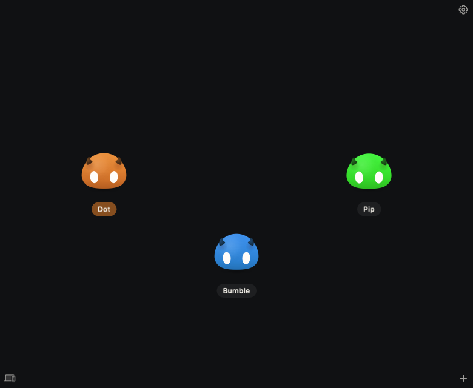
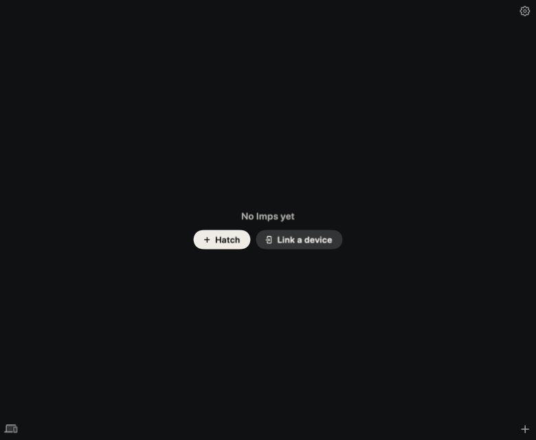

# Main screen

## Decision

On desktop the main screen is the same calm canvas as on the iPhone. The Imps move on it freely. The whole window is the canvas.

- **The corners around the window's own buttons.** The window's close, minimise and zoom buttons hold one top corner. The canvas's buttons take the other three, so nothing crowds them: Settings in the other top corner, New Imp below it, and Devices below the window's buttons. On macOS (window buttons top left) that is Settings top right, New Imp bottom right and Devices bottom left. Where the window buttons are top right (Windows), everything mirrors: Settings top left, New Imp bottom left and Devices bottom right. Corners are physical, not leading and trailing, because the system keeps its buttons where they are in any language. Show hidden Imps sits beside New Imp, on its inner side, only while some Imps are hidden, and it shows how many. Devices opens the Devices settings and wears a small green dot while a linked device is connected. Each button is one click, each has a tooltip and a spoken label. There is no "more" menu: a menu that only opens more buttons costs a click for nothing. The rule is `HomeCorners`.
- **Settings, not the canvas, holds the choices.** The background is in Settings, as a one-click control.
- **Empty canvas.** When there are no Imps, a short prompt sits in the middle: a title, a hint and one New button. It is an empty state. It goes away as soon as there is an Imp. It is never a permanent button.

## Why

- The iPhone screen is already clean and people like it. Desktop gets the same picture, so one idea works everywhere.
- A canvas with no buttons leaves room for the Imps. The Imps are the interface.
- Each action people need always has its own corner, the same one every time, away from the window's buttons. A corner is the easiest place to hit with a pointer. Right click does the same on desktop. Touch and hold does the same on a phone.
- Desktop windows can be small. One or two small icons per corner cover almost no canvas.

## Rejected

A toolbar along the edge, and a "more" menu with a nested Background menu. It adds clutter, it differs between platforms, and it would be the first thing people see instead of the Imps.

## The window

| Platform | Window |
| --- | --- |
| macOS | Full-size content view. The title bar is transparent and has no text. The close, minimize and full screen buttons stay. A strip along the top (`dragStripPoints`, 28 pt) drags the window. Empty canvas does not drag the window. |
| Windows | The content extends into the title bar. The material is Mica. The system caption buttons stay. |
| Linux | A flat, transparent header bar over the canvas (libadwaita toolbar view). The desktop's own button layout stays. |
| iPhone and Android | Full screen. The system bars stay. |

The window background is the canvas. Nothing is drawn around it.

## Background

The canvas (the room on the iPhone) shows one HTML document behind the Imps. There is no setting for it: you ask any Imp ("float some clouds by", "a starry sky", "a poker room with a seat for each of us") and it writes the page with `imp_set_background`. `imp_show_background` gives it the page that is there now, to change rather than start over. The default is one plain colour, the app surface in light and in dark (`RoomBackground.defaultHTML`), so there is always a page to start from. File › Reset Background (`menu.canvas.reset_background`) puts it back.

The page is drawn full-window under every Imp in a web view of its own (`HTMLBackdrop`). A web view is a process of its own (tens of megabytes), and a moving page keeps a core busy, so it lives only while it has to:

| Page | What runs |
| --- | --- |
| The plain one | Nothing: the app surface under it already looks the same. |
| A still one (a starry sky with no motion) | It is loaded once, kept as a picture, and its web view closes. It is drawn again only for a new page, a new window size (once the resize stops) or a change between light and dark. |
| A moving one (clouds drifting) | Its web view plays it while the canvas is on screen and the app can be seen. On a settings screen, in a hidden window, in the background on the iPhone, in Low Power Mode or with Reduce Motion, the last picture stands still in its place and the web view closes. Its scripts get 30 frames a second. |

A page counts as moving when it has CSS animations or transitions, or when two pictures of it taken 0.7 seconds apart differ. It is never clicked, scrolled or focused, VoiceOver skips it, it keeps nothing between launches, opens no windows, cannot navigate away from itself and plays no sound by itself. It may load pictures and fonts from the web. It may be at most 256 KB. The plain surface shows until it has drawn. Settings screens, sheets and the Imp's settings sit on the plain app surface whatever the page shows, so text is always easy to read.

The background is the device's: the Mac's Imps share the canvas on the Mac, and the iPhone's Imps share the room on the iPhone. Both tools are in each Imp's Look section (behind the wand), so an Imp that should not change it can have them switched off.

## Efficiency

Nothing on the canvas animates for decoration unless an Imp writes a background that does. The web view honours Reduce Motion (`prefers-reduced-motion`) and is throttled while the window is hidden. Loops pause when the window is hidden, when an Imp is still, with Reduce Motion and in Low Power Mode.

## Menus

Right click on empty space (or touch and hold on a phone). One level, no submenus:

1. New Imp (`menu.canvas.new_imp`, Command N)
2. Hidden (n) (`menu.canvas.show_hidden`), only when some are hidden. The number is how many
3. Settings (`menu.canvas.settings`, Command comma)

The background choices are not in this menu. They are one click away in Settings, so the right click stays short. The corner buttons do the same as these items.

Right click on an Imp in the window (or touch and hold on a phone), also one level:

1. Settings (`menu.imp.settings`, Command I)
2. Hide (`menu.imp.hide`)
3. Copy kit (`menu.imp.copy_kit`) and Copy link (`menu.imp.copy_link`), desktop only. Copy link is off when no link can be made
4. Let out or Send home (`menu.imp.let_out`, `menu.imp.send_home`)
5. Goodbye (`menu.imp.goodbye`), last and apart. It asks first. It is off when there is only one Imp

The Imp in its own window on the desktop has a longer menu:

1. Chat, and Settings (`menu.imp.settings`)
2. Triggers, Colour and Size
3. Hide (`menu.imp.hide`)
4. Visit {name} (`menu.imp.send_to`), one item for each linked device. Without a linked device it shows Visit another device (`menu.imp.visit_none`)
5. Send home (`menu.imp.send_home`)

Move to {name} (`menu.imp.move_to`) is in the phone's menu only. It is for an Imp hatched on the phone.

There is no Talk in this menu: a click or tap already opens the chat. The Imp's talks with other Imps are an icon in its chat's bar (`menu.imp.talks`), shown only when there are some.

The items are the same on every platform. Each platform shows them in its own menu style and with its own shortcuts. See [Platforms](/ux/platforms).

### On the iPhone

- **One top bar.** Safe-area aware, `Spacing.page` on both sides. On the leading side the connection pill: dots, one or two words (`phone.status.*`), cut in the middle when long, never clipped. On the trailing side are icon buttons, one tap each, with no menu: New Imp (`plus`), Hidden (`eye`, only while some Imps are hidden, with how many) and Settings (`gearshape`). A tap on the pill opens Devices.
- **Names and bubbles.** Name tags are a `Tone.scrim` capsule with `Tone.paper` text, one line, cut in the middle. Bubbles stay inside the safe area with `Spacing.page` margins and never sit on another bubble. A sleeping Imp is dimmed and has no words over it.
- **During a game** the top bar, speech bubbles, thinking dots and name tags are all hidden, and they come back when the game ends. A bubble that arrives meanwhile is held by the hub and shows afterwards, unless its own timer ran out.
- **The edges of the room.** A free Imp bounces off the sides and the bottom of the screen when its body touches them, not its frame or its name: the name under it may pass the bottom edge for a moment.
- **A sheet over the room.** A tap on an Imp opens its sheet at half height. The room stays alive above it: the Imp flies up into the free room and waits there in its glow, and every Imp can still be touched, carried and thrown. A tap on another Imp turns the sheet into that Imp's. Talk bubbles stay in the room you can see: over the talker's head, or under it or beside it when there is no room above, never under the top bar, the home indicator or a half sheet, and never over another bubble. A bubble, the thinking dots and the name tag keep the same distance from an Imp whatever its size, measured from its drawing (its horns, its base), not from its square. Pulled up, or lifted by the keyboard, the sheet covers the room and the room rests, and the sheet's bar shows the Imp instead. With Reduce Motion the Imp is not moved. See [The room never leaves](/design/room).
- **One sheet, always the same.** There is one sheet over the room, whatever it shows (an Imp's chat, the settings, an Imp's settings, its Brain), and it looks and behaves the same however it was reached: from the room or from inside another sheet. It always has its grab bar. Going from one thing to another (Settings while a chat is open, a tap on an Imp while Settings is open) changes the sheet's content in place and never puts it away to bring another. Something new starts at half height when it can rest there (a chat, the settings, an Imp's settings, where the Imp in the room above is the live preview of its look) and at full height only when it needs the screen (waking the first Imp). Going from one Imp's chat to another's keeps the height.
- **Touch and hold on an Imp.** Its bubble and name tag go away the moment the press is recognised, the phone gives one tick, and the Imp's menu comes up from the bottom under its name. Moving the finger drags the Imp instead. The items are icon first and short: Talk, Talks, Imp Settings, Hide, Send to a device, Move to a Mac, then Send home or Goodbye last with the destructive style. Every item is also a VoiceOver action on the Imp.

### The bar menu

The menu bar extra opens a compact panel on the app surface. At the top are four buttons, each an icon over a label: Imps, Show or Hide, Settings and Quit. Below them each Imp is a pebble with its face, its name and a state word. One click hides or shows an Imp that is out, or opens one that is at home. Everything else lives in the window and in each Imp's own menu.

## States

| State | What the screen shows |
| --- | --- |
| Empty, no Imps | The prompt `home.empty.title`, `home.empty.hint` and the button `home.empty.new_imp`. |
| Some Imps | The canvas with the Imps and the corner buttons. |
| Hidden Imps | The floor has a Hidden Imps element (`home.hidden.title`). See [Imps](/ux/imps). |
| An Imp sleeping | The Imp shows Zzz. See [States](/ux/states). |
| Offline | A quiet bar over the canvas. See [States](/ux/states). |

## Words

<!-- strings: home menu background -->
| Key | English |
| --- | --- |
| `home.canvas.hint` | Imps move around here. Press Tab to go from one Imp to the next. |
| `home.canvas.label` | The Imps' home |
| `home.corner.devices` | Devices |
| `home.corner.devices.connected` | one: {count} connected / other: {count} connected |
| `home.corner.show_hidden` | Hidden |
| `home.empty.hint` | Hatch your first Imp to get started. |
| `home.empty.new_imp` | New |
| `home.empty.title` | No Imps yet |
| `home.hidden.bring_back` | Bring back {name} |
| `home.hidden.empty` | No hidden Imps |
| `home.hidden.hint` | Hidden Imps peek out now and then. Click one to bring it back. |
| `home.hidden.peek` | {name} is peeking out from the floor. |
| `home.hidden.title` | Hidden ({count}) |
| `home.tray.quit` | Quit |
| `home.tray.show` | Open |
| `menu.bar.hide` | Hide |
| `menu.bar.hide_help` | Hide the Imps on your desktop |
| `menu.bar.imps` | Imps |
| `menu.bar.imps_help` | Open the Imps' home |
| `menu.bar.none_out_help` | No Imps are out on the desktop |
| `menu.bar.quit` | Quit |
| `menu.bar.quit_help` | Quit Imp |
| `menu.bar.settings` | Settings |
| `menu.bar.settings_help` | Settings for all Imps |
| `menu.bar.show` | Show |
| `menu.bar.show_help` | Show the Imps again |
| `menu.bar.state.hidden` | Hidden |
| `menu.bar.state.home` | At home |
| `menu.bar.state.out` | Out |
| `menu.canvas.devices` | Devices |
| `menu.canvas.new_imp` | New Imp |
| `menu.canvas.reset_background` | Reset Background |
| `menu.canvas.settings` | Settings |
| `menu.canvas.show_hidden` | Hidden ({count}) |
| `menu.imp.call_home` | Call Home |
| `menu.imp.call_home_ask` | Call Home… |
| `menu.imp.copy_kit` | Copy kit |
| `menu.imp.copy_link` | Copy link |
| `menu.imp.goodbye` | Goodbye |
| `menu.imp.hide` | Hide |
| `menu.imp.let_out` | Let out |
| `menu.imp.move_tip` | {name} lives on {device} from now on. |
| `menu.imp.move_to` | Move to {name} |
| `menu.imp.send_home` | Send home |
| `menu.imp.send_to` | Visit {name} |
| `menu.imp.settings` | Settings |
| `menu.imp.share` | Share |
| `menu.imp.talk` | Talk |
| `menu.imp.talk_help` | Talk to {name} |
| `menu.imp.talks` | Talks |
| `menu.imp.type` | Type |
| `menu.imp.type_help` | Type to {name} |
| `menu.imp.visit_none` | Visit another device |
| `menu.imp.visit_tip` | {name} visits {device} and can come back. |
<!-- /strings -->
