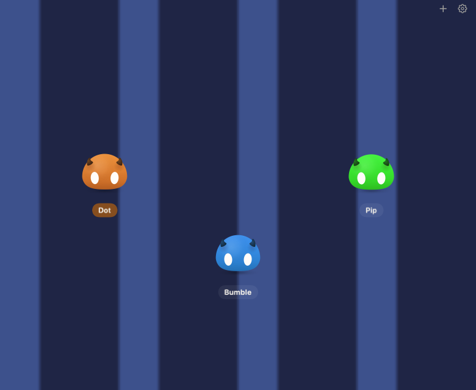
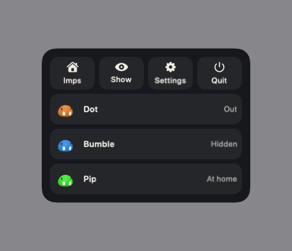

# Main screen

## Decision

On desktop the main screen is the same calm canvas as on the iPhone. The Imps move on it freely. The whole window is the canvas.

- **A few corner buttons.** A small row of icon buttons sits in the top trailing corner of the window frame: New Imp, Show hidden Imps and Settings. Each is one click, each has a tooltip and a spoken label. Show hidden Imps appears only while some Imps are hidden, and it shows how many. There is no "more" menu: a menu that only opens more buttons costs a click for nothing.
- **Settings, not the canvas, holds the choices.** The background is in Settings, as a one-click control.
- **Empty canvas.** When there are no Imps, one inline prompt "New Imp" sits in the middle. It is an empty state. It goes away as soon as there is an Imp. It is never a permanent button.

## Why

- The iPhone screen is already clean and people like it. Desktop gets the same picture, so one idea works everywhere.
- A canvas with no buttons leaves room for the Imps. The Imps are the interface.
- The three actions people need are always in the same corner. Right click does the same on desktop. Touch and hold does the same on a phone.
- Desktop windows can be small. Three small icons in a corner cover almost no canvas.

## Rejected

A toolbar along the edge, and a "more" menu with a nested Background menu. It adds clutter, it differs between platforms, and it would be the first thing people see instead of the Imps.

## The window

| Platform | Window |
| --- | --- |
| macOS | Full-size content view. The title bar is transparent and has no text. The close, minimize and full screen buttons stay. A strip along the top (`dragStripPoints`, 28 pt) drags the window. Empty canvas does not drag the window. |
| Windows | The content extends into the title bar. The material is Mica. The system caption buttons stay. |
| Linux | A flat, transparent header bar over the canvas (libadwaita toolbar view). The desktop's own button layout stays. |
| iPhone and Android | Full screen. The system bars stay. |

The window background is the canvas. Nothing is drawn around it.

## Background

The user can change the background in Settings, App. The canvas shows the chosen background. Settings screens, sheets and the Imp's settings always sit on the plain app surface, whatever the canvas shows, so text is always easy to read. The choices:

| Choice | What it does |
| --- | --- |
| Theme | The flat app surface. This is the default. |
| Colour | One colour. |
| Picture | One picture that fills the window. |
| Tile | A seamless pattern that repeats. |

Picture and Tile come from a file the user picks. The app copies the file into its own storage, so moving the original does not break the background. A file that cannot be used shows `background.picture_failed` and keeps the old background.

## Efficiency

Nothing on the canvas animates for decoration. There are no floating sparks and no setting for them. Loops pause when the window is hidden, when an Imp is still, with Reduce Motion and in Low Power Mode.

## Menus

Right click on empty space (or touch and hold on a phone). One level, no submenus:

1. New Imp (`menu.canvas.new_imp`, Command N)
2. Show hidden Imps (n) (`menu.canvas.show_hidden`), only when some are hidden
3. Settings (`menu.canvas.settings`, Command comma)

The background choices are not in this menu. They are one click away in Settings, so the right click stays short. The corner buttons do the same as these items.

Right click on an Imp (or touch and hold on a phone), also one level:

1. Talk (`menu.imp.talk`)
2. Imp Settings (`menu.imp.settings`)
3. Let out or Send home (`menu.imp.let_out`, `menu.imp.send_home`), desktop only
4. Hide (`menu.imp.hide`)
5. Copy kit (`menu.imp.copy_kit`)
6. Copy link (`menu.imp.copy_link`), off when the kit is too long for a link
7. Goodbye (`menu.imp.goodbye`), last and apart, and it asks first

The items are the same on every platform. Each platform shows them in its own menu style and with its own shortcuts. See [Platforms](/ux/platforms).

### On the iPhone

- **One top bar.** Safe-area aware, `Spacing.page` on both sides. On the leading side the connection pill: dots, one or two words (`phone.status.*`), cut in the middle when long, never clipped. On the trailing side ONE plain `ellipsis` icon button with a 44 pt target and no background. It opens a native menu with icons first: New Imp, Devices, Show hidden Imps (only when some are hidden), Settings. A tap on the pill also opens Devices.
- **Names and bubbles.** Name tags are a `Tone.scrim` capsule with `Tone.paper` text, one line, cut in the middle. Bubbles stay inside the safe area with `Spacing.page` margins and never sit on another bubble. A sleeping Imp shows one word (`phone.stage.asleep`), not a sentence.
- **During a game** the top bar, speech bubbles, thinking dots and name tags are all hidden, and they come back when the game ends. A bubble that arrives meanwhile is held by the hub and shows afterwards, unless its own timer ran out.
- **Touch and hold on an Imp.** Its bubble and name tag go away the moment the press is recognised, then the system menu lifts the Imp alone (a round preview, no dark shape behind it). Moving the finger drags the Imp instead. The items are icon first and short: Talk, New chat, Talks, Imp Settings, Hide, Send to a device, Move to a Mac, then Send home or Goodbye last with the destructive style. Every item is also a VoiceOver action on the Imp.

### The bar menu

The menu bar extra opens a compact panel on the app surface. At the top are four buttons, each an icon over a label: Imps, Show or Hide, Settings and Quit. Below them the Imps are rows, each with its name and state. There are no dividers between the rows.

## States

| State | What the screen shows |
| --- | --- |
| Empty, no Imps | The prompt `home.empty.title`, `home.empty.hint` and the button `home.empty.new_imp`. |
| Some Imps | The canvas with the Imps and the corner buttons. |
| Hidden Imps | The floor has a Hidden Imps element (`home.hidden.title`). See [Imps](/ux/imps). |
| An Imp sleeping | The Imp shows Zzz. See [States](/ux/states). |
| Offline | A quiet bar over the canvas. See [States](/ux/states). |

## Words

<!-- strings: home menu background -->
| Key | English |
| --- | --- |
| `background.choose_colour` | Choose a colour… |
| `background.choose_picture` | Choose a picture… |
| `background.colour` | Colour |
| `background.picture` | Picture |
| `background.picture_failed` | That picture could not be used. Pick another one. |
| `background.theme` | Theme |
| `background.tile` | Tile |
| `background.tile_hint` | A tile repeats to fill the window. Pick a seamless pattern. |
| `home.canvas.hint` | Imps move around here. Press Tab to go from one Imp to the next. |
| `home.canvas.label` | The Imps' home |
| `home.corner.show_hidden` | Show hidden Imps |
| `home.empty.hint` | Hatch your first Imp to get started. |
| `home.empty.new_imp` | New Imp |
| `home.empty.title` | No Imps yet |
| `home.hidden.bring_back` | Bring back {name} |
| `home.hidden.empty` | No hidden Imps |
| `home.hidden.hint` | Hidden Imps peek out now and then. Click one to bring it back. |
| `home.hidden.peek` | {name} is peeking out from the floor. |
| `home.hidden.title` | Hidden Imps ({count}) |
| `home.tray.quit` | Quit Imp |
| `home.tray.show` | Open Imp |
| `menu.bar.hide` | Hide |
| `menu.bar.hide_help` | Hide the Imps on your desktop |
| `menu.bar.imps` | Imps |
| `menu.bar.imps_help` | Open the Imps' home |
| `menu.bar.none_out_help` | No Imps are out on the desktop |
| `menu.bar.quit` | Quit |
| `menu.bar.quit_help` | Quit Imp |
| `menu.bar.settings` | Settings |
| `menu.bar.settings_help` | Settings for all Imps |
| `menu.bar.show` | Show |
| `menu.bar.show_help` | Show the Imps again |
| `menu.bar.state.hidden` | Hidden |
| `menu.bar.state.home` | At home |
| `menu.bar.state.out` | Out |
| `menu.canvas.background` | Background |
| `menu.canvas.devices` | Devices |
| `menu.canvas.new_imp` | New Imp |
| `menu.canvas.settings` | Settings |
| `menu.canvas.show_hidden` | Show hidden Imps ({count}) |
| `menu.imp.copy_kit` | Copy kit |
| `menu.imp.copy_link` | Copy link |
| `menu.imp.goodbye` | Goodbye |
| `menu.imp.hide` | Hide |
| `menu.imp.let_out` | Let out |
| `menu.imp.move_to` | Move to {name} |
| `menu.imp.new_chat` | New chat |
| `menu.imp.send_home` | Send home |
| `menu.imp.send_to` | Send to {name} |
| `menu.imp.settings` | Imp Settings |
| `menu.imp.share` | Share |
| `menu.imp.talk` | Talk |
| `menu.imp.talk_help` | Talk to {name} |
| `menu.imp.talks` | Talks |
| `menu.imp.type` | Type |
| `menu.imp.type_help` | Type to {name} |
<!-- /strings -->
