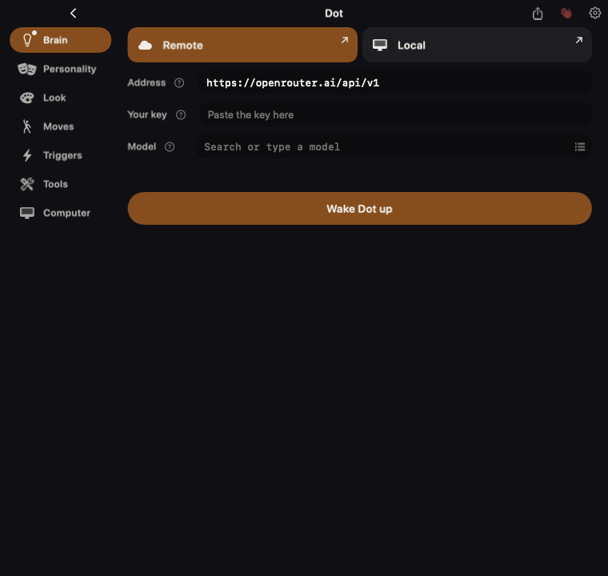
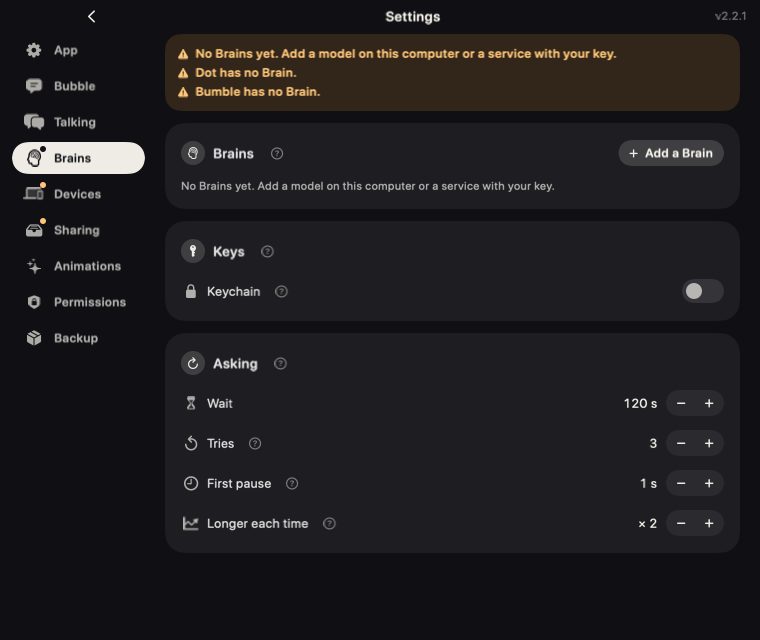

# States

Every empty, sleeping, waking, offline, error and partly set up state, with its words. A state is calm. It says what is going on and what to do next. It is never red-alarm and never blank.

## Empty states

| Where | When | Words |
| --- | --- | --- |
| Main screen | No Imps | `home.empty.title`, `home.empty.hint`, `home.empty.new_imp` |
| Hidden Imps | None hidden | `home.hidden.empty` |
| Tools | No tools | `tools.empty` |
| Triggers | No triggers | `triggers.empty` |
| Moves | No special moves | `moves.empty` |
| Brains | No Brains | `brains.empty` |
| Needs attention | Nothing to fix | Nothing is shown: no mark in the rail and no notice. |

An empty state has one line of words and at most one button.

## A sleeping Imp

### Decision

An Imp with no Brain sleeps, and so does an Imp that cannot reach its Brain. It shows Zzz. The Imp is not red, there is no warning icon, and no error appears unless the user tries to talk to it.

- The title is `state.sleeping.title`. The note says triggers still work (`state.sleeping.note`).
- The button is `state.sleeping.action`. It opens the Brain panel, or the first-run path if the user has not been through it.
- If the user talks to a sleeping Imp, the answer is `error.brain.none`, as a plain sentence in the bubble.
- A visiting Imp whose home is out of reach sleeps too: `state.visiting_asleep`.
- With no Brain at all on a phone, the Imp keeps sleeping and the small Embers game still works. This is a game, not the removed floating sparks.

### Why

Sleeping says "I need something" with no alarm and no reading. The user sees it at once.

### Rejected

A red badge or a warning triangle. It scares people and makes a missing Brain look like a fault.

### Waking

When a Brain is checked and works, the Imp stirs (`state.waking`) and then wakes up (`brain.check_ok`).

## Offline

The device has no network.

- A quiet bar says `state.offline.title` with `state.offline.note`. It does not block the canvas.
- Imps that use a model on this device keep working.
- An Imp whose Brain is out of reach sleeps and says `state.offline.imp`.
- A linked device that drops shows `state.link_lost`. The link reconnects on its own.
- When the network is back, the bar goes away and the Imps wake by themselves.

## Servers partly set up

The Den and The Hop are separate. Each is one of: set up, or not. The app never blocks on them. The Imps work with neither.

| The Den | The Hop | What the settings say |
| --- | --- | --- |
| Not set up | Not set up | Sharing is marked and its page says `settings.attention.den_off`. Devices is marked and its page says `settings.attention.hop_off`. Both map nodes are off. |
| Set up | Not set up | Devices is marked and says `settings.attention.hop_off`. Devices only find each other on the same network (`servers.hop.needed`). |
| Not set up | Set up | Sharing is marked and says `settings.attention.den_off`. A screen that needs the Den says `servers.den.needed` with the button `state.servers.set_up_den`, which opens Sharing. |
| Set up | Set up | No mark and no notice. |

Where a feature needs The Den (finding animations, sharing an Imp), the screen shows a short line and a button instead of hiding the feature: `animations.needs_den`, `share.den_needs_setup`.

## Errors

An error is a plain sentence. It says what happened and what to do next. It names the thing involved. It never shows a raw error name and never a blank bubble.

| What happened | Key |
| --- | --- |
| Something unknown | `error.generic` (only when nothing more is known) |
| An Imp has no Brain | `error.brain.none` |
| The service is slow | `error.brain.timeout` |
| The key is refused | `error.brain.key` |
| The model does not exist | `error.brain.model` |
| The service is out of reach | `error.brain.unreachable` |
| The local model does not answer | `error.brain.local` |
| Saving failed | `error.save` |
| Sharing failed | `error.share` |
| A tool server did not start | `error.tool_failed` |
| A background picture cannot be used | `background.picture_failed` |
| Another device did not take an Imp | `imp.transfer.failed` |
| A linked device dropped | `state.link_lost` |
| A server cannot be reached | `servers.state_fail` |

## Words

<!-- strings: state error -->
| Key | English |
| --- | --- |
| `error.brain.key` | {service} did not accept the key. Check it and try again. |
| `error.brain.local` | No model answered. Make sure it is running, then try again. |
| `error.brain.model` | {service} does not have the model {model}. Pick another one. |
| `error.brain.none` | {name} has no Brain yet, so it cannot answer. |
| `error.brain.offline` | No network. Check your connection, then try again. |
| `error.brain.timeout` | {service} did not answer in time. Check its address, or try again later. |
| `error.brain.unreachable` | Cannot reach {service}. Check the address and your connection. |
| `error.generic` | Something went wrong. Try again. |
| `error.save` | Could not save that. Check the free space and try again. |
| `error.share` | Could not share {name}. Try again in a moment. |
| `error.tool_failed` | {tool} could not start. Check its settings. |
| `state.link_lost` | The link to {device} dropped. It reconnects on its own. |
| `state.offline.imp` | {name} cannot reach its Brain. It wakes up when you are back online. |
| `state.offline.note` | Imps that use a model on this device still work. The others wait until you are back online. |
| `state.offline.title` | You are offline |
| `state.servers.set_up_den` | Set up Den |
| `state.servers.set_up_hop` | Set up Hop |
| `state.sleeping.action` | Give {name} a Brain |
| `state.sleeping.note` | With no Brain, it cannot think. Its triggers still work. |
| `state.sleeping.title` | {name} is asleep |
| `state.visiting_asleep` | {name} is asleep because {home} is not connected. |
| `state.waking` | Waking up… |
<!-- /strings -->
